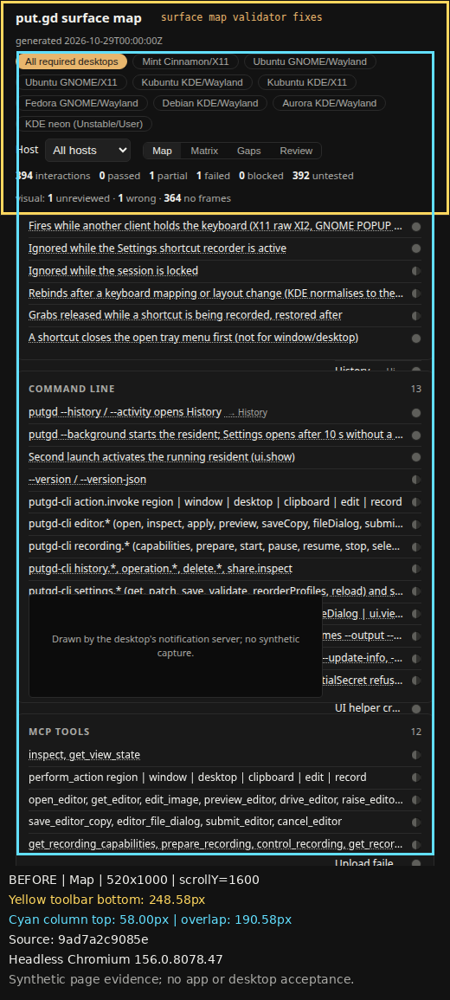
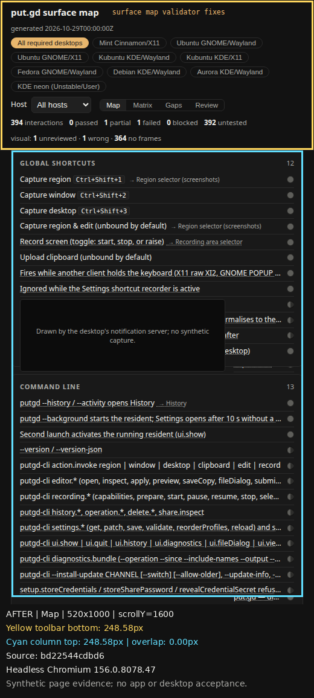
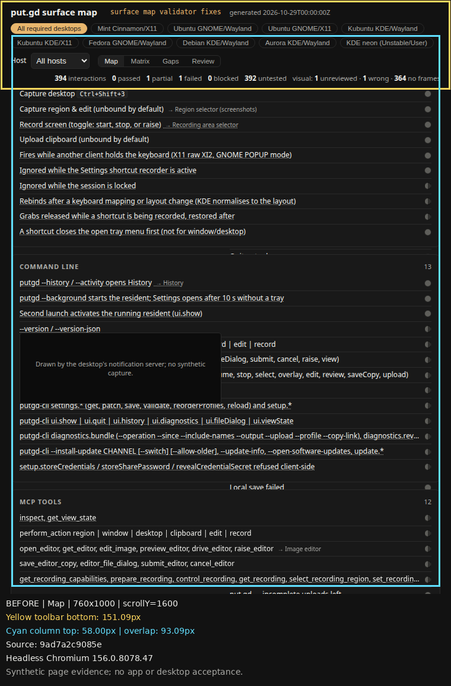
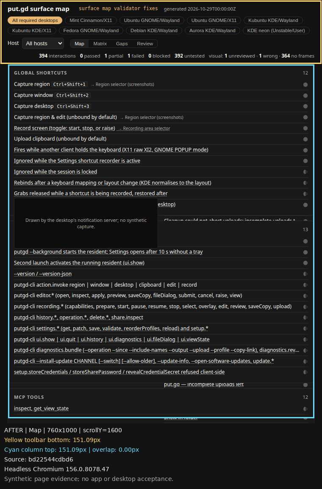
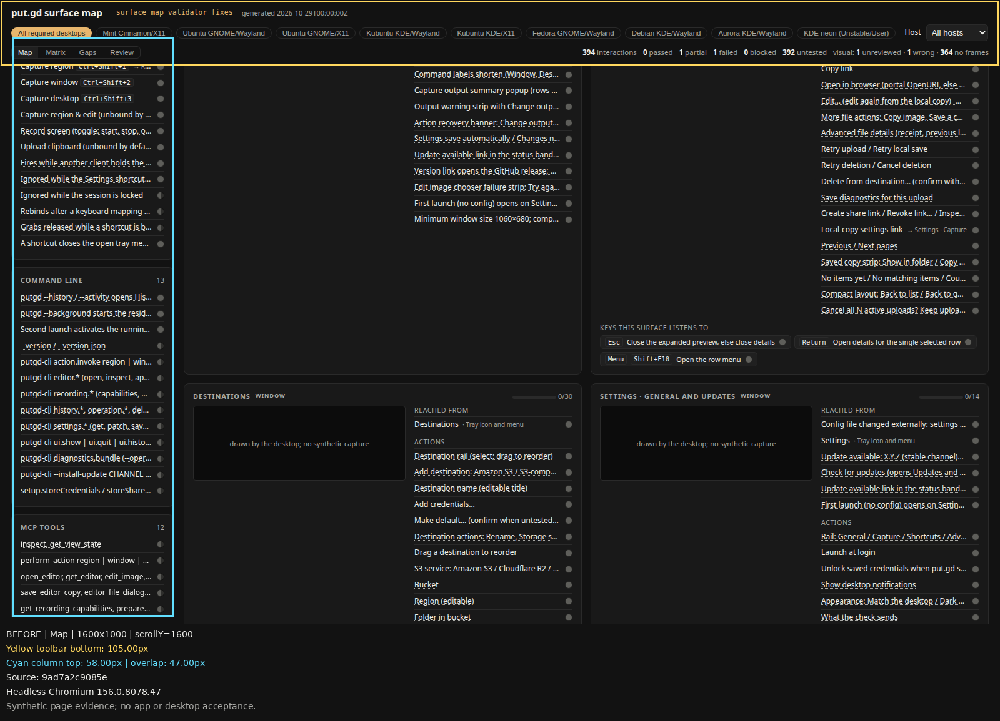
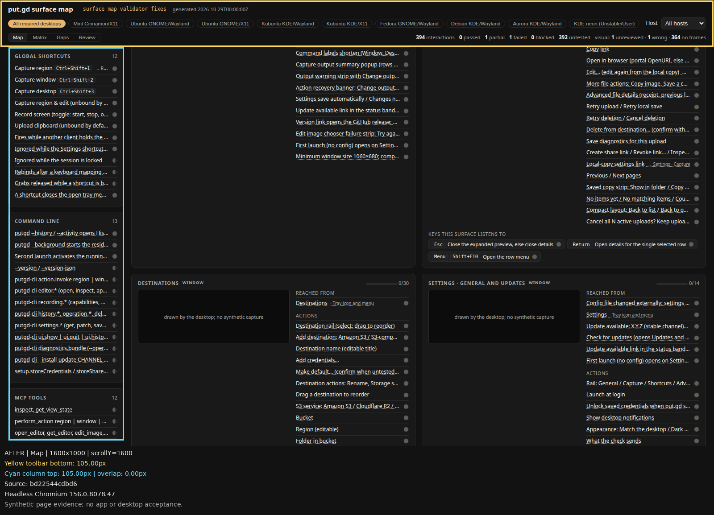

# Non-blocking validator fixes

Code [bd22544cdbd66e2f6f2d0831ff4a6d3adc8fcec1](https://github.com/patrick-hudson/put.gd-desktop/commit/bd22544cdbd66e2f6f2d0831ff4a6d3adc8fcec1) fixes the three follow-up findings on #667. This record supersedes the earlier completion record's broad statement that host-without-placement coverage must fail to load. New `mark` and `import` inputs still require placement.

All evidence is synthetic offline page testing on Patrick's workstation. No application build, desktop acceptance, VM, provider operation or app session socket was used. [verification.json](verification.json) records the host, Python/browser/session identities, exact source revisions, commands, private raw-image location and SHA-256 hashes. [first-attempts.txt](first-attempts.txt) preserves setup and transient harness failures separately from successful evidence.

| Finding | Fix commit | Evidence |
| --- | --- | --- |
| Same receipt + `visual frames` cleared an open review | `bd22544c` | `Aggregation.test_same_run_frames_alone_preserve_review_request` and `ReceiptImport.test_mark_frames_with_same_receipt_keeps_review_queue` retain the request and reason; expanded verdict tests cover passed/failed/blocked and reviewed-ok/reviewed-wrong. Explicit newer review reasons replace the old reason. [Full suite: 44 passed](pytest.txt). |
| Host-only historical coverage broke `build` | `bd22544c` | `test_load_infers_unique_native_placement` verifies native inference and successful CLI build. `test_load_unresolved_placement_stays_in_desktop_rollup_only` covers zero/two native candidates, one warning with file/entry identity, successful CLI build, no invented host cell and preservation of a failure beside a known-host pass. `test_mark_and_import_still_reject_host_without_placement` verifies write-time rejection. [44 passed](pytest.txt). |
| Map sticky column hid behind wrapped toolbar | `bd22544c` | `.col` now uses `--toolbar-height` for both top and available height. [Chromium measurements](browser-checks.json) assert exact toolbar-bottom/column-top equality and an exposed column hit target at 520/760/1600px, scrolled to y=1600, then resized to 520 and back to 1600 without reloading. All five after overlaps are 0px; no JavaScript errors. |
| V1 compatibility and model | `bd22544c` | Six Map/Matrix/Gaps comparisons for All required and Mint match nightly `5985e9043ea81a3ac33d2931203384e40bde035e`: text, verdict names/colours and Matrix headings. Only the already planned Aurora label change is normalized. [Input](v1.json), [full snapshots (gzip)](v1-snapshots.json.gz), [result](browser-checks.json); [model check passes](model-check.txt): 9 desktops, 22 surfaces, 394 interactions. |

## Annotated before and after

The actual page occupies the first 1000 pixels. Captions are appended below it and never cover the tested toolbar or column. Yellow outlines the toolbar; cyan outlines the Map column. The same synthetic input is used for before `9ad7a2c9` and after `bd22544c`. The original hard-coded 58px column top produces 190.58px/93.09px/47px overlap at widths 520/760/1600 respectively. The corrected column top is 248.578125px/151.09375px/105px, exactly the toolbar bottom at each width. The available height also keeps the column bottom 12px above the viewport edge.













## Reproduce

Use code commit `bd22544cdbd66e2f6f2d0831ff4a6d3adc8fcec1` in a clean code checkout. Run the evidence script from this docs branch by absolute path, with pytest, Playwright and Pillow available to the distro Python and `/usr/bin/google-chrome` already installed. No server or downloaded browser is required.

```sh
python3 -m pytest tests/desktop/test_surface_map.py
python3 tools/lab/surface_map/surface_map.py check
run_dir=$(mktemp -d /tmp/surface-validator.XXXXXX)
python3 /absolute/path/to/docs-checkout/docs/evidence/surface-map-hosts/validator-fixes/render-check.py \
  --output "$run_dir"
```

The script rejects the wrong source revision or a nonempty output directory, exports exact Git baseline sources, saves six annotated and six raw pictures, compares six v1 scenarios, and measures ten before/after geometry states. The same page remains scrolled during resizing; two animation frames let resize layout/scroll anchoring settle before establishing the exact scroll witness.

CI and review state is recorded in the PR comments because it can change after this immutable evidence commit. Documentation and pictures belong only to #668; merge it after code #667. No PR was merged or watched.
