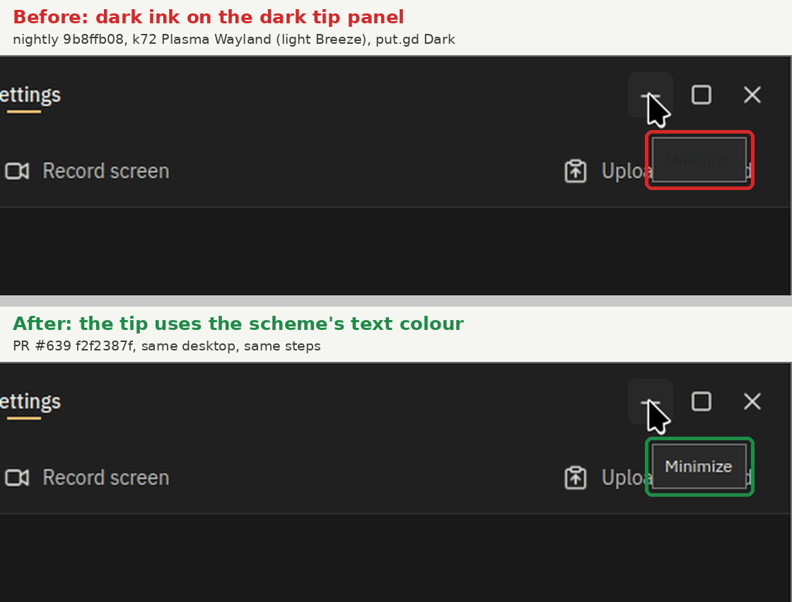

# Tooltip ink in the dark scheme (#639)

Hover tooltips in the dark scheme could show dark text on the dark tip panel.
Graphite paints the panel from the tokens (`PE_PanelTipLabel`, `surfaceRaised`),
but Qt gives a tip the desktop's tooltip palette. Qt hands tips that palette
again on every desktop palette notification (a colour scheme change, KDE's
`KGlobalSettings.notifyChange`). put.gd's own scheme doesn't change then, so
nothing restored its ink.

## How the pictures were taken

- Host: k72, Kubuntu 26.04, Plasma Wayland, Qt 6.10.2, light Breeze (tooltip
  text 35,38,41 on 247,247,247), one 1920x1080 output. Desktop lock held for the run.
- Builds, both from source on k72 (`putgd putgd-ui putgd-cli`, dev preset):
  before = nightly `9b8ffb08`, after = PR #639 head `f2f2387f`. The PR's
  later commit `376d0665` only changes a test.
- Each build ran from a private profile (`XDG_CONFIG_HOME`, data, state, cache and
  runtime under `/tmp`, the desktop's `kdeglobals` copied in) with the
  development template and `preferences.appearance.theme = "dark"`.
  `ui.viewState` reported scheme `dark` on desktop `light`.
- Steps: `ui.show settings`; a KWin script placed the window at 300,100
  (1320x880) and kept it above; `gdbus emit --session --object-path
  /KGlobalSettings --signal org.kde.KGlobalSettings.notifyChange 0 0`; a click
  on empty page content (Qt raises tips only for a focused window), then the
  pointer was moved onto Minimize through `tools/lab/host_input.py`, and a frame was
  taken 2.5 s later from the host's loopback VNC.
- Each frame was cropped to the put.gd window on the host, after a KWin stacking
  check found no other window over it and at least 40% of the crop matched the
  dark tokens (96.8%). The figure shows the window's top-right area, enlarged 2x, with the
  tip outlined.

Without the palette notification, both builds drew a readable tip on k72. On
m74 (Mint 22.3 Cinnamon, Mint-Y) the nightly build's tip was also readable at
startup; the palette notification wasn't tried there.
