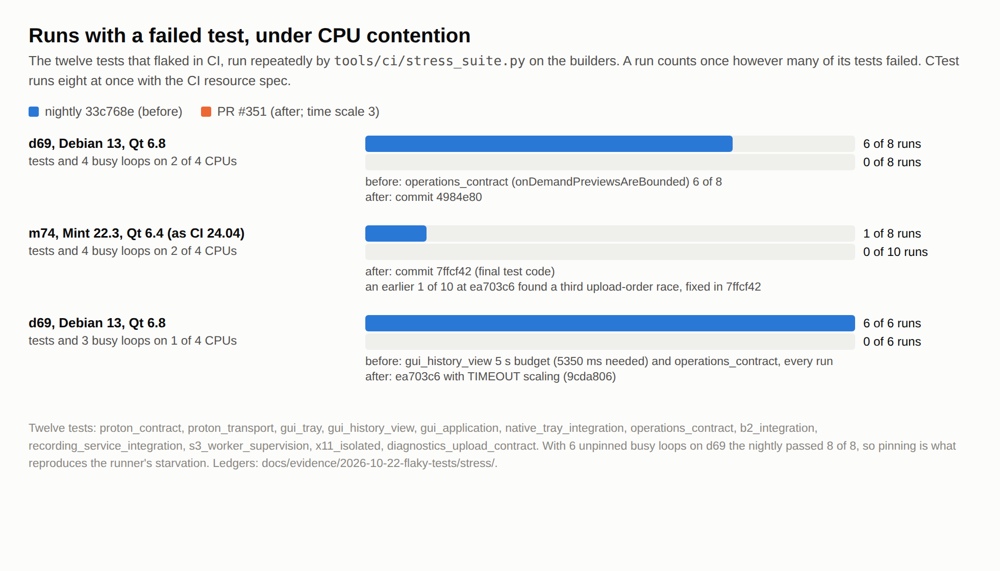
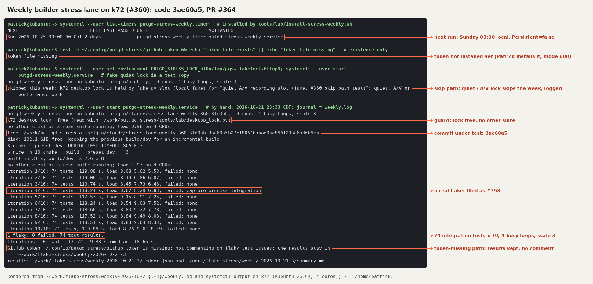
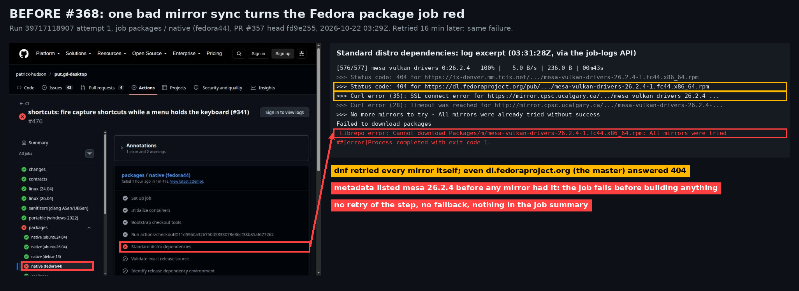
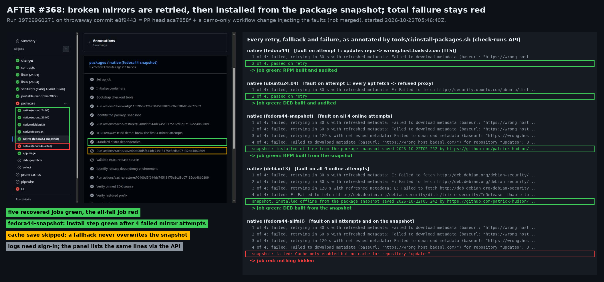
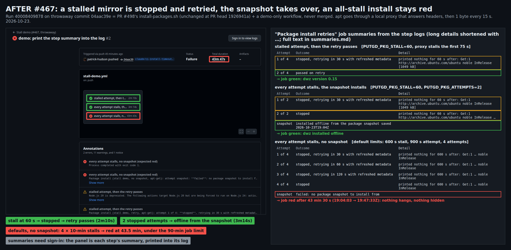

# CI records

> **Historical record.** These are dated run records, moved unchanged from [CI coverage](../release/ci.md) on 2026-11-05 (#1222). They describe what those runs found at the time, and their open or pending statements describe that time. For the current contract, see [CI coverage](../release/ci.md). Do not use them as a work list.

## Nightly baseline, 2026-10-26

The 2026-10-26 baseline [nightly run](https://github.com/patrick-hudson/put.gd-desktop/actions/runs/40275032192)
took 54 minutes 33 seconds. Its AppImage job took 23.75 minutes, collection 7.88,
the subsequent PipeWire check 4.12, and publication 15.78. Source test jobs
finished in 4.5–5.6 minutes in parallel. Removing those tests alone would not
remove the observed bottleneck.

## Sanitizers job runtime, 2026-10-19

Measured on the four-vCPU hosted runner on 2026-10-19 (Ubuntu 26.04 container,
clang 21.1.8, distro Qt 6.10.2):

| Run | Caches | Qt build | App build | CTest (23 tests) | Job |
| --- | --- | ---: | ---: | ---: | ---: |
| [39267375812](https://github.com/patrick-hudson/put.gd-desktop/actions/runs/39267375812) attempt 1, PR #107 | none | 7:35 | 9:42 | 70.5 s, passed | 23:10 |
| [39267375812](https://github.com/patrick-hudson/put.gd-desktop/actions/runs/39267375812) attempt 2, PR #107 | SDK, QtCore | cached | 4:42 | 65.3 s, passed | 7:33 |
| [39266994848](https://github.com/patrick-hudson/put.gd-desktop/actions/runs/39266994848) attempt 3, #76 reverted | SDK, QtCore, ccache | cached | 0:46 | 27.5 s, 6 failed | 2:49 |

Package installation takes about 1:15 of every run, and a cold SDK build 2:40 to
3:05. The two uncached application builds differ by five minutes on the same
source, which is runner variance. Pull requests don't save a compiler cache, so
until a `nightly` push has saved one, PR runs take the second row's time; after
that, the third row's (about 3:30 with a passing suite).

The run with #76 reverted (attempt 2 of
[39266994848](https://github.com/patrick-hudson/put.gd-desktop/actions/runs/39266994848),
throwaway branch since deleted) failed `settings_contract`, `operations_contract`,
`recording_model_contract`, `storage_contract_integration`,
`config_reload_integration` and `storage_locations_integration`, each with
`stack-use-after-scope` read by `QJsonValueRef::toObject()` from
`Settings::validate` in `'ref.tmp' (line 158)`. Attempt 1 of that run failed only
because `download.qt.io` didn't resolve once; the recipe now retries downloads.

## Hosted CTest wall times

CTest wall time ("Total Test time (real)") in seconds, all 72 tests unless noted:

| Run | Commit | Slots | Durations | 24.04 | 26.04 |
| --- | --- | ---: | --- | ---: | ---: |
| [39165764037](https://github.com/patrick-hudson/put.gd-desktop/actions/runs/39165764037), push to `nightly` (before, with #69) | `70722c3` | 2 | none | 311.90 | 308.66 |
| [39174290324](https://github.com/patrick-hudson/put.gd-desktop/actions/runs/39174290324), push to `nightly` (before, 73 tests) | `4d3b6d5` | 2 | none | 313.69 | 308.37 |
| [39167182473](https://github.com/patrick-hudson/put.gd-desktop/actions/runs/39167182473), PR #70 | `65caac1` | 8 | none | 99.96 | 105.24 |
| [39168198731](https://github.com/patrick-hudson/put.gd-desktop/actions/runs/39168198731), own Xvfb displays | `4142fae` | 8 | restored | 87.59 | 76.32 |
| [39169471820](https://github.com/patrick-hudson/put.gd-desktop/actions/runs/39169471820), trial | `1ae2fc5` | 12 | restored | 71.15, 1 failed | 70.69 |
| [39170267410](https://github.com/patrick-hudson/put.gd-desktop/actions/runs/39170267410) attempt 1 | `904dcda` | 8 | restored | 81.77 | 75.89 |
| [39170267410](https://github.com/patrick-hudson/put.gd-desktop/actions/runs/39170267410) attempt 2 | `904dcda` | 8 | restored | 76.35 | 96.43, 1 failed |
| [39172087415](https://github.com/patrick-hudson/put.gd-desktop/actions/runs/39172087415) attempts 1–4, tray race fixed | `68aa356` | 8 | restored | 78.28–84.26, 4 passed | 77.79–83.61, 4 passed |
| [39175234634](https://github.com/patrick-hudson/put.gd-desktop/actions/runs/39175234634) attempts 1–4, CPU pool, 73 tests | `54a0a95` | 8 | restored | 77.61–85.43, 4 passed | 77.84–85.45, 4 passed |

Every hosted run from `68aa356` on passed: 16 job runs on the two distros.
The Test step fell from 296–314 s at two slots to 78–86 s, and warm Linux jobs took
3:51 to 6:14 instead of about eight minutes; package installation accounts for
most of the spread. At eight slots the CPU pool left the wall time unchanged
(77.6–85.5 s against 77.8–84.3 s without it), because the long idle tests still
hold every slot for the first 55 s, but it shortened the CPU-bound tests:
`collision_policy_integration` averaged 9.9 s instead of 11.6 s. Twelve slots
reached the 70 s floor before the tray race was fixed; with the pool they are
the next step to try.

### What grew since the 57-test baseline

Between run 38292139041 (2026-10-12, 57 tests, 159 s wall) and nightly push
39161438843 (2026-10-18, 72 tests, 295 s wall), the summed Ubuntu 24.04 test
time rose from 313.8 s to 585.7 s. With `--parallel 2` the wall time was half
the summed time. The growth arrived with new tests and new cases in existing
binaries:

| Source | Added seconds |
| --- | ---: |
| 16 new tests, chiefly `native_background_startup_integration` (69.1 s), `edit_operations_integration` (8.1 s), `proton_transport` (6.9 s), `recording_helper_integration` (5.2 s) and `proton_contract` (4.4 s) | 101.5 |
| `gui_tray`: 8 to 28 test functions, 23.5 s of explicit waits | 46.9 |
| `gui_settings`: 41 to 52 test functions | 41.6 |
| `gui_application`: 8 to 25 test functions | 24.0 |
| `operations_contract`: 41 to 72 test functions | 16.8 |
| `gui_history_view`: 9 to 23 test functions | 9.4 |
| `s3_worker_supervision`, `native_tray_integration`, `s3_integration` and smaller changes | 32.4 |
| `gui_operations_view` folded into other views | -0.8 |

Ubuntu 26.04 matches within a few seconds (340.2 s to 614.6 s summed).

## Retry policy demonstration, #351

The policy was demonstrated on #351 with temporary tests, since reverted: a
test that failed its first run passed its retry, appeared in the job summary
and opened a tracker issue
([run 39710070705](https://github.com/patrick-hudson/put.gd-desktop/actions/runs/39710070705),
[#355](https://github.com/patrick-hudson/put.gd-desktop/issues/355)); a `unit`
test that failed once failed the job without a retry
([run 39711215419](https://github.com/patrick-hudson/put.gd-desktop/actions/runs/39711215419)).

## Builder stress lane results, 2026-10-22

| Host | Load | Tests | Nightly `33c768e` | #351 |
| --- | --- | --- | --- | --- |
| d69 (Debian 13, Qt 6.8) | 4 busy loops and the tests on 2 of 4 CPUs | known set | 6 of 8 runs failed (`operations_contract`, 6) | 0 of 8 (`4984e80`) |
| m74 (Mint 22.3, Qt 6.4) | same | known set | 1 of 8 (`operations_contract`) | 0 of 10 (`7ffcf42`) |
| d69 | 3 busy loops and the tests on 1 of 4 CPUs | known set | 6 of 6 (`gui_history_view` 5 s budget, `operations_contract`) | 0 of 6 (`ea703c6`, timeouts scaled) |
| k72 (Kubuntu 26.04, Qt 6.10) | 4 busy loops | the 74 `integration` tests, 12 at once | | 0 of 8 (`c6918fe`) |

The lane also found four races the scaled waits alone did not fix, each fixed in
#351: `onDemandPreviewsAreBounded` slept 1.5 s for the after-operation posters
(it now waits for the new `previews` diagnostic), three operations tests
assumed the first operation takes the shared upload lock, and an X11 test read
grabs before the resident's ungrab reached the server. The ledgers are in
[`records/2026-10-22-flaky-tests/stress/`](https://github.com/patrick-hudson/put.gd-evidence/tree/874703b35562c732268c6fe0bc9b42614ffda928/records/2026-10-22-flaky-tests/stress).

## First weekly runs on k72, 2026-10-21

The first runs, on 2026-10-21, were started by hand
([`records/2026-10-22-stress-weekly/`](https://github.com/patrick-hudson/put.gd-evidence/tree/874703b35562c732268c6fe0bc9b42614ffda928/records/2026-10-22-stress-weekly)):

- A fake quiet A/V lock in a test copy skipped the week and logged why.
- The first full run timed out five native and X11 tests in every iteration.
  They had inherited the Plasma session from the systemd user manager (see
  [remote-builders.md](../lab/remote-builders.md#weekly-stress-lane-on-k72)). Since
  that fix, the children get a headless environment.
- The rerun built incrementally in 31 s, then ran the 74 integration tests ten
  times in about 118 s each, 20 minutes in all.
  `capture_process_integration` failed 1 of 10 runs, now
  [#398](https://github.com/patrick-hudson/put.gd-desktop/issues/398).

## Fedora mirror incident and retry demonstration (#368)

On 2026-10-22 a Fedora mirror sync turned every pull request's
`packages / native (fedora44)` job red for about 40 minutes
([#368](https://github.com/patrick-hudson/put.gd-desktop/issues/368)). The
`updates` metadata listed mesa 26.2.4 before any mirror served it. dnf tried
every mirror, `dl.fedoraproject.org` included, and got 404 or a broken TLS
connection. Retrying the same install a few minutes later, or falling back to
the master mirror, would not have helped.

The pictures come from #388. Before: run 39717118907, PR #357's head
`fd9e255`. After: run 39729960271 on a throwaway commit (`e8f9443b`, PR head
`aca7858f` plus a demo-only workflow change that wrapped `dnf` and `apt-get`
to inject mirror faults). There, a fault on the first attempt passed on its
retry, four failed attempts installed from the snapshot and built the package,
and a fault on every attempt and on the snapshot failed the job. Job summaries
and logs are visible only to signed-in viewers, so the after picture lists the
same lines from the check-runs API. The files are in
[`records/2026-10-22-package-installs-368/`](https://github.com/patrick-hudson/put.gd-evidence/tree/874703b35562c732268c6fe0bc9b42614ffda928/records/2026-10-22-package-installs-368). To repeat it, push such a
wrapper to a pull request branch, never to `nightly`.

## Stalled install demonstration (#467)

The demo ran on throwaway branch `claude/ci-install-timeouts-467-demo` (run
40008409878, commit `04aac39e`), which is #498's install script plus a
demo-only workflow and was never merged. apt went through a local proxy that
accepts every connection, sends response headers, and then sends one body byte
every 15 s. apt's idle timeout never fires against it, as in the nightly
hang. With a 60 s stall limit, a stall during the first 75 s was stopped and
the retry passed. Two stopped attempts were followed by an offline install
from a snapshot. With the default limits and no snapshot, every attempt
stalled and the job failed red after 43.5 minutes, inside its 90-minute timeout. Evidence:
[`records/2026-10-23-package-install-stalls-467/`](https://github.com/patrick-hudson/put.gd-evidence/tree/874703b35562c732268c6fe0bc9b42614ffda928/records/2026-10-23-package-install-stalls-467).

## Rollout measurements (October 2026)

Historical hosted runs from the first day of the redesigned pipeline, before
non-Linux support was dropped on 2026-10-31. "Cold" means the
cache keys had just changed; "warm" restored the caches the `nightly` push run
saved. Wall time runs from the trigger to the last job.

| Run | Event | Caches | Wall |
| --- | --- | --- | ---: |
| [39091022143](https://github.com/patrick-hudson/put.gd-desktop/actions/runs/39091022143) | PR #61, every path class | cold | 16:15 |
| [39092148362](https://github.com/patrick-hudson/put.gd-desktop/actions/runs/39092148362) | push to `nightly` | cold | 14:16 |
| [39093024865](https://github.com/patrick-hudson/put.gd-desktop/actions/runs/39093024865) | promotion PR #63 | warm | 8:21 |
| [39093014897](https://github.com/patrick-hudson/put.gd-desktop/actions/runs/39093014897) | manual nightly, published `v0.1.1-dev.309` | warm | 15:49 |
| [39093989128](https://github.com/patrick-hudson/put.gd-desktop/actions/runs/39093989128) | manual nightly, unchanged source | none needed | 0:20 |
| [39093626492](https://github.com/patrick-hudson/put.gd-desktop/actions/runs/39093626492) | push to `main`, cut `v0.1.1-rc.1` | warm | 13:43 to draft |

Warm Linux test jobs took about eight minutes. Of that, 1:17 to 2:03 is
package installation, under 30 seconds is the ccache build, and about five
minutes is CTest. Issue
[#62](https://github.com/patrick-hudson/put.gd-desktop/issues/62) cut that to
under 90 seconds; see [hosted CTest schedule](../release/ci.md#hosted-ctest-schedule).

| Linux 24.04 step | Cold | Warm |
| --- | ---: | ---: |
| Build (Debug, Proton bundled) | 4:41 | 0:24 |
| CTest (67 tests) | 5:06 | 5:02 |
| SDK provisioning | 2:48 | skipped |

The retired platform job fell from 7:42 cold to 3:21 warm in that historical run. The published nightly spent 2:20
collecting and 3:13 publishing after its builds. The unchanged-source nightly
ran only `plan` and skipped every other job.

The first nightly also showed the Fedora package builder rebuilding the SDK on
a cache it should have hit: `rpm -qa` lists packages in database order, so the
key changed between runs with identical packages. Pull request
[#64](https://github.com/patrick-hudson/put.gd-desktop/pull/64) sorts the
inventory before hashing.

## Previous pipeline measurements

These describe the pipeline before October 2026's redesign: `build.yml` on every
pull request and branch push, `release.yml` for packages, and a coordinator that
dispatched one into the other. They are retained for comparison only.

From 2026-10-10 to 2026-10-17 it started 175 runs for 17 merges. Pull request
Build runs averaged 15.0 minutes, branch-push Build runs 14.4 minutes and
dispatched nightly package runs 17.7 minutes, including a 16-minute wait for a
separate Build run. On a warm cache, Ubuntu 24.04 spent 1:22 installing
packages, 1:24 cloning the SDK source, 9:37 building and testing, and 2:37 on a
second Release compile.

Hosted Build run `38292139041` (source117, `a91a7ce`) restored and validated the
exact SDK prefix on every platform. One matched cold/warm pair, in seconds:

| Job | Cold | Warm |
| --- | ---: | ---: |
| Ubuntu 24.04 | 861 | 633 |
| Ubuntu 26.04 | 918 | 766 |
| macOS 14 | 344 | 261 |

Warm Linux CTest times were 159.22 and 173.27 seconds. Earlier run 38201680155
took 15m21s/16m38s on Linux, with SDK builds of 183s/213s and separate
production builds of 136s/146s.
