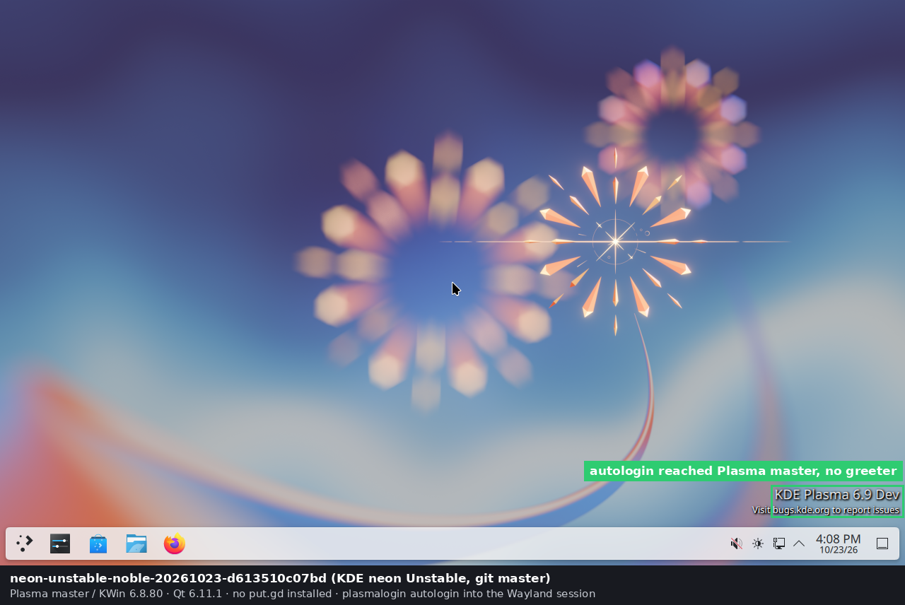

# KDE neon VMs: released Plasma and Plasma master

KDE neon is KDE's own packaging of Plasma, Frameworks and Gear on an Ubuntu LTS
base. The lab keeps two neon goldens for catching KDE bugs before the required
distros ship them:

- **neon User Edition**: the newest *released* Plasma (6.8.1 on 2026-10-23).
- **neon Unstable Edition**: Plasma, Frameworks and Gear built nightly from git
  master (KWin reports `6.8.80`; the live session watermark reads "KDE Plasma
  6.9 Dev"). This is the furthest-edge KDE target in the lab. Released Plasma is
  the comparison point, so a finding on Unstable can be split into "already in
  6.8" or "new on master".

Neither has a row in the [package matrix](acceptance-matrix.md): they are
evaluation guests and don't replace the Kubuntu, Debian or Aurora KDE evidence.
Plasma 6.8 dropped the X11 session, so both are Wayland-only. KDE/X11 coverage
stays on Kubuntu 26.04.

Both goldens were made on 2026-10-23 (US Central). Private receipts, the
provisioning disks and the smoke-run evidence are on the builders under
`~/work/put.gd/work/neon-lab/`.

## Goldens

Both are standalone qcow2 files (32 GiB virtual) under
`~/work/put.gd/work/lab-images/<name>/`. Each directory has `image.qcow2` (mode
0444), `source.manifest.json`, `image-info.json`, `image-check.txt`,
`source-info.json`, `source-check.txt`, the pinned guest `known_hosts`,
`identity.pub` and `bootstrap.sh`. The
[immutable-golden rules](vm-lab.md#base-protection-and-inventory) apply.

| Name | Edition | SHA-256 | Copies |
| --- | --- | --- | --- |
| `neon-unstable-noble-20261023-d613510c07bd` | Unstable (git master), made on d69 | `9fef081035ca6691446672b2914c09ff4a7b4a4b359577a6087279b0d892e8f6` | d69, f44, S3 |
| `neon-user-6.8.1-20261023-9ef808278853` | User (Plasma 6.8.1), made on f44 | `191852a5b552492daa9eac1093acd7e15578b0cc5374f4c9a660037af5863238` | f44, d69, S3 |

| Item | Unstable | User |
| --- | --- | --- |
| Base | Ubuntu 24.04 (noble), kernel `7.0.0-38-generic` | same |
| Plasma | `plasma-workspace 4:6.8.1+p24.04+vunstable+git20261020.1504-0`, `kwin-wayland …git20261023.0434-0` (KWin 6.8.80, master) | `plasma-workspace 4:6.8.1-0zneon+24.04+noble+release+build100`, KWin 6.8.1 |
| Login manager | `plasmalogin 6.8.1+p24.04+vunstable+git20261020.1558-0` | `plasmalogin 6.8.1-0zneon…build27` |
| Frameworks | `kf6-kcoreaddons 6.31.0+p24.04+vunstable+git20261023.0113-0` | `kf6-kcoreaddons 6.31.0-0zneon…build49` |
| Gear | 26.08.2 master builds (Dolphin, Konsole) | 26.08.2 |
| Qt | `qt6-base 6.11.1` (neon build 163) | `qt6-base 6.11.1` (neon build 162) |
| Graphics, audio, portal | Mesa 25.3.6, PipeWire 1.6.0, xdg-desktop-portal 1.18.4 with the KDE backend from master | same versions from the release archive |
| Rendering | llvmpipe through `virtio-vga` (no GL passthrough; see [#522](https://github.com/patrick-hudson/put.gd-desktop/issues/522)) | same |
| Host key | `SHA256:KrjLS2FI82YHbSrVfx7np6wM2z2j2AnyGeG475I7PrY`; `known_hosts` pins `[127.0.0.1]:22468` and `:22471` | `SHA256:KHZxSDQk/Ezdndqafa/jVhEHtcY2GPPclrX33Ye5Tgw`; pins `:22469` and `:22472` |
| Bootstrap key | `~/work/put.gd/work/lab-bootstrap-<host>/neon-unstable/identity` on d69 and f44 | `…/lab-bootstrap-<host>/neon-user/identity` on f44 and d69 |
| Size | 8.2 GB allocated; 3.19 GB as `.qcow2.zst` | 8.0 GB; 3.20 GB as `.qcow2.zst` |

Common guest state: user `lab` with the
[standard remote lab login](remote-golden-images.md#standard-remote-guest-login),
hostname `neon-lab`, America/Chicago, ext4 with a swap file, BIOS boot (no
UEFI). Plasma Login Manager autologs `lab` into the Plasma Wayland session
(`Service=plasmalogin-autologin`, `Type=wayland`). The screen locker, dimming,
display power-off and suspend are off. `/etc/update-manager/release-upgrades`
has `Prompt=never`. The only authorized key is the bootstrap key. The sudo rule
allows `lab` only `apt-get`, at both `/usr/bin/apt-get` and neon's
`/usr/sbin/apt-get` wrapper (sudo's `secure_path` finds the wrapper first). neon
installs no Spectacle by default.



## Source ISOs

Both ISOs are signed by the KDE neon ISO Signing Key
`B74EA2162376765BEAC3AE4345F4C354638D1F29`, which neon.kde.org's download page
names as `0x45F4C354638D1F29`. `gpg --verify` passed on the builders, and the
SHA-256 values match neon's `.sha256sum` files. Both are locked in
[`tools/lab/image-lock.json`](../tools/lab/image-lock.json) as `kde-neon-user`
and `kde-neon-unstable`.

| ISO | SHA-256 | On the builders |
| --- | --- | --- |
| `neon-user-desk-20261018-1825.iso` (Plasma 6.8.0) | `b1b3bd85136a358713b73155cc662170337bed6d702c65488266a40fec842e3a` | `work/lab-bootstrap-d69/neon-iso/`, `work/lab-bootstrap-f44/neon-iso/` |
| `neon-unstable-desk-20261017-2157.iso` | `e81d627d27a61b0f3d106998d4377b6e3677b1cea6725e24123889b7e01dc6eb` | `work/lab-bootstrap-d69/neon-unstable-iso/` |

Download them from `https://files.kde.org/neon/images/desk/<edition>/<build>/`;
`https://neon.kde.org/download` links the current builds. Unstable had only the
one ISO build on 2026-10-23. The installed guest is upgraded to that day's
master packages afterwards.

## How they were made

Each in a fresh provisioning directory (`work/neon-lab/p2` on d69 for Unstable,
`work/neon-lab/u1` on f44 for User), with `qemu-install.cmd` and
`qemu-boot.cmd` saved there:

1. Fresh 32 GiB qcow2 on a `virtio` drive with `discard=unmap`. QEMU: `q35`,
   KVM, 2 vCPUs, 5 GiB, `virtio-vga`, `usb-tablet`, the ISO as CD with
   `-boot order=d`, user networking with `hostfwd` to the SSH port, VNC on
   loopback (`:68` on d69, `:69` on f44), QMP socket, `-daemonize`.
2. Calamares: American English, America/Chicago, US keyboard, *Erase disk* with
   *Swap to file* (User defaults to an 8.8 GiB hibernate swap partition), user
   and login `lab`, computer `neon-lab`, *Require strong passwords* off. Uncheck
   *Restart now* on the last page, choose *Done*, then QMP `quit`.
3. Boot the installed disk (`-boot order=c`, no CD) with a 16 MiB FAT seed
   labelled `PUTGDLAB` holding
   [`tools/lab/bootstrap-neon-guest.sh`](../tools/lab/bootstrap-neon-guest.sh)
   and a fresh Ed25519 public key. Log in at the greeter and in Konsole run
   `sudo mount /dev/vdb /mnt` and `sudo sh /mnt/bootstrap.sh /mnt/identity.pub`.
   Use `/dev/vdb`: typing through QEMU VNC drops Shift, so `PUTGDLAB` can't be
   typed. Compare the fingerprint printed on the console with `ssh-keyscan`
   before pinning. `ssh-keyscan` prints a `#` comment line first; pin only the
   `ssh-ed25519` line.
4. Upgrade over SSH in the foreground:
   `sudo -n apt-get -y --allow-downgrades -o Dpkg::Options::=--force-confdef -o Dpkg::Options::=--force-confold full-upgrade`.
   neon pins its own `ubuntu-release-upgrader` fork at priority 1100, which is
   older than Ubuntu's, so the upgrade needs `--allow-downgrades`. Unstable took
   209 packages and User 145 (6.8.0 to 6.8.1). A `setsid nohup` run of the
   upgrade died with the SSH session, so run it in the foreground or keep the
   session open. `sudo` refuses `DEBIAN_FRONTEND` in the environment.
5. Reboot and check autologin. neon's Calamares writes
   `Session=/usr/share/wayland-sessions/plasma.desktop`, an absolute path, into
   `/etc/plasmalogin.conf`, overriding the drop-in. plasmalogin 6.8.1 and master
   both log "Unable to find autologin session entry" and show the greeter.
   The bootstrap script rewrites it to `plasma.desktop`
   ([#524](https://github.com/patrick-hudson/put.gd-desktop/issues/524)).
6. Set `Prompt=never`, `apt-get clean`, vacuum the journal, delete the upgrade
   log and shell history, `fstrim -av`, `systemctl poweroff`.
7. `qemu-img check`, `qemu-img convert -O qcow2` to the new golden directory,
   `qemu-img compare` (identical), `qemu-img check`, SHA-256, mode 0444, then
   the sidecars, the manifest and the bootstrap key directory.

## Copies and S3

Each golden was streamed through the workstation to the other builder (keys stay
on the workstation), checked against its SHA-256, `qemu-img check`ed, and given
its sidecars and bootstrap key. Receipts are in the workstation's
`work/verification/golden-transfer-<id>/`.

The S3 copies follow [golden storage](remote-golden-images.md): the object
`linux/<name>/<name>.qcow2.zst` (zstd level 10, Glacier Instant Retrieval,
`application/zstd`) has `sha256`, `zst-sha256`, `virtual-size` and `source`
metadata, and `linux/<name>/<name>.manifest.json` holds the manifest.
Decompressing each `.zst` on its builder reproduced the image SHA-256 before
upload.

| Name | `zst-sha256` | Bytes |
| --- | --- | --- |
| `neon-unstable-noble-20261023-d613510c07bd` | `edb4fdb309a7c7e69f853db588f091d656d25401e4f5e5eee96ec205edb97d17` | 3,187,930,055 |
| `neon-user-6.8.1-20261023-9ef808278853` | `982f093dbc4c551db19c0195e5dadaa63f6bf4d3a823bad4d1098ab64c501cd9` | 3,195,524,776 |

## Running a disposable overlay

`tools/lab/lab.py` runs both through the `neon-kde-wayland` profile
([`tools/lab/profiles/neon-kde-wayland.yaml`](../tools/lab/profiles/neon-kde-wayland.yaml):
KDE, Wayland, `plasmashell`, BIOS, `install: appimage`, 6144 MiB, 2 vCPUs, the
`kde-wayland` fixture hotkeys). The profile installs the AppImage because neon
is Ubuntu 24.04 based. Our Ubuntu 24.04 DEB is built on Qt 6.4.2 without the
LayerShellQt region overlay: on neon it installs and runs, but reports region
capture unavailable. The AppImage offers desktop, region and window capture.
The guest already has `libfuse2t64` and `fuse3`.

Run from a checkout that contains this runner. A scratch tree needs the
`labroot.py` override that points the lab roots at `~/work/put.gd` (see
[Aurora VM](aurora-vm.md#running-a-disposable-overlay)); `~/work/put.gd-neon`
on d69 and f44 has one. Check that the SSH and VNC ports are free first.

```sh
set -eu
cd ~/work/put.gd-neon
g=~/work/put.gd/work/lab-images/neon-unstable-noble-20261023-d613510c07bd
r=~/work/put.gd/work/lab-runs/neon-$(python3 -c 'import uuid; print(uuid.uuid4().hex[:6])')
test ! -e "$r"
python3 tools/diagnostics/check_socket_paths.py --socket "$r/qmp.sock"
python3 labroot.py launch --profile neon-kde-wayland --golden "$g/image.qcow2" --run "$r" \
  --bootstrap-key ~/work/put.gd/work/lab-bootstrap-d69/neon-unstable/identity \
  --known-hosts "$g/known_hosts" --ssh-port 22468 --vnc-display 68 --timeout 420
python3 labroot.py install --run "$r" --appimage PATH/TO/putgd-*-x86_64.AppImage
python3 labroot.py start --run "$r"
python3 labroot.py cli --run "$r" --method capabilities
python3 labroot.py screenshot --run "$r"
```

On f44 the key is under `lab-bootstrap-f44/`. For the User golden use its directory, `neon-user/identity` and port `22469`
(or `22472`) with VNC `:69`. Plasma takes about half a minute after SSH answers
to draw its panel. A screenshot straight after `start` can show only the
wallpaper, so take another before calling it a failure. Retire with `reset` and
the guarded `cleanup --evidence-manifest` described in
[vm-lab.md](vm-lab.md#retire-completed-overlays). Expose a run on the wall with
a tunnel to its VNC port, following [remote VM displays](remote-vm-displays.md).

### Smoke round trip, 2026-10-23

Nightly `putgd-26.1023.1058-nightly-x86_64.AppImage` (SHA-256 matches the
release's `SHA256SUMS`), evidence under `work/neon-lab/evidence-<run>/` on each
builder:

| Run | Golden | Result |
| --- | --- | --- |
| `neon-a955b23` (d69) | Unstable | launch 36 s; `install --appimage` and `start` ok, resident `82a25356…` = receipt; `capabilities`: `source.adapter` `kde-wayland`, desktop, region and window capture `compositor-native` through `org.kde.KWin.ScreenShot2` v5, permission entry matches the executable; dashboard and tray on screen ([picture](evidence/2026-10-23-neon-goldens/pictures/02-unstable-appimage-capture-available.png)) |
| `neon-abd768f` (f44) | User 6.8.1 | same results ([picture](evidence/2026-10-23-neon-goldens/pictures/03-user-6.8.1-appimage-capture-available.png)) |
| `neon-s9c888e` (d69) | Unstable, Ubuntu 24.04 DEB | installs and runs; desktop and window capture available, region capture unavailable ("requires … LayerShellQt and Qt 6.5 or later") |

All three were retired with an explicit completion manifest; cleanup removed
only `disk.qcow2`. On both Plasma versions the AppImage's windows show KWin's
generic Wayland icon in the title bar, where the DEB shows the put.gd icon
([#523](https://github.com/patrick-hudson/put.gd-desktop/issues/523)).

## Follow-ups

- Rebuild the Unstable golden on Ubuntu 26.04 once neon publishes that base
  ([#521](https://github.com/patrick-hudson/put.gd-desktop/issues/521)). On
  2026-10-23 the `resolute` Unstable archive existed but was incomplete, and
  neon's meta-release still listed only noble.
- Refresh the Unstable golden regularly: master moves daily. Make a new golden
  directory each time; never upgrade an existing one in place.
- A GPU-accelerated (virgl) variant so KWin's hardware GL paths are exercised
  ([#522](https://github.com/patrick-hudson/put.gd-desktop/issues/522)).
- Report the plasmalogin absolute-session-path problem upstream, with Patrick's
  OK ([#524](https://github.com/patrick-hudson/put.gd-desktop/issues/524)).
