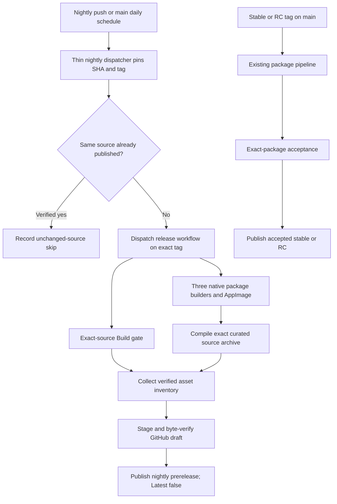

# Stable and Nightly Release Channels - Plan

## Goal Capsule

- Objective: Users can download identifiable development builds as changes land, while stable releases remain a separate, deliberate choice.
- Means: Extend the existing Linux package pipeline with immutable nightly tags and explicit publication channels (KTD1, KTD2, KTD4).
- Authority: The user's release-channel request governs this addition; the implementation contract in issue #1 and `docs/plans/2026-10-07-1926-feat-qt-linux-share-plan.md` still governs application behavior.
- Execution profile: Build/release metadata and automation changes, using the existing CMake, Python standard-library tooling and GitHub Actions builders.
- Stop conditions: A mismatched source identity, unsuccessful required build, unverified package bytes or conflicting existing release prevents publication (R6, R7).
- Ownership: The implementing agent completes the units and shipping verification; maintainers promote development work and authorize stable publication (R2, R5).

---

## Product Contract

### Summary

`main` is the stable source branch and `nightly` is the development integration branch.
Feature branches can target `nightly`; promoting reviewed changes into `main` remains explicit.
Nightly pushes and a daily schedule publish newly changed development source as uniquely tagged GitHub prereleases containing the same individual downloads as stable releases.
This establishes release channels for future updates without implementing an updater.

### Problem Frame

The existing release pipeline accepts stable and release-candidate tags and stages verified drafts.
It cannot yet publish tagged development builds automatically, so users cannot consistently install current development work from GitHub releases.
Actions artifact ZIPs alone do not satisfy the requested public downloads.

### Requirements

**Branches and release identity**

- R1. Keep `main` as the default stable branch and establish a dedicated `nightly` integration branch after compatible workflows exist on both branches.
- R2. Support feature work through ordinary branches and PRs, with deliberate promotion from `nightly` into `main`; do not automatically merge development changes into stable.
- R3. Every published nightly has a unique immutable development tag and full source identity, including commit, tree and full-history commit count.
- R4. Check `nightly` pushes and once daily; publish only source commits not already successfully published in the nightly channel. Unchanged successfully published source is skipped, while a failed or incomplete attempt may retry with its original source and tag.

**Publication and downloads**

- R5. Stable and release-candidate publication retain the existing exact-package acceptance requirement; nightly publication uses an explicitly labeled automated build-and-package verification class.
- R6. Nightly publication requires successful required test and portable-compilation CI for its exact source commit, all existing package audits and successful compilation of the exact curated source tarball being published.
- R7. Never move a published tag, overwrite public assets or mix source identities between release jobs; incomplete or conflicting releases fail visibly.
- R8. Publish both raw Ubuntu DEBs, the Fedora RPM, AppImage, curated source tarball, GNOME extension ZIP, `release-builds.json`, combined release ZIP and `SHA256SUMS` as separate GitHub Release assets.
- R9. Mark nightlies and release candidates as GitHub prereleases; nightlies never become the repository's Latest stable release.
- R10. Expose enough channel, source, run and byte-verification information in receipts and release notes for humans and agents to identify what was published and reproduce its verification.

**Compatibility and scope**

- R11. Keep existing untagged development identities and the source-export supplied-provenance boundary; a source archive rebuild must not impersonate an officially tagged binary build.
- R12. Preserve the current package recipes, native distro Qt linkage and application behavior, including all existing test gates appropriate to those changes.
- R13. Coordinate CI to avoid redundant same-source Build runs and repeated identical production builds, while retaining the meaningful C++ suite, Windows/macOS compilation, all native package audits, AppImage and extracted-source compilation. Apply CI speed improvements through shared workflows so both main and nightly benefit.

### Acceptance Examples

- AE1. Covers R3, R4, R6, R8, R9. A changed `nightly` commit not previously published passes required builds and audits. Its tagged prerelease becomes public with nine individually downloadable assets and does not replace Latest stable.
- AE2. Covers R3, R4, R7. The branch advances during packaging. All jobs still compile, collect and publish the source SHA resolved at preparation, with the original tag.
- AE3. Covers R4, R7. A publisher is retried after a partial upload. Matching completed assets are verified and missing assets are uploaded; different existing bytes prevent mutation.
- AE4. Covers R5, R6. An automated nightly passes, but no graphical package acceptance has occurred. Its notes say build-tested development release; a stable or RC publication still rejects the missing acceptance receipt.
- AE5. Covers R6, R7. Package jobs pass but the exact source required CI fails, is cancelled or cannot be verified. No public release is created.

### Scope Boundaries

The change covers version labeling, branch-triggered and scheduled build/publication automation, exact release assets and the contributor/release runbook.
The application does not gain an update client, new settings, capture behavior, storage provider or memory experiment.

#### Deferred to Follow-Up Work

- Application updater and channel-selection UI, including install migration and downgrade policy.
- Flatpak with the selected host companion, already tracked in issue #14.
- Automated retention/pruning of old nightly releases; deletion is a separate ownership decision.

#### Considered and Not Built

- A moving `nightly` tag or overwritten download assets: immutable releases already support identity and future update selection (R3, R7).
- A second development branch named `dev`: `nightly` supplies the requested integration branch without another promotion boundary (R1, R2).
- A duplicate package pipeline or new hosted service: the existing release matrix supplies every required format (R8, R12).
- Full VM desktop certification on every nightly: the publication class in R5 describes automated evidence honestly; stable qualification remains separately required.
- A signed channel feed or automatic downgrade mechanism: no updater consumes one in this task; revisit when an updater defines its trust contract.

---

## Planning Contract

### Existing Behavior and References

Planning is grounded in source commit `a10ce13adbe95cbeb62851b5ad396210063faf03`.
The implementation must refresh this baseline after the packaging PR merges rather than assume a feature branch remains canonical.

`cmake/GenerateBuildInfo.cmake` and `tools/releases/verify_tag.py` independently require a clean Git checkout and an exact tag-to-HEAD match.
`tools/releases/release_bundle.py` separately restricts the version grammar used for its positive filename inventory.
`tools/releases/collect.py` verifies full compiled identities and hashes before creating output, including a successful extracted-source production build.
`tools/releases/publish.py` verifies exact Build success before staging a draft and requires exact-asset acceptance before its current public mutation.
Its existing draft retry rejects conflicting bytes and already public releases.
Reuse these ownership boundaries rather than adding permissive overrides.

### Key Technical Decisions

- KTD1. Add a thin `.github/workflows/nightly.yml` dispatcher for nightly pushes, the default-main daily schedule and manual recovery. It resolves `nightly` once to a full commit, uses the pinned source tooling to prepare its immutable tag, and explicitly dispatches the existing `release.yml` on that exact tag. Package jobs therefore use the workflow definition and source from the same pinned commit; `release.yml` retains its tag, PR and manual entry points. Repository-token tag creation does not launch another workflow, so dispatch is explicit. Governs R1, R3, R4, R7. [GitHub event rules](https://docs.github.com/en/actions/reference/workflows-and-actions/events-that-trigger-workflows#schedule), [workflow token behavior](https://docs.github.com/en/actions/how-tos/write-workflows/choose-when-workflows-run/trigger-a-workflow).
- KTD2. Add only the exact tagged development shape `vBASE-dev.COUNT.UTC+gSHORT`, with `UTC` the source commit's 14-digit UTC committer timestamp and `SHORT` the first 12 lowercase hexadecimal characters of the full commit. Base, count, timestamp and hash must match the clean checkout. Map its package version to `BASE~dev.COUNT.UTC+gSHORT`, preserving the existing stable and RC forms. Governs R3, R4, R9, R11.
- KTD3. Keep the compiled manifest schema's existing source fields; derive the release channel from the verified strict tag grammar. Record `stable`, `candidate` or `nightly` in release receipts, with automation source SHA and run identifiers in separate orchestration evidence. The curated source rebuild continues reporting its ordinary supplied development identity, as enforced by `collect.py:verified_source`. Governs R3, R10, R11.
- KTD4. Extend `.github/workflows/build.yml` to include `nightly` pushes and exact-tag manual dispatch. Reuse a completed successful Build for the pinned commit, or observe an in-progress run for that commit; if none exists, dispatch Build on the exact newly created tag. A bounded CI gate verifies the producer workflow ID, repository, run identity, head SHA and successful required jobs before publication. If coordination moves those jobs into a reusable pipeline, update the publisher’s evidence contract with its producer instead of launching another Build solely to satisfy the old workflow-name query. No branch-wide success or PR merge-commit success can stand in for the source SHA. Only the orchestration job needs Actions write permission. Governs R6, R10, R12.
- KTD5. Introduce a narrowly named nightly publication mode in `publish.py`, permitted only after the verified tag classifies as nightly. It checks automated CI and package evidence, retains remote tag and asset-byte verification, and publishes with prerelease true and Latest false. Stable and RC continue through their existing acceptance mode. Never add a general skip-acceptance flag. Governs R5, R6, R7, R9. [GitHub release metadata](https://docs.github.com/en/rest/releases/releases#create-a-release).
- KTD6. Serialize nightly publication writers without cancelling an already publishing immutable release. Persist the first preparation receipt under the workflow run ID before fan-out, and reuse it on retries. Push and scheduled runs derive the same per-commit tag. Verify an existing matching tag rather than recreating it. Skip only a successfully published nightly whose channel receipt, full remote tag commit and complete expected asset inventory verify against the pinned source; a tag or draft alone cannot establish success. Resume a partial draft using its original audited artifact handoffs under the existing byte contract. Missing handoffs or conflicting rebuilt bytes fail visibly without replacing the tag or assets; a new run for unchanged source cannot create a replacement tag. Preserve that blocked attempt, and publish a newer source commit under its own deterministic tag when one is available. A previously public release is a verified no-op only when its retained original inventory and remote bytes match; do not rebuild and overwrite it. Governs R3, R4, R7, R10.
- KTD7. Require append-only, fast-forward development history to keep count-based package ordering meaningful. Prove ordinary dev, successive tagged nightlies, RC and stable ordering with actual Debian and Fedora RPM comparison tools. Promotion produces a new stable tag on a reviewed `main` commit, rather than reclassifying the nightly's tag. A same-base switch from stable to nightly is an explicit downgrade; document it without implementing an updater. Governs R1, R2, R3, R9.
- KTD8. Retain existing raw and combined asset inventories and the exact compiled-source receipt through nightly collection. Only version/channel handling changes in collector and bundle validation; no working-tree archive, private work directory or test artifacts enter the public source export. Governs R8, R10, R11, R12.
- KTD9. Inspect the current build inputs before choosing CI sharing. Use one coordinator and reusable workflow steps where they remove proven duplication; reuse compiled outputs only when source/tag identity, distro ABI, Qt/dependencies, compiler, build flags and helper set match. Debug test builds, release packaging, separate distros and bundled AppImage Qt remain distinct when those inputs differ. Preserve every R13 proof and add no ccache or substitute toolchain. Governs R6, R12, R13.

### High-Level Technical Design

The lifecycle and data dependencies are projections of KTD1, KTD4, KTD5 and KTD6.

```mermaid
stateDiagram-v2
    [*] --> Prepared: pinned source and tag receipt
    Prepared --> Skipped: unchanged successfully published source
    Prepared --> Building: new or incomplete source publication
    Building --> Blocked: Build or audit fails
    Building --> Draft: verified assets
    Draft --> Blocked: tag or byte conflict
    Draft --> Public: channel-specific evidence passes
    Draft --> Draft: retry verifies bytes; uploads missing assets
    Public --> Public: matching verified retry; no mutation
    Blocked --> [*]: preserve logs and receipts
```





Directional grammar guidance for KTD2:

```text
stable    = vBASE
candidate = vBASE-rc.POSITIVE_INTEGER
nightly   = vBASE-dev.COMMIT_COUNT.COMMITTER_UTC_YYYYMMDDHHMMSS+gSHORT_COMMIT
```

### Assumptions

- One daily scheduled run at an off-hour UTC minute is sufficient; GitHub may delay or drop scheduled runs, so this is not a delivery-time guarantee.
- The daily job is a catch-up check rather than a rebuild obligation; it skips an unchanged successfully published commit under R4.
- `nightly` starts from the compatible merged `main` commit. Existing feature branches can target either branch, but only integration branch pushes publish automatically.
- Required current Build and package checks remain meaningful automated prerequisites; their success does not establish graphical compositor or physical-memory acceptance.
- Publishing existing stable tags is deliberate, not automatic on every `main` commit. This preserves R5 rather than calling every commit stable.

### Risks and Dependencies

The channel implementation depends on the completed packaging/source/combined-ZIP changes being present in `main`.
Do not create the development branch from the older release implementation.
Repository Actions settings or branch/tag rules may restrict orchestration token writes; inspect them before activation and report the actual restriction rather than installing a personal token by default.

An interrupted preparation must not resolve a newer branch on retry.
If its original preparation receipt cannot be recovered, fail that retry and start an explicitly new run rather than silently changing source (KTD6).
GitHub can reorder or drop queued concurrency work, so preserve the source that an admitted run pinned and expose skipped/cancelled run status.
Do not promise a release for every intermediate commit in a push burst.

Package rebuilding can change bytes despite identical source.
The retry path either reuses original successful handoffs or enforces KTD6's conflict boundary; retaining original Actions artifacts does not justify replacing a public file.

### System-Wide Impact

Human and agent release tools share the same tagged identities, exact-byte collector and channel-specific publisher.
No additional MCP server or agent-only publication path is needed.
Default source builds and CLI version output remain compatible under R11.
Consumers should distinguish the verified release channel from a mutable branch name and treat nightly notes as development coverage, not stable certification.

---

## Implementation Units

### U1. Admit immutable tagged development identities

- Goal: Every builder, validator and archive inventory agrees on the nightly label and native package ordering.
- Requirements: R3, R9, R11; KTD2, KTD3, KTD7.
- Dependencies: Packaging changes merged into the implementation baseline.
- Files: `cmake/BuildVersion.cmake`, `cmake/GenerateBuildInfo.cmake`, `tools/releases/verify_tag.py`, `tools/releases/release_bundle.py`, `tests/cmake/version_contract.cmake`, new `tests/releases/test_verify_tag.py`, `tests/releases/test_release_bundle.py`.
- Approach: Extend existing strict stable/RC validation with KTD2, retaining exact clean Git provenance and existing manifest refresh. Put Python parsing/classification in one shared release helper rather than duplicating its grammar in bundle validation. Add a cross-language case table exercised against Python and CMake.
- Patterns to follow: Existing synthetic Git version fixtures and `--version-json` identity checks.
- Execution note: Characterize current stable/RC and ordinary dev behavior before broadening the accepted grammar.
- Test scenarios:
  1. A clean exact nightly tag produces identical version/packageVersion/full source fields in CMake and Python, and every built helper exposes that identity.
  2. Reject wrong base, count or short hash, leading-zero numeric identifiers, invalid UTC values, missing tags, wrong tag commits, dirty sources and supplied archive provenance.
  3. Existing stable/RC labels and untagged clean/dirty development identities retain their current behavior.
  4. Actual Debian and Fedora RPM comparisons order successive nightly source commits, RC numeric values and stable correctly; same-base stable-to-nightly is a downgrade.
  5. Nightly filenames retain the bundle's positive inventory and reject unsafe or unrelated version forms.
- Verification: Cross-language contracts agree on acceptance/rejection and source identity; native builder jobs prove real package metadata and ordering.

### U2. Pin nightly inputs and coordinate exact-source CI

- Goal: Push, scheduled and manual runs build one immutable source with reproducible orchestration evidence.
- Requirements: R1, R3, R4, R6, R7, R10, R12, R13; KTD1, KTD4, KTD6, KTD9.
- Dependencies: U1.
- Files: `.github/workflows/build.yml`, `.github/workflows/release.yml`, new `.github/workflows/nightly.yml`, new `tools/releases/nightly.py`, new `tests/releases/test_nightly.py`, new `tests/ci/test_release_channels.py`.
- Approach:
  1. Add the thin dispatcher, preparation outputs and retained receipt using KTD1 and KTD2; dispatch the existing package workflow on the exact tag and propagate that SHA/tag.
  2. Inspect exact inputs and coordinate reusable CI under KTD9. Add nightly test/portable Build coverage and a pinned-tag dispatch route where still needed, with the exact-source gate from KTD4.
  3. Set concurrency and narrowly scoped write permissions according to KTD6; retain failure logs, run IDs and source identity as Actions evidence.
  4. Keep PR verification read-only and avoid a second tag-triggered run for the workflow-created tag. Record the dispatched package run identity separately from the dispatcher run.
- Patterns to follow: Current full-history checkout, ABI-separated matrices, SDK cache verification, structured logs and PR cancellation policy.
- Test scenarios:
  1. Covers AE2. A scheduled event's default-branch SHA differs from the pinned `nightly` source; dispatch selects the latter's exact tag and workflow definition despite a later branch advance.
  2. Push and scheduled runs for the same commit derive KTD2's same tag, a verified unchanged published commit skips, and a retry reuses its original receipt after the branch advances.
  3. A missing or contradictory original receipt prevents retry fan-out rather than generating a new tag under the old run.
  4. A successful exact-source required CI run is reused; an in-progress matching run is observed; absence dispatches on the pinned tag rather than the moving branch.
  5. Covers AE5. Wrong repository/producer workflow/commit, failed or cancelled required jobs, unknown result and timeout all prevent public publication.
  6. Existing matching tags or partial drafts do not trigger an unchanged-source skip; failed attempts retain their evidence and remain recoverable.
  7. Fork PRs get no publishing write path; overlapping publication cannot mix or overwrite tag identities.
  8. Workflow syntax/contracts preserve all current builders and avoid recursive or duplicate token-created tag processing. A main scheduler never executes package fan-out using main's potentially different workflow recipe.
  9. Existing successful exact-source CI is reused without another Build run; coordinated evidence still requires all meaningful tests and portable jobs. Mismatched source/tag, distro, Qt, flags or helper sets reject compiled-output reuse.
  10. Record which repeated compilation was actually removed and which remains necessary; a reused workflow name or cache alone does not count as demonstrated build-output reuse.
- Verification: Local orchestration contracts and actionlint pass; a real pinned manual nightly workflow exercises GitHub dispatch, identity and permission behavior before scheduling is considered active.

### U3. Collect and publish the full nightly asset set

- Goal: Users receive individually downloadable development packages with honest coverage and verified bytes.
- Requirements: R5, R6, R7, R8, R9, R10, R11; KTD3, KTD5, KTD6, KTD8.
- Dependencies: U1, U2.
- Files: `tools/releases/collect.py`, `tools/releases/publish.py`, `.github/workflows/release.yml`, `tests/releases/test_collect.py`, `tests/releases/test_publish.py`, `tests/releases/test_release_bundle.py`.
- Approach: Add the explicit nightly publication class and release channel receipts using KTD3 and KTD5. Reuse existing source/package audits, collection and remote-byte verification. Implement draft and public retry behavior under KTD6, preserving stable/RC acceptance and the complete asset inventory from R8.
- Patterns to follow: Resolve-before-output collection, receipt-guarded source tarball, no-clobber draft upload, remote tag/asset revalidation and deterministic bundle inputs.
- Test scenarios:
  1. Covers AE1. Nightly collection includes all nine public downloads, with two distinct DEBs and exact tarball bytes supported by successful extracted compilation.
  2. Mixed manifests, changed package/source bytes, missing helper identity or failed source compilation reject collection before creating output.
  3. Covers AE4. Nightly's automated mode publishes only a verified nightly prerelease with Latest false; stable and RC reject the same mode and still need exact acceptance.
  4. Covers AE3. Partial matching draft uploads reuse original audited handoffs and resume missing assets, while conflicting bytes, missing handoffs, changed tags or changed metadata prevent replacement and preserve the failed attempt.
  5. A public retry with retained matching inventory verifies every remote asset and returns no-op; conflicting or unprovable public state is never overwritten.
  6. Repeated collection with fixed inputs keeps raw files, source TAR, both ZIPs and checksum bytes deterministic.
  7. Publication notes/receipts identify channel, source and Build/package run evidence without claiming compositor certification or including private context.
- Verification: Release suites pass, a hosted complete nightly package matrix succeeds and the first prerelease's actual individual assets match the collected checksums after upload.

### U4. Document promotion and activate the channels

- Goal: Contributors can reproduce nightly publication and deliberate stable promotion without relying on session history.
- Requirements: R1, R2, R4, R5, R9, R10, R12; KTD1, KTD6, KTD7.
- Dependencies: U1, U2, U3 reviewed and merged.
- Files: `docs/release.md`, `docs/versioning.md`, `docs/agents.md`, `README.md`, new channel execution evidence under `docs/evidence/releases/` after verification; repository branch/workflow configuration as separately recorded operations.
- Approach: Explain branch targets, tag grammar, package/channel ordering, first-run bootstrap, manual recovery and evidence boundaries. Create `nightly` from the compatible merged commit and verify the scheduled dispatcher exists on default `main`. Preserve append-only branch/tag behavior and keep promotion explicit. Record actual run IDs, hashes, downloads and any blocked gates.
- Patterns to follow: Existing release runbook, curated-source documentation and honest hosted-versus-graphical acceptance descriptions.
- Execution note: Hosted workflow and public-download verification supplies the primary proof for this automation change. Do not invent a new VM acceptance matrix unless implementation changes runtime application behavior.
- Test scenarios:
  1. A cold agent following the documented manual route resolves the correct branch and identifies the same immutable tag/source/run/asset inventory.
  2. The bootstrapped branch contains compatible workflows; a real push or dispatch publishes an actual nightly and leaves main, existing stable tags and Latest unchanged.
  3. The daily dispatcher is configured on main and its pinned-tag packaging dispatch is exercised using the same preparation path; report the first observed scheduled event separately from manual proof.
  4. The stable route continues rejecting missing acceptance, and the documented promotion requires reviewed changes and a distinct stable/RC tag.
- Verification: A publicly downloadable tagged dev release exists with all R8 assets and clear coverage; branch setup and scheduled/manual proof are documented with their actual limits.

---

## Verification Contract

| Scope | Check | Evidence boundary |
| --- | --- | --- |
| U1 identity | `cmake --preset dev`, `cmake --build --preset dev`, `ctest --preset dev` including version contracts | Build identity and core/widget contracts; no compositor proof |
| U1 package ordering | Actual distro version comparison in the DEB and Fedora RPM builder jobs | Native metadata/upgrade precedence, not an updater |
| U2 orchestration | Python standard-library release/CI tests and actionlint | Trigger/input/permission contracts; mocked APIs are not hosted proof |
| U3 collection/publication | Existing native audit, source archive, bundle, collector, publisher and AppImage suites | Exact identities, compiled-source receipt and asset byte boundaries |
| U2/U3 hosted execution | Exact-source required-build evidence from KTD4's verified producer, plus all four package jobs and publication receipt | Real GitHub orchestration and compiled/audited packages |
| U3/U4 public downloads | Download every individual asset, verify checksums and unpack the combined ZIP/source TAR | Actual public file inventory and byte equality |
| U4 schedule | Same pinned preparation path plus recorded first real scheduled event when it occurs | Manual dispatch does not prove the scheduler fired |

Retain structured parameters, commands, run/attempt IDs, workflow revisions, logs, source/tree/count and package SHA256 values.
Public evidence must exclude credentials, VM login input, payloads and private work context.
The prepared source archive remains the exact archive actually compiled; its supplied manifest is evidence of source completeness rather than official tag provenance (R11).

For a pure version/release automation change, these checks do not alter or certify native capture, live S3 or memory behavior.
If implementation changes application runtime paths, follow the repository's Cinnamon functional/memory-first policy before cross-desktop acceptance.
Stable/RC package publication continues to need current package-specific graphical/install acceptance under R5.

---

## Definition of Done

- U1 through U4 meet their unit verification outcomes and preserve R1 through R13.
- Compatible workflows are merged before the nightly integration branch is bootstrapped.
- At least one real immutable nightly prerelease is publicly downloadable with all nine R8 assets and verified exact source/bytes; a subsequent unchanged-source run demonstrably skips publication.
- Scheduled target resolution and manual/push orchestration are exercised; actual schedule firing is reported separately if it has not yet occurred.
- Stable/RC acceptance and Latest behavior remain intact, and no update-client feature is implied.
- CI evidence records avoided redundant runs/builds and preserves the distinct required proof types under R13; no extra Build is dispatched merely to satisfy an obsolete workflow-name query.
- Source exports contain no private context; failed attempts retain useful structured evidence without retaining abandoned implementation code.
- Documentation distinguishes local contract tests, hosted builds, publication checks, historical graphical evidence and any remaining acceptance gates.
