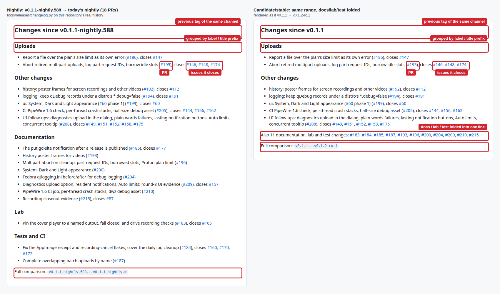
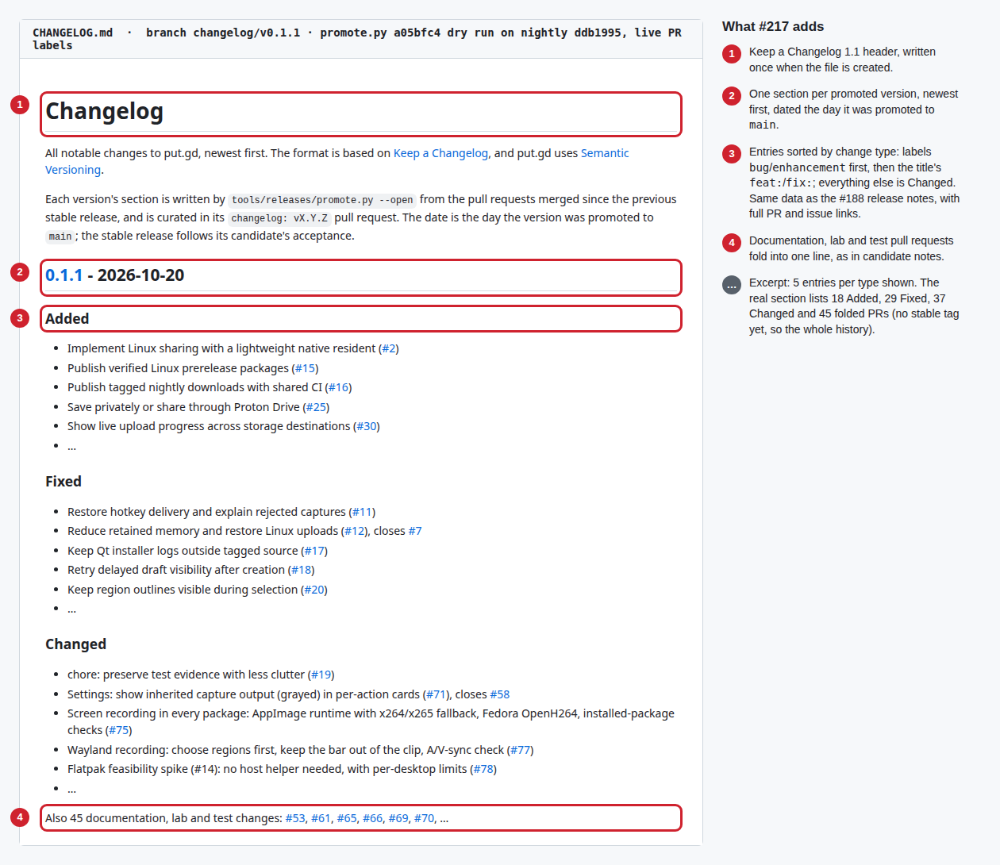

# Linux releases

Release builds use C++20, Qt 6, the pinned official AWS SDK, CMake presets, Ninja
and native packaging tools. The application is MIT licensed. The first public
track is a prerelease. Flatpak is separate work in GitHub issue [#83](https://github.com/patrick-hudson/put.gd-desktop/issues/83) and needs no host
helper; only Plasma Wayland loses direct screenshots (see `docs/flatpak.md`).

## Branches and channels

`nightly` is the default branch and the integration trunk. Every feature, fix,
documentation and tooling pull request targets `nightly`. `main` is the release
branch. It changes only through a promotion pull request from `nightly`, or a
hotfix pull request. Rulesets on both branches require a pull request and the
`CI` check, and block force-pushes and deletion. Nobody pushes to either branch
directly, and published tags are never moved or deleted.

| Channel | Tag | Cut by | Publication |
| --- | --- | --- | --- |
| Channel | Tag | Cut by | Publication |
| --- | --- | --- | --- |
| Nightly | `vYY.MDD.N-nightly` | daily schedule on changed `nightly` | automated, build-tested prerelease |
| Stable | `vYY.MDD.N` | every push to `main` | draft; published after exact-asset acceptance |

Versions are calendar versions (#373, [versioning.md](versioning.md)):

- `YY.MDD` is the tagged commit's UTC committer date, as month times 100 plus
  day, with no leading zeros.
- `N` is the commit's full-history count.

For example, `v26.1022.942-nightly` is titled "put.gd 26.1022.942 nightly". The
tag, full commit, tree and count must match the clean source. Because the
version comes from the commit, no file is bumped before or after a release.

There is no release-candidate channel. The stable draft is what exact-asset
acceptance runs on. A failed acceptance is fixed on `nightly` and promoted again,
which makes a new commit on `main` and so a new version.

Earlier tags keep their names and stay readable: `v0.1.1-nightly.N`, the
unpublished `v0.1.1-rc.1` draft, and before 2026-10-18
`vBASE-dev.COUNT.UTC+gSHORT`. Every calendar version sorts after them.
Nightlies never replace GitHub's Latest stable release. New releases publish
five installers and ten small support files. Source downloads are linked
separately; debug files stay in CI artifacts. Older releases retain their original
asset layouts and remain verifiable.

### Nightly

`.github/workflows/nightly.yml` runs at 05:23 UTC on `nightly` and on demand
(`gh workflow run nightly.yml --ref nightly`). GitHub can delay scheduled work;
this is not a delivery-time guarantee. Its `plan` job derives the nightly tag for
`nightly` HEAD. When that exact source is already a complete, verified public
nightly, the run stops there: nothing is built or published. Otherwise it
creates the immutable tag, reuses passing source CI for that exact commit when
available (otherwise runs the full suite), builds and checks all tagged packages,
and publishes the collected installers as a prerelease. [CI coverage](ci.md)
describes the exact evidence required for reuse. A tag, draft
or failed run alone is not a published nightly, so unchanged source whose last
attempt failed is retried.

After publishing, the run notifies the download site
(`patrick-hudson/put.gd-site`), which refreshes its links within about a minute
instead of at its next six-hourly deploy. The step needs the `SITE_DISPATCH_TOKEN`
secret and only warns when the notification fails; see
[Notifying put.gd-site](ci.md#notifying-putgd-site).

`plan` refuses a tag that wouldn't sort after the newest existing nightly. Only
a rewritten committer date on `nightly` HEAD could cause that; check the commit
and its date.

Nightly notes state automated coverage: Linux test suites, Windows portable
compilation, package audits and the extracted-source production build. They are
development releases, not new graphical, memory or live-S3 certification.

### Changes in the release notes

Every release's notes start with a "Changes since <previous tag>" section,
written by `tools/releases/changelog.py` when `publish.py` stages the release.
It lists the pull requests whose merge commits are in `<previous>..<tag>`:

- **Nightly:** since the previous nightly tag reachable from this one.
- **Stable:** since the previous stable release, so the notes list everything
  the version adds. Documentation, lab and test pull requests are
  folded into one "Also N documentation, lab and test changes" line.
- Only published releases count as the previous one. A stable tag whose
  acceptance failed, or a nightly whose publication failed, is skipped. The
  publisher reads the list with `gh`; with `--offline` every tag counts.
- The promotion (`release: promote nightly YY.MDD.N`, head `nightly`) and back-merge pull requests
  (head `main`) aren't listed themselves; the pull requests they carry are.
- With no earlier tag of that kind, the section is "Changes in <tag>" and lists
  the whole history.

Entries are grouped as Features, Fixes, Recording, Uploads, Packaging and
releases, Other changes, Documentation, Lab, and Tests and CI. A pull request's
labels decide its group (`bug`, `enhancement`, `documentation`, or a group name
such as `recording`); otherwise its title prefix does (`feat:`, `fix:`,
`feat(s3):`, `docs:`, `lab:`, `test:`, `ci:`, `Recording:`, `AppImage:`...).
Unrecognised prefixes go under Other changes. Each entry links its pull request
and the issues it closes. The labels and closing issues come from one GitHub
GraphQL query per 50 pull requests, which is why the `publish` and `draft` jobs
have `pull-requests: read` and `issues: read`. If that query fails, the issue
numbers a title ends with, such as `(#146 #148)`, stand in, and publication
continues. If the history itself can't be read, the section says so instead.

Preview a section from a local checkout with
`python3 tools/releases/changelog.py --tag vYY.MDD.N-nightly --repository patrick-hudson/put.gd-desktop`
(add `--offline` to skip the GitHub query). The fixture history in
`tests/releases/test_changelog.py` covers the ranges, grouping and folding.



### CHANGELOG.md

`CHANGELOG.md` at the repository root is the curated history of stable versions,
in [Keep a Changelog 1.1](https://keepachangelog.com/en/1.1.0/) style (#217).
`tools/releases/promote.py` writes the section from the same data as the release
notes: the pull requests merged since the previous published stable release, with
their labels and closing issues. Entries are grouped by change type instead of
area. `bug` and `enhancement` labels win; otherwise a `feat:` or `fix:` title
(any scope) gives Added or Fixed, and everything else is Changed. Documentation,
lab and test pull requests fold into one line.

A stable version is the date and count of `main`'s merge commit, so it exists
only after the promotion merges (#373). The section is therefore written in two
steps:

1. **Before the promotion.** `promote.py --open` pushes `changelog/promote-YY.MDD.N`.
   That is one commit on `origin/nightly` that adds the section as `## [Unreleased]`,
   built without touching the working tree, and named after the nightly version
   being promoted. It opens a `changelog: next stable release` pull request into
   `nightly`. Curate the entries there and merge it. The promotion pull request,
   opened next, shows the same section as its change list and carries the file
   once that pull request is in `nightly`. A rerun after that opens only the
   promotion, and never replaces an `[Unreleased]` section that is being curated.
2. **After the stable release is published.** `promote.py --finalize vYY.MDD.N --open`
   opens `changelog: vYY.MDD.N` into `nightly`. It renames the heading to
   `## [YY.MDD.N] - <publication date>` and links it to the compare view from the
   previous stable release, or to the release itself for the first one. If
   `nightly` has no `[Unreleased]` section, it writes the version's section
   instead. It refuses a tag that isn't a published calendar stable release.

The stable release's own source tree therefore carries its section under
"Unreleased". `CHANGELOG.md` is prose, so CI runs `contracts` alone for it.
`tests/releases/test_promote.py` covers the section, the file update, the pull
request order and `--finalize`.



### Stable

Agents releasing a version follow [the release runbook](release-runbook.md),
which adds the version checks, acceptance recording and confirmation points.

1. Run `python3 tools/releases/promote.py` to preview, then `--open` to create
   the `changelog: next stable release` pull request into `nightly` (see
   [CHANGELOG.md](#changelogmd)) and the pull request from `nightly` into `main`
   titled `release: promote nightly YY.MDD.N`. Merge the changelog pull request
   first. Merge the promotion with a merge commit once `CI` passes, so every
   `nightly` commit keeps its SHA.
2. The push to `main` starts `.github/workflows/release.yml`. It tags the merge
   commit's version, `vYY.MDD.N`, or reuses that tag when rerun (a manual run
   does the same for `main` HEAD). It runs full CI and packaging on the tag and
   stages a verified stable draft. The run summary names the tag and the next
   steps.
3. Run exact-package acceptance on the draft's assets, as described under
   [Acceptance boundary](#acceptance-boundary). Publish it with the acceptance
   receipt; a published stable release becomes GitHub's Latest release:

   ```sh
   git checkout vYY.MDD.N
   gh release download vYY.MDD.N -D build/publish
   python3 tools/releases/publish.py --tag vYY.MDD.N --directory build/publish --publish --acceptance /private/current-package-acceptance.json
   ```

   After the draft goes public, the command notifies `patrick-hudson/put.gd-site`
   with your `gh` login (a `release-published` dispatch with the tag and whether
   it is a prerelease), and the receipt's `siteNotified` records whether that
   worked. A "could not notify" warning doesn't undo the publication: the site
   catches up on its six-hour schedule, or run its deploy by hand with
   `gh workflow run deploy.yml -R patrick-hudson/put.gd-site`.

   If acceptance fails, leave the draft unpublished, fix it on `nightly` and
   promote again. The next push to `main` is a new commit with a new version;
   nothing is retagged. The failed tag stays as an unreleased tag, and the
   release notes and CHANGELOG skip it because it was never published.
4. Run `python3 tools/releases/promote.py --finalize vYY.MDD.N --open` to name the
   CHANGELOG.md section after the release, and merge that pull request into
   `nightly`. Nothing else changes for the next version: nightlies continue
   with the next commit's date and count.

A hotfix is a pull request into `main`. Its merge tags that commit's version and
stages its draft; follow steps 3 and 4. Then merge `main` into `nightly` through
a pull request so the fix is not lost at the next promotion. Promotion does not
need `nightly` to contain `main`'s merge commits.

### Recovery

Use GitHub's "Re-run failed jobs" on the original run. A rerun reuses the
successful package and collection artifacts of that run, and the publisher
resumes a partial draft: matching uploaded bytes are kept and only missing
assets are uploaded. Conflicting bytes, an ambiguous draft or an already
published release stop with an error for inspection; assets are never silently
replaced. A new run for the same source rebuilds packages, so it cannot resume a
partially uploaded draft from another run. Inspect that draft, and delete it only
when nothing has been published, before retrying.

Plans, tag decisions and publication receipts are retained as Actions artifacts
for 90 days, package handoffs for 30 days and the collected `release-assets` for
14 days. The public `release-builds.json`, checksums and release notes remain the
source of truth after Actions artifacts expire.

## Proton experimental production integration

The user approved shipping and maintaining Proton on 2026-10-15. Its
experimental designation records compatibility maturity. Upstream endorsement
or SDK general availability is not a publication prerequisite; the concrete
[evidence and release gates](proton-drive-release-gates.md) remain applicable.

Linux x86-64 Build and release jobs provision and test the pinned official JS
helper, enable its bundle explicitly, and require matching runtime, notices and
source catalog in native/AppImage audits. Windows/macOS Proton support remains
outside this release scope. The curated source archive includes Proton build
inputs and its production rebuild checks the extracted helper.

Every Proton-enabled release delivers the current `proton-source-catalog.json`.
Its permanent URLs point to the unchanged corresponding-source transport parts,
which are no longer downloaded and uploaded again for each nightly. Publication
requires those URLs to identify public GitHub assets with the pinned sizes and
SHA-256 digests (falling back to a byte download when the server has no digest).
The current catalog/helper hashes must still match every installer. Concatenate
the parts in numeric order and verify their combined hash before extracting.
The application source overlay accompanies the AppImage sources in the linked
source release. Preserve those sources while their binaries remain available.

Native Linux packages also generate `/usr/share/doc/putgd/copyright` in DEP-5
format and a deterministic `changelog.gz` from the source commit. The copyright
file reproduces all shipped attribution, including compressed Bun notices and
ICU 78.3, so it survives Debian's usual minimized-documentation exception. RPM
notice files are `%license` and survive `--excludedocs`/`tsflags=nodocs` (#470).
Product ELF executables explicitly use PIE and full RELRO; the native artifact
audit rejects regressions (#475). Bun's upstream helper is outside that compiler
change and remains tracked in #471. Proton's installed dependency notices are
stable across npm 9/10/11 because the formerly optional peer dependency is pinned
directly (#369), and ICU 78.3 is bound into both Linux redistribution copies
(#461).

The [native packaging evidence](evidence/2026-10-24-native-packaging-540/README.md)
records the clean Fedora/Debian build, strict metadata and filtered-install
checks, npm-version comparison, original failures and the final CI run.

Final packaged functional/resource acceptance remains a separate receipt.
Previously tested private deployments do not establish package acceptance. P5
credits the actual Crypto source update and completed rebuild work; ongoing
compatibility checks remain in the maintenance procedure.

For each subsequent release carrying Proton, the release maintainer retains the
integration maintainer's dated compatibility/migration check, pinned SDK/Crypto/
Bun versions, runtime/manifest/notices hashes, supported asset list and current
acceptance evidence. Follow the [maintenance procedure](proton-drive-release-gates.md#maintenance-procedure).
An upstream required update or observed service incompatibility requires a
compatible put.gd release and preserved recovery state. Existing stable
and nightly coverage classes continue to apply.

## Formats and build environments

| Asset | Builder | Qt distribution |
| --- | --- | --- |
| Ubuntu 24.04 / Mint 22.3 DEB | pinned Ubuntu 24.04 container | distro Qt 6.4.2 minimum API |
| Ubuntu 26.04 / Kubuntu DEB | pinned Ubuntu 26.04 container | distro Qt and LayerShellQt |
| Debian 13 DEB | pinned Debian 13 container | distro Qt 6.8, LayerShellQt and FFmpeg 7.1 |
| Fedora 44 RPM | pinned Fedora 44 container | distro Qt and LayerShellQt |
| x86_64 AppImage | Ubuntu 24.04, official Qt 6.12.0, locked ECM/LayerShellQt | dynamically bundled Qt/plugins |

AppImage requires glibc 2.39 or newer; it does not substitute the host libc.
DEB/RPM continue using system Qt. AppImage's normal bundled runtime is the
explicit distribution exception added by the user's October 12 release request.
The GTK platform theme must remain available for native dialogs/fonts. Never
substitute a newer-glibc build or omit KDE region support to produce an asset.

Screen recording ships in every installer. The DEBs and the RPM depend on the
distro's GStreamer plugin packages and link the distro FFmpeg; the RPM also
recommends `gstreamer1-plugin-openh264` and `openh264`, Cisco's library that
replaces Fedora's `noopenh264` placeholder. Recommends do not replace an installed
conflicting placeholder: Fedora recording needs the explicit command
`sudo dnf install openh264 gstreamer1-plugin-openh264`. The one-line installer
runs that codec step when the Cisco repository is enabled; otherwise it prints
the enable-then-install commands (see [codec setup](recording.md#packages-and-codecs)).
Each DEB therefore installs only
on the release it was built for: the Ubuntu 24.04 and 26.04 DEBs need
`libavcodec60` and `libavcodec62`, which Debian 13 does not ship, so Debian 13
has its own DEB built against its `libavcodec61` (issue #85; see the
[acceptance matrix](acceptance-matrix.md#screen-recording-rows)).

The AppImage builds `putgd-record` against a pinned FFmpeg configured with
`--enable-gpl` (`packaging/appimage/tools.lock.json`, options in `media.json`)
and bundles the Ubuntu 24.04 GStreamer plugins the helper uses, including
`x264enc`, with the distro's `libx264` and `libx265`. The host's GPU encoders
(VA-API, NVENC) are tried first; the bundled x264 and x265 are the fallback when
none of them works. VA-API, PipeWire and NVIDIA's libraries always come from
the host. This was Patrick's decision on 2026-10-19 ("bundle x264, and then
default to whatever is best ... only fall back to the library when absolutely
necessary"; "x265 can be bundled too").

Because of x264, x265 and the GPL FFmpeg, the AppImage is a GPL-2.0-or-later
combined work; put.gd's own code stays MIT and each component keeps its
licence. The image carries `usr/share/doc/putgd/APPIMAGE-GPL-NOTICE.txt` and
the licence texts under `usr/share/doc/putgd/bundled-licenses`. Every release
links `putgd-VERSION-appimage-complete-source.tar.gz` from its source release, built automatically by
`tools/releases/appimage_complete_sources.py` from the exact image's component
inventory. It carries all pinned Qt module trees (including embedded third-party
code), LayerShellQt, QtKeychain, ICU, AWS SDK/CRT submodules, FFmpeg with its
configure/build scripts, and the exact distro sources of every bundled Ubuntu
binary. Distro source includes the `.dsc`, original archives and Debian changes,
verified by source version and checksums after download through signed apt
indexes. The runtime's source, libfuse patch, static-library sources and Alpine
recipes/patches are included too; their closure is pinned to the runtime digest
in `packaging/appimage/runtime-source.json`.

The source asset's `SOURCES.json` maps every component to its source and checksums.
`upstream/*/TREES.json` maps root and recursive submodule archives to their
original paths. The collector rejects missing components, changed Qt/runtime
pins, a partial media-only asset or mismatched archive contents. put.gd's own
`-source.tar.gz` and the linked Proton source catalog/transport parts remain separately
verified downloads linked from the installer release. Keep all these source assets available
alongside the corresponding binary. No three-year written-offer process or
separate source mirror is substituted for these automated assets (#416).

The upstream runtime's old build logs have expired. Its exact binary and debug
hashes, identified static-library versions, available packaging revisions and
reproduction limits are recorded in the runtime source lock. Source delivery
is not a claim that the official runtime or Qt binaries rebuild byte for byte.
The runtime also embeds mimalloc 2.1.7; its original MIT notice is now included
in the image's notice inventory.

### Codec distribution decision (#419)

Patrick delegated the distribution choice on 2026-10-23. Retain the software
H.264 encoder/decoder, H.265 encoder and AAC encoder/decoder in the free,
directly downloadable stable and nightly AppImage. This preserves recording
fallback and MP4/H.265 export on systems without a working host hardware encoder,
following the approved functional choice to bundle x264/x265. AAC is included
explicitly: GStreamer vo-aacenc supplies recording audio and FFmpeg AAC supplies
working-clip decoding/export. The DEB/RPM continue to use distribution codecs.

This chooses distribution under the upstream software licences, with complete
notices and corresponding source; it does not assert a patent licence or
universal patent clearance. Do not infer an exemption from free downloads,
source availability, small download counts or the AVC royalty threshold. The
[AVC programme](https://www.via-la.com/licensing-programs/avc-h-264/) describes
product licensing and threshold terms; the [AAC programme](https://www.via-la.com/licensing-programs/aac/)
addresses end-user encoder/decoder products; [Access Advance's FAQ](https://accessadvance.com/faq/)
addresses downloadable HEVC software. Those are the administrators' published
positions, not a finding that every patent in their pools applies to this build.
[FFmpeg's legal guidance](https://www.ffmpeg.org/legal.html) distinguishes code
licensing from jurisdiction-dependent patent questions.

No patent-pool agreement, payment, territorial clearance or downstream patent
sublicence is represented or entered into by this decision. Reassess this
posture if distribution becomes paid, bundled with hardware or services, or a
specific applicable claim/licensing obligation is established. Source compliance
and the existing security, exact-package and desktop release gates still apply.

GNOME capture currently targets Shell 50 and requires the host extension.
Release collection also emits the matching extension ZIP. Installing files inside
an AppImage does not install a host extension. See [GNOME setup](desktops/gnome.md).
Minimum-Qt DEB compatibility compilation is separate from GNOME/KDE compositor
qualification. Windows CI compilation is future-platform evidence, not a
native support claim.

## Package repositories

Every published nightly and stable release also reaches the signed apt and dnf
repositories at `pkg.put.gd`. The signer on d69 picks it up within about ten minutes,
and the update feed follows once the repositories carry it. A stable release needs the
user's stable key ([release-runbook.md](release-runbook.md) step 7). The layout, keys
and operation are in [package-repositories.md](package-repositories.md).

## AppImage updates

Tagged AppImages carry zsync update information, so AppImageUpdate, Gear Lever and
AppImageLauncher can update them (design: issue #293). The runtime's `.upd_info`
section holds `zsync|https://app.put.gd/dl/<channel>/appimage.zsync`, the
put.gd-site permalink to the newest `.zsync` of the channel:

| Tag | Channel in the update information |
| --- | --- |
| `vYY.MDD.N-nightly` (and pre-#373 `v0.1.1-nightly.N`) | `nightly` |
| `vYY.MDD.N` (and the pre-#373 `v0.1.1-rc.N`) | `stable` |
| none (pull requests, CI pushes, local builds) | nothing is embedded and no `.zsync` is made |

An untagged build carries nothing, so no updater offers to replace a development
build with a release. Each release publishes `putgd-VERSION-x86_64.AppImage.zsync`,
made in the AppImage job from the final image bytes. Its `URL` is the image's
copy on the release signer's mirror, `https://pkg.put.gd/releases/TAG/putgd-VERSION-x86_64.AppImage`,
so the updater fetches that exact image however it reached the `.zsync`, and with no
redirect: zsync2 follows redirects with a request that ignores the CA bundle, which fails
on Fedora 44 (#297). The signer mirrors each release's image and `.zsync` (verified against
`SHA256SUMS`, the receipt and GitHub's digest) before it moves the channel's
`dl/<channel>/appimage.zsync`, which `app.put.gd/dl/<channel>/appimage.zsync` serves from
the pkg bucket, and the feed ([package repositories](package-repositories.md#layout)).
Releases built before that name the GitHub download, and the mirror accepts both. The AppImage receipt records the update
information and the `.zsync`'s URL, size and SHA-256 under `update`. Read an
image's value with `./putgd-VERSION-x86_64.AppImage --appimage-updateinformation`.
Assembly details are in
[AppImage assembly](../packaging/appimage/README.md#update-information); the lab
update from one build to the next is recorded in
[AppImage zsync updates](evidence/2026-10-20-appimage-zsync-293/README.md).
On Fedora, appimageupdatetool can't find the certificate bundle; `SSL_CERT_FILE` alone
isn't enough. The workaround and Gear Lever (unaffected) are in
[Updating the AppImage](updates.md#fedora) (#297).

Gear Lever and AppImageLauncher both move N to N+1 through a 302, like the site
permalink's, in a lab Mint 22.3 guest
([desktop acceptance](evidence/2026-10-21-updates-acceptance-303/README.md#4-appimage-updates-gear-lever-appimagelauncher-start-at-login-295)).

**Gear Lever** downloads the whole image and replaces the file in place.
**AppImageLauncher**'s updater and appimageupdatetool do a zsync delta and write the
new version under the `.zsync`'s file name beside the old one; AppImageLauncher keeps
the old file, `appimageupdatetool --remove-old` deletes it. Start at login from an
AppImage runs a script put.gd keeps current, which starts the newest put.gd AppImage
in that folder with the same update information, so the next login starts the new
version after all three
([#307](https://github.com/patrick-hudson/put.gd-desktop/issues/307); the rules are in
[AppImage assembly](../packaging/appimage/README.md#start-at-login-after-an-update)).

The image root holds exactly one desktop entry, `putgd.desktop`, and the build checks
it, so AppImageLauncher integrates put.gd and offers **Update this AppImage**
([#306](https://github.com/patrick-hudson/put.gd-desktop/issues/306)). Both are recorded
in a Mint 22.3 guest with real logouts and logins:
[AppImage login and integration](evidence/2026-10-21-appimage-login-306-307/README.md).

A live delta update from nightly 801 to 816 through the site permalink and GitHub's
download CDN worked with appimageupdatetool in the Mint guest (95 % of the image reused,
6.8 MB fetched, SHA-256 equal to 816's `SHA256SUMS` line;
[pre-check](evidence/2026-10-21-appimage-login-306-307/README.md#live-pre-check-801-to-816)).
The live close-out moved nightly 842 to 847 (both with #307) through the permalink with
appimageupdatetool, Gear Lever and AppImageLauncher in the Mint guest; after each, a real
logout and login started 847, and the feed and permalinks answered as designed (no stable
permalink yet): [live update](evidence/2026-10-21-appimage-live-294-296/README.md).

## GitHub downloads and source

The main GitHub Release page has 15 uploaded assets:

- Five installers: Ubuntu 24.04, Ubuntu 26.04 and Debian 13 DEBs, the Fedora 44
  RPM, and the x86_64 AppImage.
- The AppImage `.zsync`, needed by update clients.
- Five package SBOMs (`putgd-VERSION-LABEL.cdx.json`).
- `SHA256SUMS`, `release-builds.json`, `source-delivery.json`, and the current
  `proton-source-catalog.json`.

There is no new combined ZIP or public debug archive. GitHub's automatic source
links remain available, and developers can clone the release tag.

Release notes and `source-delivery.json` link a separate
`sources-vVERSION-files` release containing the exact application source tarball,
AppImage complete-source tarball, optional GNOME extension ZIP and their
`SHA256SUMS`. The delivery manifest binds filenames, sizes and hashes to the
installer commit. Source releases are always prereleases, never Latest, and use
a suffix that the download site's nightly selector cannot mistake for an
installer. Publishing installers first requires these sources to be publicly
available and checksum-verified. Interrupted uploads resume only matching bytes;
existing source tags/assets are never overwritten. The Proton catalog links its
unchanged source parts at their permanent release instead of duplicating 2.5 GB
per version.

Each package job retains its checked debug tar and manifest in the separate
`debug-symbols-LABEL` Actions artifact for 90 days. Download the artifact from the
producer run linked in the release notes before it expires; archive it privately
when longer retention is needed. [Diagnostics](diagnostics.md#kept-debug-symbols)
describes extraction and build-ID lookup. Package binaries remain stripped.

The installer and source handoffs are separate Actions artifacts,
`release-assets` and `release-source-assets`, retained for 14 days. The public
source release remains available after Actions artifacts expire.

The curated source tarball exports committed files from a positive allowlist:
the application's `src/`, CMake files/presets, native packaging, GNOME integration,
licenses, dependency provisioning/verifier, the bounded `tools/proton/` build
inputs and build instructions. Helper tests required by provisioning are included;
application test/lab targets and outputs are excluded. It contains no `work/`,
builds, credentials, agent context, plans/reviews/evidence, lab images or run logs. Its generated `source-info.json` records the original
commit/tree/count and every included file hash. Archive timestamps, modes and
ownership are deterministic.

`README_SOURCE.md` gives normal CMake/Ninja commands for the extracted source.
No Git history or third-party SDK binary prefix is bundled; provision the official
pinned AWS SDK separately. Extracted builds use the existing supplied-provenance
CMake flags, retaining the original commit/count with a development version.
They do not claim locally observed clean Git or an exact release-tag build.
Official binary release assets continue to come from a clean tagged checkout.
On untagged runs, the Ubuntu 24.04 packaging job compiles an extracted export
with the normal release preset. Tagged builds export the exact committed source
without repeating that compilation. Collection always verifies its identity,
size and checksum; a source-build receipt, when present, must match as well.

## SBOMs and vulnerability scans

The stable draft workflow also runs `tools/releases/audit_assets.py` on exact
GitHub downloads, including all five packages/SBOMs, the linked complete/curated
sources and the pinned Proton transport parts. It verifies the published SBOM
declarations against the extracted files before regenerating/scanning them with
the current database and stable policy. Official Bun advisories supplement the
scanner because a database can miss a newly published embedded-runtime advisory.
The retained `exact-asset-audit-TAG` artifact includes failures and raw findings.
See [the runbook](release-runbook.md#4-run-acceptance-on-the-stable-draft) for the
builder command and the separate manual review/acceptance boundary.

Every `package.yml` run, tagged or not, ends with an `sbom` job (#420). It
downloads the five packages, pins Syft and Grype by version and SHA-256
(`packaging/sbom/tools.lock.json`), and runs `tools/releases/sbom.py`:

1. **SBOM.** Each package is unpacked (the AppImage with `--appimage-extract`, DEBs
   with `dpkg-deb`, the RPM with `rpm2cpio`) and catalogued by Syft. Syft alone
   finds almost nothing there: the AppImage carries no dpkg database, and it reads
   FFmpeg's library sonames as FFmpeg versions. So `sbom.py` adds the components
   the packages' own inventories name, and drops Syft's guesses for the same
   components:
   - the AppImage's `bundled-components.json`: the 124 Ubuntu 24.04 packages as
     `pkg:deb/ubuntu/...?distro=ubuntu-24.04` with their source packages, the Qt
     modules, the third-party code Qt builds in (libpng, PCRE2, SQLite, HarfBuzz,
     libjpeg-turbo, libtiff, libwebp, md4c, ...), FFmpeg, ICU, LayerShellQt,
     QtKeychain and the type2 runtime;
   - every package's `dependency-lock.json`: the AWS SDK and the CRT libraries it
     links, by commit;
   - every package's Proton helper notices: the npm packages bundled into the
     helper and its embedded Bun runtime.
   Components with NVD entries carry a CPE (`qt:qt`, `ffmpeg:ffmpeg`, ...). The
   SBOM's metadata names the package file and its SHA-256, and `collect` checks
   that binding before publishing it.
2. **Scan.** Grype matches each SBOM against its vulnerability database. The job
   downloads the current database archive (about 195 MB), checks it against
   its listed SHA-256, keeps it in the `grype-db-v6-<sha256>` cache and imports it.
3. **Report.** `packaging/sbom/policy.json` sorts the findings, which go to the job
   summary and the `vulnerability-report` artifact (`vulnerability-report.json`
   and each SBOM's Grype output, kept 90 days).

| Finding | Pull request and nightly | Stable tag |
| --- | --- | --- |
| Critical or high, in bundled code, with a fixed version | flagged: warning annotation and summary row | blocks: the `sbom` job fails, so `collect` and the draft don't run |
| Critical or high with no fix yet, or medium and below | reported | reported |
| Accepted in `policy.json` and not expired | reported as accepted | reported as accepted |

Bundled code is everything the AppImage ships, Ubuntu packages included (the
image freezes them), and the pieces the native packages ship themselves: the AWS
SDK and the Proton helper. The native packages' distro dependencies, Qt among
them, are the distribution's to fix; their SBOMs don't list them.

Accept a finding only with a reason and an expiry. An expired acceptance counts
as a new finding again:

```json
"ignore": [
  {"id": "CVE-YYYY-NNNNN", "component": "ffmpeg", "reason": "the affected decoder is not built (media.json)",
   "expires": "2027-01-21", "issue": 511, "scope": "appimage-ffmpeg-7.1.5"}
]
```

`id` also matches a finding's aliases (a GHSA's CVE). Legacy entries permit
`component: "*"`; the #511 acceptances name one component and an explicit scope.
Policy schema version 2 requires a scope for every acceptance and is rejected
by older scanner helpers. The policy's `scopes` bind each acceptance to the package
label, component version, upstream source commit, actual library bytes and absence
of the omitted tools. `sbom.py generate` calculates `putgd:filesSha256` from the extracted image's
component paths and file hashes, and records `putgd:toolsAbsent`. FFmpeg's
compiled configure string is part of those library bytes. Adding a tool,
changing a library/configuration, source pin or version, or passing an older
SBOM without these properties stops the acceptance from matching. Regenerate an
old SBOM from its verified package; never copy scope properties into it by hand.
The repository contract also requires reassessment when the locked source or
`media.json` configure list changes. The existing stable severity/fix gate stays
unchanged, and all accepted findings remain in the report with reasons and expiry.

The [#511 evidence](../packaging/sbom/dispositions/511.json) records three FFmpeg
backports and the omitted components behind the other 26 Critical/High matches.
It also resolves the reachability question for ICU 73.2 CVE-2025-5222: the
[upstream fix](https://github.com/unicode-org/icu/commit/2c667e31cfd0b6bb1923627a932fd3453a5bac77)
changes `tools/genrb/parse.cpp`, and that parser and `SRBRoot` belong to the
`genrb` executable. The audited AppImage ships only `libicudata`, `libicui18n`
and `libicuuc`; neither `genrb` nor `libicutu` is present. This acceptance applies
to those exact runtime bytes, not to the ICU source package or a system `genrb`.
No new upstream patch or ICU ABI substitution is needed for this disposition.
The acceptances expire on 2027-01-21 and do not cover other CVEs.

The evidence package is the development-identity AppImage from `nightly`
`50053b01f1bbd7f3776a53513bb8c43151ce0de8` (CI run 40045151634), not a published
nightly or stable draft. Each later package must satisfy the same fingerprint
guards, and the exact stable draft still requires its current scan and other
release acceptance. The [remaining-findings assessment](evidence/2026-10-24-release-blockers-511-416-419/README.md)
checks the exact source behind libtiff CVE-2026-4775 and GStreamer CVE-2025-3887.
Qt's pinned libtiff already contains all four upstream overflow corrections.
GStreamer's affected H.265 parser is bundled and unpatched, but no current
product input path to it was identified: recording uses explicit H.264/AAC
graphs, and preview/export uses FFmpeg. Both raw findings remain visible; no
new policy ignore or release acceptance follows from this assessment.

CPE matching takes NVD's version ranges literally. FFmpeg's maintenance branches
backport fixes that NVD records only against the next major, and the AppImage
builds FFmpeg with `--disable-everything` plus a short list of components, so
check an FFmpeg finding against `packaging/appimage/media.json` before acting on
it. The AWS SDK and CRT have no NVD product entries, so nothing matches them. Qt's
own security advisories mostly don't reach NVD's CPE data either: on the
`v26.1023.1058-nightly` AppImage, Qt 6.8.3 matched one medium finding per module,
while Qt had published about 23 fixes since it (#418). For Qt, the scan is a
backstop; Renovate's Qt updates, whose patch releases open at once, are the
main defence.

**Stable releases after they ship.** A stable AppImage keeps the Ubuntu packages,
Qt and FFmpeg it was built with; it gets none of the fixes published later. So
`nightly.yml`'s `stable-scan` job re-scans the latest stable release every day,
whether or not a nightly is built. It downloads that release's published SBOMs,
checks them against its `SHA256SUMS`, scans them with that day's database
(`sbom.py scan --released`, which flags and never fails), and keeps one issue
current: "Stable vYY.MDD.N: bundled components with fixed critical or high CVEs",
labelled `area: packaging` and `needs-patrick`. The issue is opened when the
first finding is flagged, and its body is replaced with each day's table after
that; close it by hand once a new stable ships or every finding is accepted.
Whether a finding calls for a new stable release is the re-release policy in
[#420](https://github.com/patrick-hudson/put.gd-desktop/issues/420). Releases
before the first with SBOMs are skipped.

To scan a published release yourself, download its SBOM and run any CycloneDX
scanner, for example
`grype sbom:putgd-VERSION-appimage.cdx.json --distro ubuntu:24.04`.
Renovate keeps the pinned components themselves current
([ci.md](ci.md#dependency-updates)).

## Version identity

Normal builds are `YY.MDD.N-dev+gHASH`, the commit's calendar version; each
commit changes their identity. An explicit clean exact tag of that commit,
`vYY.MDD.N-nightly` or `vYY.MDD.N`, produces `YY.MDD.N-nightly` or `YY.MDD.N`;
any other date or count is rejected. Dirty, missing, mismatched and
arbitrary archive release labels are rejected. [versioning.md](versioning.md)
explains package ordering and the archive provenance boundary.

Every product executable exposes `--version-json` before GUI initialization.
Package installation checks the entire embedded manifest, not only the version
string: equal-version binaries from different commits must be rejected. Module
runtime hashes and the pinned SDK/component license snapshot remain mandatory.

## Build and audit locally

Use the standard packages and SDK provisioning in [build.md](build.md). For a
fixture-free native package:

```sh
cmake --preset release -DBUILD_TESTING=OFF -DPUTGD_LAB_FIXTURE=OFF -DPUTGD_PHYSICAL_BENCHMARKS=OFF -DCMAKE_INSTALL_PREFIX=/usr -DPUTGD_RELEASE_TAG=vYY.MDD.N-nightly
cmake --build --preset release
python3 tools/releases/native.py --build build/release --format DEB --output /tmp/new-release-deb
```

Run `--format RPM` on Fedora with its matching system libraries. Never convert
a DEB into an RPM or reuse another distro's SDK binary prefix. The output must
be a new absent directory. The wrapper uses stock CPack/dpkg-deb or RPM/cpio,
then checks package ownership/modes, helper identities, licenses, SDK/module
SHA256 values and ELF resolution. RPM dependency detection excludes private
SDK SONAMEs while retaining system requirements; post-install stripping is
suppressed because it would invalidate recorded runtime digests.

Outputs include the package, extracted inventory, native-audit.json,
build-info.json, SHA256SUMS and CPack logs. [AppImage assembly](../packaging/appimage/README.md)
uses locked official deployment tools around the same CMake install tree.
It has a separate inventory because Qt/plugins are bundled and ELF RPATHs may
change. Its receipt explicitly records desktop acceptance pending after assembly.

## GitHub build and publication

`.github/workflows/package.yml` builds and audits the four native packages and
the AppImage. CI calls it on pull requests that touch packaging, CMake, Proton
or CI inputs, on every push to `nightly`, and from the nightly and release runs
with an exact tag. Builders are ABI-separated, keep read-only permissions and
use the normal presets rather than an alternate build system.

Each package job sets `PUTGD_PACKAGE_TARGET` to its matrix name (`appimage` for the
AppImage), so the build's update check offers that same package. `native.py
--package-target` and the AppImage build check it with `putgd-cli --update-info`
([updates.md](updates.md)).

Each package job stages split debug files with `tools/releases/debug_symbols.py stage`, verifying them against the installed binary build IDs, and uploads them
as separate CI artifacts. They are not downloaded for SBOMs or publication.

With a tag, `collect --installers-only` requires the four native installers and
AppImage from one clean tagged commit/tree/count/version, the five matching
SBOMs, the exact application source export and complete AppImage source receipt.
It recalculates hashes and assigns distro-specific filenames. The AppImage's
embedded update information and `.zsync` must describe this release's bytes and
URL. The required source, SBOM and PipeWire jobs run concurrently after image
assembly; publication waits for every selected job. Nightly source CI may be
reused as documented in [CI coverage](ci.md), with its exact producer recorded.
Only the nightly `publish` job and stable `draft` job write releases. They publish
the linked source materials before exposing the installers; stable installers
remain a draft pending exact-asset acceptance.

Draft staging uses `gh release create --verify-tag`. A rerun can resume a
partial draft: existing uploaded bytes must match exactly, and only missing
assets are uploaded. Incomplete or conflicting assets and an already published
release are rejected for inspection; existing assets are never silently replaced.
For stable releases, public publication is the last step after
actual package-specific acceptance. Nightlies use the explicit automated class
described above; `--nightly` cannot publish stable tags.
The publisher compares GitHub's SHA-256 asset digests with every collected
checksum, downloading bytes when a digest is absent. It verifies the checksum
file too and rejects missing/extra assets, a different remote tag,
or assets changed during verification. GitHub does not offer an atomic lock
across verification and publication; coordinate other release writers. The
publication receipt retains verified remote asset identities:


```sh
python3 tools/releases/publish.py --tag vYY.MDD.N --directory build/publish --publish --acceptance /private/current-package-acceptance.json
```

The acceptance receipt must identify the exact tag/commit and every collected
asset checksum, with actual passed results. It is a summary of observed tests,
not a replacement for their evidence. Preserve the commands, parameters, source
and package hashes, desktop/backend versions, JUnit/logs, screenshots, operation
IDs, public byte comparisons, exact guarded cleanup and quiet-family memory
results. Never include credentials, private login input or payloads in release
artifacts, logs or review material.

## Acceptance boundary

Hosted packaging/ELF checks and saved source114 evidence replay establish their
stated contracts. They do not prove the new packages' compositor integration.
Cinnamon functionality and memory come first for a new stable draft; after passing,
GNOME/KDE checks may proceed independently on the exact package. Keep graphical
interactions visible through the VNC wall and use immutable-base overlays.

AppImage format overhead is accepted as a documented exception to the native
40 MiB target. Preserve the measured strict-gate result and report the entire
family; do not count only the application or label an over-budget sample as
passing. See the measured compression tradeoff in [AppImage assembly](../packaging/appimage/README.md).

For AppImage, include the outer launcher/mount processes in family memory and
prove GTK dialogs/fonts, persistent-image autostart, KDE permission registration
and cleanup (both the ScreenShot2 and the recorder's screencast entries), all
capture/clipboard actions, screen recording with the bundled runtime, local
archives, live S3/history and production CLI/MCP behavior. Native packages need install/upgrade/removal and
host integration checks appropriate to the target distro. Full U9/U10 release
certification remains separate; [verification.md](verification.md) and the
implementation contract list remaining gates. A prerelease must describe its
observed coverage honestly, without relabeling historical source114 tests.
