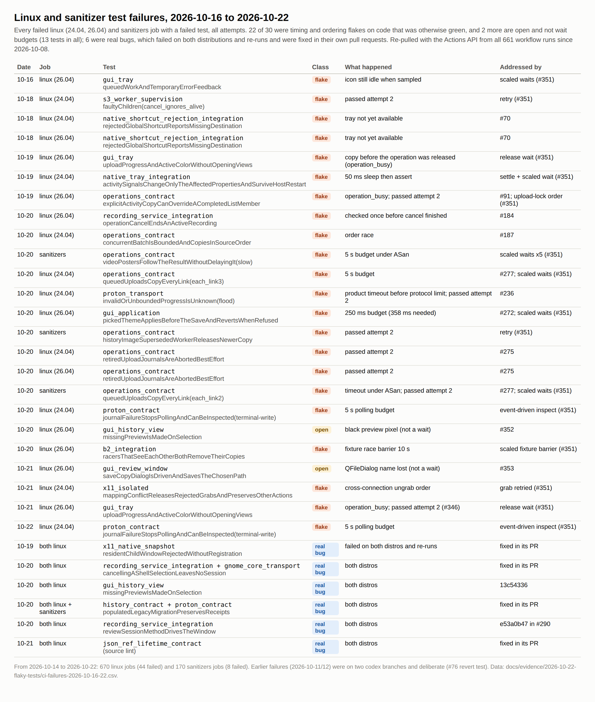
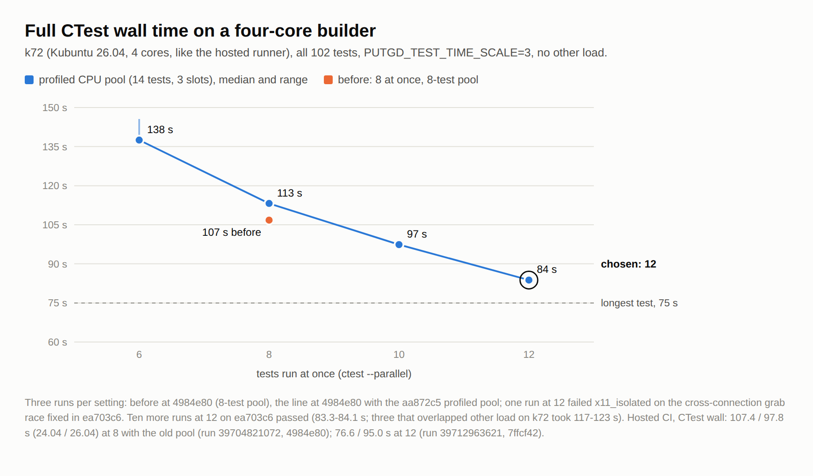

# CI coverage and runtime

Five workflows cover every event. Jobs that gate one another run in the same
workflow run and are linked with `needs:`. Nightlies can reuse completed source
checks for their exact commit; an absent or failed lookup runs the tests again.
No job waits for another workflow to finish.

put.gd is Linux-only: DEB, RPM, pacman and AppImage. Native Windows support was
dropped on 2026-10-31; CI no longer compiles or provisions Windows.

| Workflow | Runs on | Does |
| --- | --- | --- |
| `ci.yml` | every pull request, pushes to `nightly`, manual runs; called by nightly and release | contracts, Linux tests, clang ASan/UBSan core tests, packages, the AppImage's pipewiresrc on PipeWire 1.6; on `nightly` pushes, cache pruning |
| `package.yml` | called by `ci.yml` | five native packages, AppImage, their SBOMs and vulnerability scan, and with a tag the collected `release-assets` |
| `nightly.yml` | 10:23 UTC daily and manual | skip unchanged source, or tag, test, package and publish a nightly, then notify put.gd-site; re-scan the latest stable release's SBOMs |
| `release.yml` | pushes to `main` and manual | tag the stable merge commit, test, package and stage a draft |
| `renovate.yml` | 04:17 UTC Mondays and manual; pull requests that change it | open dependency-update pull requests against `nightly`; on pull requests, a read-only lookup ([dependency updates](#dependency-updates)) |

The single required status check is the `CI` job. It fails when any job the
change selected did not succeed. A cancelled or failed job is never a pass; a
job skipped because the change cannot affect it is.

## Job selection

`tools/ci/changes.py` classifies a pull request's changed paths. Pushes, the
schedule, manual runs and stable release callers select everything by default.
The nightly caller sets `reuse_source_ci: true`: `tools/ci/reuse_ci.py` looks for
a successful `ci.yml` push run on `nightly` at the exact commit. It requires
contracts, both Linux test jobs, sanitizers and `CI` to
have succeeded in that run's successful attempt. Only then are source builds
and sanitizers skipped. Contracts, tagged packages, AppImage checks, source
delivery and scans still run. Missing, cancelled, incomplete, unrelated or
unavailable evidence falls back to the full suite. The producer run, attempt,
commit and job IDs are saved in `source-ci-provenance` for 90 days.

| Changed paths | contracts | linux | packages |
| --- | --- | --- | --- |
| `docs/` (except below), `README.md`, `AGENTS.md`, `CLAUDE.md` | yes | no | no |
| Lab, MCP and maintenance Python; `tests/ci`, `tests/releases`, `tests/maintenance`; Python and YAML directly under `tests/desktop` and `tests/performance`; `.github/renovate.json`, `.github/dependabot.yml` | yes | no | no |
| Anything else, including `src/`, C++ tests, schemas and new directories | yes | yes | no |
| `packaging/`, `tools/releases/`, `tools/proton/`, `tools/ci/`, `cmake/`, `integrations/`, `.github/workflows/`, root CMake files, `LICENSE`, `THIRD_PARTY_NOTICES.md`, `.gitignore`, `docs/release/build.md`, `docs/user/proton-drive.md` | yes | yes | yes |

Unknown paths select the build by default. The last row lists every input to the
package builders and the curated source archive.

A pull request selects the union of its rows, so a documentation edit pushed to a
code pull request re-runs that pull request's whole build. Keep documentation in
its own pull request (see `AGENTS.md`): a documentation-only pull request runs
`contracts` alone, unless it touches `docs/release/build.md` or `docs/user/proton-drive.md`.

The **sanitizers** job is selected separately: by `src/core/`, `src/app/`, `src/ipc/`, the C++
sources under `tests/unit/`, `tests/integration/` and `tests/fixtures/`, and by
`cmake/`, `tools/ci/`, `CMakeLists.txt`, `CMakePresets.json` and `ci.yml`. UI,
platform, storage and packaging changes don't select it.

The **pipewire** job is selected by every packaging row above, by `src/record/` and
by `tests/desktop/pipewire/`. That directory's scripts are read by this job alone,
so a change to them doesn't select `linux`.
`tests/ci/test_changes.py` pins these rules.

## Jobs

**contracts** runs on a plain `ubuntu-24.04` runner in about a minute. It runs
every hosted Python suite once through `tools/ci/contracts.py`:

- `release`: `tests/ci`, `tests/releases` and the Python suites in `tests/unit`.
  `tests/ci/test_layers.py` fails on a cross-module include under `src/` that is
  neither an allowed edge nor a pinned exception, and on a stale entry or a cycle
  in that table (`tools/ci/check_layers.py`). `tests/ci/test_docs.py` fails on a
  broken documentation link or anchor, a document that neither its folder README
  nor its topic's entry page links, or a file under `docs/evidence` outside the
  two kept directories (`tools/ci/check_docs.py`).
- `proton`: the helper source and redistribution suites in `tools/proton`.
- `lab`: every `tests/desktop/test_*.py`, `tests/maintenance` and the UI-process
  benchmark contract. QEMU disk utilities are installed so overlay tests run.
- `observer`: the cold-family observer suite inside an owned, 45-second subtree.
- `evidence`: the saved historical live-S3 numeric replay, which is historical
  validation rather than a fresh cloud or desktop run.

Each group writes a JSON report and log to the `contracts` artifact. A failing
suite's output, with its failing cases and tracebacks, is also printed in the
job log. The job also runs `actionlint` 1.7.12, pinned by SHA-256, on every workflow.

**linux** builds the Debug `dev` preset with the bundled Proton helper on Ubuntu
24.04 (minimum distro Qt API) and Ubuntu 26.04 (LayerShellQt). It runs the full
registered CTest suite as an unprivileged user, with private temporary paths and
saved socket preflight, JUnit, test logs and build identity. Waits and test timeouts scale by 3
and a failed integration test is retried once and reported (see
[flaky tests](#flaky-tests)). Hosted Xvfb and
offscreen contracts do not establish compositor support or physical memory
acceptance. The Release-preset compile happens in the package builders, not here.

On the 26.04 leg (`-DPUTGD_UI_CATALOG_RENDER=ON`), the suite includes
one [UI catalog](../design/ui-catalog.md) test, `ui_catalog_render`, in the
`cpu` pool. On a pull request it runs only when a changed path can alter the
catalog (the `catalog` output of `tools/ci/changes.py`). Every other run renders it. The test renders the complete dark catalog and rejects renderer failures,
incomplete or restricted manifests, source reads, missing images and skipped
captures. It does not compare pixels or require reference-image updates.
When the catalog was rendered, the surface map and secret-control gate then check
`build/dev/ui-catalog/dark`, and CI uploads that directory, including `manifest.json`,
as the `ui-catalog` artifact with `if-no-files-found: error`. Nightly publishing
and desktop admission still consume that exact-build artifact. Review rendered
UI changes by inspecting it; automatic detection of visual differences has
been removed along with the light and 150% text catalog CTests.

**sanitizers** builds the `clang-asan` preset (the `asan` preset's
`-fsanitize=address,undefined`, compiled with clang) in an Ubuntu 26.04 container and
runs the core contracts and short unit tests the `clang-asan` test preset selects:
settings, operations, history, storage locations, payload, archive, upload naming,
recording model, storage, config reload, local IPC and the small parser and
platform-model tests. The test preset makes every UBSan report fatal; any ASan
report already is. Waits and test timeouts scale by 5 there, and the same
[retry policy](#flaky-tests) applies. The job is not in the required `CI` summary yet (issue
[#90](https://github.com/patrick-hudson/put.gd-desktop/issues/90)); add it there once
it has run green on `nightly` for a while.

Distro Qt is not instrumented, so ASan can't check loads made inside it. The bug
[#76](https://github.com/patrick-hudson/put.gd-desktop/pull/76) fixed kept a
`QJsonValueRef` to a destroyed temporary `QJsonObject`, and only exported QtCore
functions read through it. It passed both GCC and clang ASan against distro Qt; both
compilers do poison the temporary, but no instrumented code read it. The job
therefore builds QtCore itself with ASan (`tools/ci/provision-qt-asan.sh`: the
pinned qtbase archive matching the distro version, Core only, the distro's
absolute install paths so the distro plugins still load) and caches it. The
application still compiles against the distro headers; the tests run with
`LD_LIBRARY_PATH` pointing at the instrumented `libQt6Core.so.6`, and distro QtGui,
QtSql, QtTest and the plugins bind to it. When Ubuntu 26.04 moves to another Qt
release the recipe stops with a version mismatch and fails the job; update its
version and SHA-256 together. The cache key names the distro Qt version, the clang
version and the recipe's hash, so any of them changing rebuilds QtCore. The
instrumented QtCore is a CI-only test library: no package, AppImage or release build
uses it, and release builds stay on distro Qt. `json_ref_lifetime_contract` still
rejects the #76 pattern in source.

**packages** calls `package.yml`. It builds and audits the Ubuntu 24.04,
Ubuntu 26.04 and Debian 13 DEBs, the Fedora 44 and 45 RPMs, Arch pacman package and the AppImage. Outside pull requests to `nightly`, it also compiles the curated source
export on Ubuntu 24.04. `native.py` also audits the file-manager plugins
(`tools/releases/audit_file_manager_plugins.py`, #1105): `readelf -d` NEEDED
entries, `nm -D` symbol sources for Peony, the RPM's co-owned directories and
provides, and a load check per plugin (`putgd-<fm>-check`, QPluginLoader for
Peony); changes under `src/filemanager/` select the package jobs. Its `sbom` job writes a CycloneDX SBOM of every package and
scans them with Grype ([SBOMs and vulnerability scans](release.md#sboms-and-vulnerability-scans)).
With a release tag, `collect` verifies and assembles the
public asset set. See [releases](release.md).

The AppImage job excludes the hosted runner's Azure Ubuntu mirror before APT
installation (#500). It keeps the runner's official archive/security fallback
and signing settings, including legacy direct and folded deb822 source URIs.
Its standard build-dependency attempts have a 300-second deadline, a 120-second
silence limit and three attempts; the shared installer records failures and retry outcomes. It
adds no AppImage package snapshot to the shared 10 GB cache: it restores
`native (ubuntu24.04)`'s snapshot when one exists and never saves one. On a hit it downloads only
the packages missing from that snapshot or newer than it; on a miss it downloads them all. That container installs `zstd`, because
`actions/cache` treats gzip and zstd caches as different caches. The restored files land three
levels above the hosted workspace, not in `/var/cache`, because the cache stores the path
relative to the container's shallower workspace. Native dependency pins are unchanged. See the
[independent mirror and journal-retry evidence](https://github.com/patrick-hudson/put.gd-evidence/blob/874703b35562c732268c6fe0bc9b42614ffda928/records/2026-10-24-ci-mirror-journal/README.md)
for targeted checks and the outstanding hosted-run/stress gates.

**appimage-pipewire** in `package.yml` checks each new image as soon as its
build finishes, alongside the SBOM and corresponding-source jobs. It remains
a required part of the package workflow. The outer **pipewire** job runs only
for recorder/check changes that did not build packages, using a checksum-verified
published nightly. Both check the AppImage's bundled GStreamer `pipewiresrc` against a PipeWire
1.6 daemon (issue #144). The AppImage bundles Ubuntu 24.04's PipeWire 1.0.5 plugin,
while hosts run their own daemon, and PipeWire 1.5.81 and later refuse a link whose
buffer-count ranges don't overlap. That mismatch broke recording on Plasma 6.6 (#137)
and nothing in CI could see it, since the runners have PipeWire 1.0.5. The job runs
`tests/desktop/pipewire/ci_check.sh` in a pinned `ubuntu:26.04` container. It:

- compiles the branch's own `pipewireSourceDescription()` (`recorder_properties.cpp`)
  to get the properties the recorder sets, such as `min-buffers=1`;
- links the image's `pipewiresrc`, with those properties, to `run_buffers.sh`'s
  KWin-like (2-4 buffers) and Mutter-like sources on a private daemon with no
  session manager, devices or D-Bus, and requires frames at the sink;
- requires a control with `min-buffers=8` to be refused, so a daemon that doesn't
  enforce the rule can't pass silently.

It takes the AppImage from this run's `packages` job when that ran. Otherwise only
`src/record` or the check changed, so it downloads the latest nightly's AppImage and
checks it against that release's `SHA256SUMS`. It takes about two minutes, most of
it installing the container's packages. A branch that drops `min-buffers=1` fails
it with the #137 error, `error alloc buffers: Invalid argument (-22)`. The job is
part of the required `CI` summary when selected.

## Nightly runtime and artifact transfers

The 2026-10-26 baseline is in [the CI records](../history/ci-records.md#nightly-baseline-2026-10-26).

Package compiler caches are separate per distro/AppImage and dependency
fingerprint, capped at 256 MiB each (384 MiB on Arch, which also compiles the SDK
through ccache: Arch rolls, so an exact SDK prefix cache would rarely hit). Arch's key names only the distro, so a restore can cross a dependency update; ccache's own hashing of the compiler and headers keeps stale objects from being reused. The
source export compiled on Ubuntu 24.04 has its own compiler cache, saved even when a newer push cancels the compile. Only `nightly` pushes save them; other runs
restore them. Superseded entries are pruned by the existing cache maintenance.
No application build directory or version manifest is reused. AppImage's required
`appimage-sources` job caches exact Ubuntu source downloads and revalidates their
source identity and checksums. Its key is the SHA-256 of the image's Ubuntu source
packages and versions, read from the AppImage receipt, so editing a description or a
pin that selects no Ubuntu source doesn't change it. With no entry for that key it
restores the newest tree and downloads only what is missing. Each package version has
its own directory, checked against its `.dsc` on every restore: a copy that fails is
downloaded again, and versions the image no longer bundles are dropped before saving.
It runs alongside image checks and SBOM generation.
Its tarball uses gzip level 1; installers keep their existing compression.

Downstream package checks download installers and receipts only. Debug symbols
are separate per-build artifacts retained for 90 days. The source archive is
compiled on untagged package runs, avoiding another production compilation for
each tagged nightly. Already compressed package/source handoffs use artifact
compression level 0. Collection no longer runs cross-build DWARF deduplication
or makes a duplicate all-in-one release ZIP.

The main release carries installers and small support metadata. Sources and the
optional GNOME extension have a linked source release; the unchanged 2.5 GB of
Proton source parts stay at their permanent URLs. Publication checks GitHub's
SHA-256 asset digest, downloading bytes only when that digest is absent. It still
rejects missing assets, checksum mismatches, replaced tags and changed metadata.

These changes need a new hosted run to establish their actual elapsed-time
improvement. Cache warm-up, source changes and mirror availability affect it.
They do not replace stable-release desktop or memory acceptance.

## Dependency updates

Dependabot reads only manifests it knows. Most of put.gd's pins are versions in
JSON locks and CMake, each with a commit or SHA-256 beside it. Self-hosted
[Renovate](https://docs.renovatebot.com/) watches them (#420): `renovate.yml`
runs it weekly from `.github/renovate.json`, and opens update pull requests
against `nightly`. Nothing merges itself; each update goes through CI and the
usual acceptance like any other change.

| Pins | File | Source of new versions | Pull requests |
| --- | --- | --- | --- |
| Qt binaries for the AppImage and the five modules' licence sources | `packaging/appimage/tools.lock.json` | `qt/*` tags | one group; patch releases open at once, a new minor or major waits for approval |
| LayerShellQt, extra-cmake-modules | `packaging/appimage/tools.lock.json` | `KDE/*` tags | one group |
| QtKeychain (AppImage) | `packaging/appimage/tools.lock.json` | tags | one each |
| FFmpeg (AppImage recorder) | `packaging/appimage/tools.lock.json` | `n*` tags | patch releases at once; a new minor or major waits for approval (its sonames change) |
| Tesseract, Leptonica, ZXing-cpp (AppImage text engines) | `packaging/appimage/tools.lock.json` | tags | patch releases at once; a new minor or major waits for approval, as FFmpeg's do |
| English `tessdata_fast` (AppImage) | `packaging/appimage/tools.lock.json` | the repository's `main` branch digest | one each |
| linuxdeploy, its Qt plugin, appimagetool, the type2 runtime | `packaging/appimage/tools.lock.json` | GitHub releases | one group |
| Syft, Grype | `packaging/sbom/tools.lock.json` | GitHub releases | one group |
| AWS SDK for C++ | `cmake/dependency-lock.json`, `cmake/Dependencies.cmake` | tags | one group |
| Proton helper: npm packages, Bun, the SDK | `tools/proton/package.json` and its lock, `tools/proton/runtime-lock.json` | npm | one group, and only after approval |
| MCP helper | `tools/mcp/pyproject.toml` | PyPI | one group |

ICU is the build that ships inside Qt's binaries, so it moves with Qt and is not
watched by itself. The unsupported sandbox manifest was a research spike and is not watched.

**Versions only, then a refresh.** Renovate changes the version fields. Its
post-upgrade task, `tools/maintenance/refresh_pins.py`, then re-derives
everything that goes with them: each tool's download URL and SHA-256 (checked
against upstream's checksum file where one is published), each source pin's tag
commit, and the AWS SDK's commit with all fifteen CRT submodule pins, read from
tree-only fetches. It never runs what it downloads. That leaves one manual step:
the digest of the `zsyncmake` inside appimagetool, which the appimagetool pull
request's body explains; until it is updated the AppImage job fails with
"Bundled zsyncmake digest mismatch". Run the script by hand after editing a
version yourself: `python3 tools/maintenance/refresh_pins.py`. The AppImage job
reads its Qt version from the lock, so a Qt update needs no workflow change.

**Approval.** Updates that need a decision wait on the dependency dashboard, the
issue titled "Dependency updates (Renovate)": Qt and FFmpeg minor and major
releases, and every Proton helper update. A Proton helper update also needs its
notices and corresponding-source catalog rebuilt (docs/user/proton-drive.md), which
Renovate cannot do. Tick an update on the dashboard and the next run opens it. At
most five update pull requests are open at once.

**Token.** The job uses the workflow's own `GITHUB_TOKEN` with
`contents: write`, `pull-requests: write` and `issues: write`; there is no
personal access token or app. That has three costs:

- The repository must allow it: Settings, Actions, General, "Allow GitHub
  Actions to create and approve pull requests". The `nightly` ruleset requires no
  approving review, so the approval half grants nothing extra.
- Pull requests opened with the workflow token don't start workflows by
  themselves. A maintainer approves each one's workflows ("Approve and run
  workflows" on the pull request) and CI then runs as usual.
- The token cannot change `.github/workflows`, so Renovate leaves the workflows
  alone (`enabledManagers` leaves out `github-actions`). Dependabot keeps their
  action SHAs current instead (below). The container digests, actionlint and
  the Renovate image inside the workflows are not actions, so neither bot
  updates them; they stay manual
  ([#507](https://github.com/patrick-hudson/put.gd-desktop/issues/507)).

Patrick chose this setup on 2026-10-23: the workflow token for Renovate, and
Dependabot for the workflow pins.

**Workflow actions.** `.github/dependabot.yml` has Dependabot update the
`uses: owner/action@<sha> # vX` pins in `.github/workflows` weekly (Mondays
04:47 UTC), against `nightly`, in one grouped pull request labelled
`dependencies` and `area: ci`. Dependabot's pull requests start CI on their own, with a
read-only token; the flaky-test tracker then logs a warning instead of
updating its issues.

**Checking a change to this setup.** A pull request that changes
`.github/renovate.json`, `renovate.yml` or the two maintenance scripts runs the
`lookup` job instead: `renovate-config-validator --strict`, then Renovate's
local platform in `lookup` mode over the pull request's own checkout, read-only
(`contents: read`). Its job summary lists every detected dependency, its current
version and the update Renovate would propose; the full JSON log is the
`renovate-lookup` artifact. `tests/ci/test_renovate_config.py` checks that every
regex manager still matches each pin it manages.

**Running it by hand.** `gh workflow run renovate.yml -f dry-run=full` logs the
branches and pull requests Renovate would create without creating them; with no
input it runs for real. Each run's summary has the same dependency table and
its log is an artifact. The Renovate image is pinned by version and digest in
`renovate.yml`.

## Notifying put.gd-site

The download site ([patrick-hudson/put.gd-site](https://github.com/patrick-hudson/put.gd-site))
builds its links from this repository's releases. Its deploy workflow
(`.github/workflows/deploy.yml` there) runs every six hours, and also on a
`repository_dispatch` of type `release-published`, when it regenerates
`releases.json` within about a minute.

`nightly.yml`'s `publish` job sends that event after `publish.py --nightly` has
published the prerelease. The `Notify put.gd-site` step posts
`repos/patrick-hudson/put.gd-site/dispatches` with the payload `tag` (the nightly
tag) and `prerelease: true`.

- The workflow token cannot dispatch to another repository, so the step uses the
  `SITE_DISPATCH_TOKEN` repository secret: a fine-grained personal access token
  for `patrick-hudson/put.gd-site` only, with Contents: read and write. Store it
  under Settings, Secrets and variables, Actions.
- Without the secret, the step logs that it isn't notifying the site and exits 0.
- A failed dispatch is a warning, not a failure. The release is already public,
  and rerunning `publish` would stop at the already-published check. The site
  catches up on its schedule, or when its deploy workflow is run by hand:
  `gh workflow run deploy.yml -R patrick-hudson/put.gd-site`.

`release.yml` only stages drafts and sends nothing. A stable draft
is published by hand with `publish.py --publish`, which sends the same event with
the operator's own `gh` login (see [releases](release.md#stable)).
`tests/ci/test_release_channels.py` pins the nightly step and forbids every other
`/dispatches` call in the workflows: workflows never start one another.

### Sanitizers job runtime

Caches: the instrumented QtCore is 29 MiB compressed, the SDK prefix 4 MiB and the
compiler cache 97 MiB. The QtCore key is
`qt-asan-core-26.04-qt<distro Qt package version>-clang<version>-<recipe hash>`, so a
new distro Qt or clang package, or an edit to the recipe, rebuilds it once (about
7:35). Runner image updates don't change it, since the job runs in its own
container.

Measured run times from 2026-10-19 are in [the CI records](../history/ci-records.md#sanitizers-job-runtime-2026-10-19).

## Speed measures

- **SDK prefix caches.** Each builder restores an exact installed SDK prefix.
  Keys hash the dependency lock, the SDK recipes (`tools/ci/sdk-source.sh`,
  `tools/releases/provision-sdk.sh`, the job's own provisioning script), the
  cache implementation, compiler output, installed distro packages, runner
  image, architecture and workspace path. Workflow edits do not invalidate them.
  No partial restore key or cross-OS archive is used. Installed files, modes and
  symlinks are checked against the sealed inventory before compilation; a
  mismatch fails the job. Fork pull requests restore but never save.
- **No SDK checkout on Linux test cache hits.** The Linux test prefix also
  carries the SDK `LICENSE` files that packaging configuration reads, so a hit
  needs no clone. Package builders still clone and verify the pinned SDK source
  and all submodules every run, because packages ship those licenses and the
  source export rebuilds against that tree. The clone is sparse: only S3 is built
  and no client is regenerated, so the other generated service clients (165,000
  files) and the code generator's API models (333 MB) are left out.
  `tools/verify_dependencies.py` still checks the commit, every submodule pin and
  tracked modifications.
- **ccache for the Linux test and sanitizer builds.** Compiler outputs are cached
  per job. Only pushes to `nightly` save one, trimmed to the entries that build
  used; every other run restores the newest `nightly` cache and does not save.
  See [cache budget](#cache-budget). The build-identity source changes every
  commit and is always recompiled. Package builders use their own caches ([below](#nightly-runtime-and-artifact-transfers)); on a cache hit ccache still hashes each source and header, so a source or header that the compile needs but the source export lacks fails the build. Files the compile doesn't read, such as the SDK provisioning script, aren't exercised by this check.
- **No second compile on pull requests to `nightly`.** They check the source export instead of compiling it: `check_source_build.py --inputs-of` configures the extracted export, dry-runs Ninja and compares the package build's recorded inputs with the archive, in about 15 seconds. Pushes to `nightly`, pull requests to `main` and stable tags still compile it, and only that compile writes the receipt a stable release requires.
- **Parallel builds.** Application and SDK builds use every runner CPU.
- **Parallel tests, longest first.** CTest runs twelve tests at once and restores
  the previous run's durations, so the longest tests start first. See
  [hosted CTest schedule](#hosted-ctest-schedule).
- **One contracts job.** Python suites that previously ran in eight jobs run once.

Cache hits are dependency reuse, never application acceptance evidence.
Application binaries, build identities, test results, credentials and VM runs
are outside every cache.

## Cache budget

The repository's Actions cache limit is 10 GB; past it, GitHub evicts the least
recently used entries, which can be a warm QtCore or SDK prefix. On 2026-10-19 the
cache held 9.78 GB in 101 entries and passed the limit (10.62 GB) when #107's
`nightly` push saved. 9.0 GB of it was 22 `ccache-linux-*` entries of 350 to 435 MB:
every `nightly` push, including runs cancelled by the next push, saved a new
`ccache-linux-<distro>-<run>-<attempt>` entry, although a prefix restore only ever
reads the newest one on a ref. Three rules keep the total bounded:

- **One saver per compiler cache.** Only a push to `nightly` saves ccache; pull
  requests, manual runs and the nightly and release callers restore the newest
  `nightly` entry. A cancelled run doesn't save.
- **Trimmed and capped.** The build step records its start time, and afterwards
  `ccache --evict-older-than` drops every entry the build neither hit nor stored,
  so the saved cache is one build's working set, not every object since the first
  save. A ccache hit refreshes the entry's time, so the working set survives.
  `CCACHE_MAXSIZE` caps each job in case the working set grows.
- **Pruning after every `nightly` push.** The `prune caches` job in `ci.yml` runs
  `tools/ci/cache_prune.py` after the Linux and sanitizer jobs, with the run's
  `GITHUB_TOKEN` (`actions: write`, `pull-requests: read`; the nightly and release
  callers grant them, and the job runs only on `nightly` pushes). It deletes, by id:
  every entry of a rolling family (`ccache-*` and `ctest-cost-*` by
  `<run>-<attempt>` suffix, `qt-asan-core-<distro>-`, `putgd-pkgs-v1-*` by ISO
  week, `grype-db-v6-*` by database, and `appimage-distro-sources-v1-*` whatever
  its package hash) older than the newest on the
  same ref, and every cache of a closed pull request or deleted branch. On `main`,
  `nightly` and `v*` tags it deletes only those superseded entries. Merging a
  pull request pushes to `nightly`, so its caches go with the next run. Exact-key
  caches (SDK prefixes, the Qt installer's) are left to GitHub's seven-day idle
  eviction. `--dry-run` lists the deletions without making them. The job is not
  in the required `CI` summary.

Historical budget per job, measured 2026-10-19 (before non-Linux CI was removed;
compressed archive sizes; the ceiling is
`CCACHE_MAXSIZE`, which bounds what a working set can grow to):

| Cache | Saved by | Entries kept | Size | Ceiling |
| --- | --- | ---: | ---: | ---: |
| `ccache-linux-24.04-*` | `nightly` push | 1 | 405 MB | 1 GB |
| `ccache-linux-26.04-*` | `nightly` push | 1 | 435 MB | 1 GB |
| `ccache-clang-asan-26.04-*` | `nightly` push | 1 | 102 MB | 400 MB |
| `qt-asan-core-26.04-*` | first miss on a ref | 1 per ref | 31 MB | recipe-bound |
| `install-qt-action-*` (AppImage and retired platform jobs) | first miss | 1 each | 650 MB | Qt version |
| `putgd-sdk-v1-*` (9 environments) | first miss on a ref | 1 per environment | about 60 MB | dependency lock |
| `ctest-cost-linux-*` | every non-fork run | 1 per ref | under 2 kB | |
| `grype-db-v6-<sha256>` ([vulnerability database](release.md#sboms-and-vulnerability-scans)) | first `sbom` job to see a new database, per ref | 1 per ref | about 195 MB | one database |
| `putgd-pkgs-v1-*` ([package snapshots](#package-installs)) | first run of an ISO week, or new dependency scripts, per ref | 1 per package target | 408-544 MB (Fedora 544, Ubuntu 24.04 408, Ubuntu 26.04 422, Debian 13 421 on 2026-10-22) | dependency lists |

The four package snapshots add 1.8 GB on `nightly` to the steady state below. A new week's
snapshot supersedes the previous week's at the next prune, and a pull request
that changes the dependency scripts saves its own four until it closes.

Steady state after a `nightly` push is about 1.7 GB (the ccache sizes above
still include objects from earlier commits, so the trimmed caches will be
somewhat smaller). Between a push's saves and its prune job, three superseded
ccache entries add about 0.94 GB. With every ccache at its ceiling the steady
state would be 3.1 GB and the peak 5.5 GB. Open pull requests add only small
SDK, QtCore and CTest entries until they close. Hit rates don't change: runs
already restored only the newest `nightly` entry, and that is the one kept.

## Reproduce and investigate

Use normal presets. To reproduce the hosted test schedule locally, select a new
short private TMPDIR, configure with `-DPUTGD_TEST_TIMEOUT_SCALE=3`, then run
`tools/ci/ctest_preflight.py` and, with `PUTGD_TEST_TIME_SCALE=3`,
`python3 tools/ci/ctest_retry.py --ledger LEDGER --junit PATH -- --preset dev
--parallel 12 --resource-spec-file "$PWD/tools/ci/ctest-resources.json"`.
Pull requests add `--label-exclude ^nightly$`, which leaves out
`gui_theme_contrast`; pushes run it.
Plain `ctest` works too, without the retry and ledger. Retain the exact command,
registered tests, environment/version identity, JUnit and LastTest.log for each
attempt. Preserve failures before retrying; never fix a long path by weakening
socket checks or silently excluding a test.

Run any contract group with `python3 tools/ci/contracts.py GROUP`; the reports
land in `build/contracts`. Download the per-job artifacts for hosted failures,
and compare full commit/build identity and test names first. A workflow
scheduling or cache change requires hosted validation of both Linux
distributions and selected package jobs before it is reported green.

## Tests retained after the audit

No invalid or redundant test was established in the audit. Long waits protect
real contracts: worker ownership beyond its old 30-second idle expiry, the
15-second client/CLI deadline, incomplete IPC frame disconnection, allocator
cleanup admission, cancellation and subprocess reaping. CLI, client, provider
and SDK-worker checks cover different failure boundaries. The historical KDE
CTest evidence totaled 363.86s; 27 sub-second tests contributed only 6.52s,
while 14 tests over ten seconds contributed 271.86s.

The collision-policy fixture waits for a terminal operation with an explicit
15-second budget (scaled like every wait since #351). Its former five-second polling helper silently returned a
`running` operation: the controlled 32-HEAD exhaustion row completed at 5,056 ms
on the local release work run. The no-PUT, exact 32-HEAD, no-copy and final
`collision_exhausted` assertions remain unchanged; this is a test synchronization
bound, not a relaxed production timeout or memory benchmark.

## Hosted CTest schedule

Issue [#62](https://github.com/patrick-hudson/put.gd-desktop/issues/62) cut
hosted Linux CTest from about five minutes to about 80 seconds on each
distro. No test was removed, split or weakened, and every timing assertion above
is unchanged; two tests gained missing synchronization waits (below). Socket
preflight, the `putgd-ci` user and JUnit retention are as before.

- **Durations.** Each distro restores the newest
  `Testing/Temporary/CTestCostData.txt` before CTest and saves it afterwards,
  failed runs included. CTest then starts earlier failures first and the rest
  longest first. Same-repository pull requests save entries too and restore
  their own newest one before the newest `nightly` one. A new test has no
  duration until it has run once.
- **Slots.** CTest runs twelve tests at once on the four-vCPU runner (eight
  until #351; see [parallelism](#parallelism)). Most of the suite is waiting:
  `tools/ci/ctest_cpu_profile.py`, one test at a time on k72, measured 261 CPU
  seconds in 822 summed seconds for 102 tests; `gui_tray` used 3 s of CPU in a
  48 s run.
- **CPU pool.** CPU is the one resource every test shares. With eight slots and
  no limit, the CPU-bound medium tests ran together once the long idle ones
  finished: on 24.04 `s3_delete_integration` took 22 s instead of 8 s and
  `collision_policy_integration` 18 s instead of 9 s, closer to the explicit
  15-second collision bound. Every test that keeps at least half a core busy
  for two seconds or more in that profile declares `RESOURCE_GROUPS`, one `cpu`
  slot per core it uses, in `cmake/TestPolicy.cmake`: 13 tests with one slot
  and `export_av_sync_contract` (1.7 cores) with two. `tools/ci/ctest-resources.json`
  gives the runner three `cpu` slots, so at most three cores' worth of them run
  at once while idle tests use the other slots. Without a resource spec, as in
  a plain local `ctest`, the property has no effect.
- **Shared resources.** The audit found one: Xvfb display numbers. Concurrent
  `xvfb-run -a` calls that start from the same display race for the X server's
  per-display lock, and the loser sleeps two seconds per attempt;
  `x11_native_snapshot` once spent 6.25 s starting Xvfb for a 4 ms test. Each
  Xvfb test now starts its search at its own display (`putgd_xvfb_display`, 200
  upwards) and `-a` still moves past displays that other processes hold.
  Nothing else is shared between tests: buses come from `dbus-run-session`;
  sockets, configuration, data and lock files live in per-test temporary
  directories or `XDG_*` overrides; S3 fixtures bind port 0; process scans match
  only the test's own children; Proton account locks use per-test references;
  `version_contract` builds under its own `Testing/version-contract-*` root. No
  `RESOURCE_LOCK` is needed. A new test that uses a fixed path, port, display or
  bus name must declare one; a new CPU-bound test should join the `cpu` group.
- **Races the schedule exposed.** `native_shortcut_rejection_integration`
  pressed Ctrl+1 as soon as the synthetic watcher received
  `RegisterStatusNotifierItem`. The resident marks its tray available only after
  that call's reply and a follow-up `IsStatusNotifierHostRegistered` query, and
  it drops failure notifications while the tray is unavailable; the 2 s
  duplicate-feedback guard then hides a retry. When the resident's D-Bus replies
  lagged behind the X key event, no notification ever arrived. It failed once at
  twelve slots and once at eight. The test now also waits for the resident's own
  `trayAvailable` diagnostic, as `native_background_startup_integration`
  already does. Pinned to four local cores beside eight busy loops, the old test
  failed 15 of 80 runs and the new one 0 of 120. In `gui_history_view`,
  `uploadProgressRendersBeforeCompletionDuringDelayedRecentReplies` checked the
  "Reading the clipboard" subtitle once, right after the row turned active; the
  `acquiring` state can reach the model one update later. The check was made to
  retry like its neighbours, with the acquisition held open so no later state
  could satisfy it. Under the same load it failed 21 of 40 runs before and 0 of 80
  after. It failed once in local suite runs and never on hosted runners. The test
  was removed in #1421.
- **Floor.** `native_background_startup_integration` takes about 70 s: nine data
  rows in one process, each waiting for a product startup bound. It starts first
  and bounds the wall time.

Hosted run wall times, and what grew since the 57-test baseline, are in [the CI records](../history/ci-records.md#hosted-ctest-wall-times).

## Flaky tests

From 2026-10-14 to 2026-10-22, 52 of 840 Linux and sanitizer test jobs failed.
From 2026-10-16, 22 failures were timing and ordering flakes on code that was
otherwise green (the same commit passed on a re-run or on the other
distribution), 2 more are open and are not wait problems (#352, #353), and 6
were real bugs that failed everywhere and were fixed in their own pull
requests. Thirteen tests flaked. Each earlier fix (#184, #187, #272, #275,
#277) patched one test. Most shared one cause:

- Tests waited with fixed budgets: 1770 `QTRY_*` and `qWait` uses, every
  `QTRY_*` defaulting to 5 s, and 246 bare `qWait` calls, most of them a
  sleep followed by an assertion.
- The hosted runner has four vCPUs and runs eight tests at once, with SQLite,
  worker threads, child processes and Xvfb. Under that load, a step that takes
  0.2 s alone sometimes takes more than 5 s.



The rest were tests that assumed which of two operations would take an upload
first, a sleep standing in for a wait, and an X request read before another
connection's ungrab reached the server. The fix has four parts, introduced by
#351.

### Scaled waits

Every wait in a C++ test goes through `tests/fixtures/Waits.h`
(namespace `putgd::test`):

| Use | For |
| --- | --- |
| `PUTGD_TRY_VERIFY(expr)`, `PUTGD_TRY_COMPARE(a, b)` (and `_WITH_TIMEOUT`, `PUTGD_TRY_VERIFY2`) | wait until it holds, then assert it |
| `PUTGD_VERIFY_STEADY(expr, ms)`, `PUTGD_COMPARE_STEADY(a, b, ms)` | it holds, and still holds `ms` later ("arrives once, nothing follows") |
| `waitFor(predicate, ms)`, `waitForSignal(spy, count, ms)`, `waitForWindowExposed(w)`, `waitForWindowActive(w)` | helpers, callbacks and windows |
| `settle(ms)` | fixed, unscaled time: to let a product timer run, or before a check that nothing happened |

A budget scales with `PUTGD_TEST_TIME_SCALE`: 1 when unset (local runs), 3 in
the `linux` job and 5 in `sanitizers` (instrumented code runs about three
times slower). A passing wait returns as soon as its condition holds, so a
larger budget doesn't slow a passing test; it only bounds how long a test
waits for something that will happen. Product timing contracts are not
budgets and never scale. The B2 and S3 fixture servers scale their own
barriers the same way.

`tools/ci/check_test_waits.py` (run by `tests/ci/test_flake_tools.py` in the
`contracts` job) rejects `QTest::qWait`, `qWaitFor`, `QTRY_*`,
`QSignalSpy::wait`, `qWaitForWindowExposed/Active`, and a `settle()` followed
directly by a plain `QVERIFY`/`QCOMPARE` (a sleep standing in for a wait).
Exceptions go in `tools/ci/test-waits-allowlist.json` with a reason and an
exact count per file; today only the manual theme-switch benchmark is listed.

Prefer a wait on the real completion signal or callback over polling where
the code exposes one. For example, `proton_contract` now waits for each
`inspectSharing` reply before asking again, instead of queueing a new request
every few milliseconds, and the tray tests wait for the operation's release
before copying its result (copying earlier is refused with `operation_busy`).

The migration turned each `qWait(N); QCOMPARE(...)` into
`settle(N); PUTGD_TRY_COMPARE(...)`: the N ms still elapse, so a check that
nothing more arrives keeps its window, and a late arrival passes within the
budget. Assertions with side effects stayed plain. `waitFor` polls like
`QTRY_*` (every 50 ms, running the event loop in between) and ends only when
both the scaled budget and its steps have run out, so it is never stricter
than the loop it replaced. About 50 other `settle()` calls are fixed time on
purpose; [#354](https://github.com/patrick-hudson/put.gd-desktop/issues/354)
tracks replacing those that still stand in for a completion.

### Labels and one reported retry

`cmake/TestPolicy.cmake` labels every test. A `unit` test runs synchronously in
its own process (no event loop waits, threads, child processes, sockets, buses
or displays), so its failure is deterministic. Every other test is
`integration`, including new tests until someone lists them as `unit`. The
label follows the behaviour, not the name: `operations_contract` and
`proton_contract` are integration tests.

`tools/ci/ctest_retry.py` runs CTest once, then reruns the failed integration
tests once with the same arguments:

- every test passed: the job passes;
- every failure was an integration test that passed its retry: the job passes,
  with a workflow warning per test;
- a unit test failed, an integration test failed twice, or CTest failed
  without a failed test to show: the job fails.

Nothing passes silently. `tools/ci/flake_ledger.py` writes every test that
failed, retried or not, to the job summary, and records each pass on a retry
in that test's [`flaky-test`](https://github.com/patrick-hudson/put.gd-desktop/issues?q=label%3Aflaky-test)
issue: one issue per test, titled `Flaky test: NAME`, with a comment per
occurrence (run link, job, commit, first failure lines). A recurrence reopens
a closed issue. The `linux` and `sanitizers` jobs need `issues: write`, so
`nightly.yml` and `release.yml` grant it to their `ci` call. Fork pull
requests get a read-only token; their flaky tests still appear in the job
summary, with a warning that the tracker wasn't updated.

The ledger (`flake-ledger.json`) and the retry's JUnit
(`ctest-results-retry.xml`) are kept in the `ctest-linux-*` and
`ctest-clang-asan` artifacts. Nightly publication is unchanged: `publish` still
needs the whole `ci.yml` call to succeed, so a test that fails twice blocks it
and a test that passed its retry doesn't. Test `TIMEOUT`s are hang guards and
scale like the waits: `-DPUTGD_TEST_TIMEOUT_SCALE` (3 on `linux`, 5 on
`sanitizers`) multiplies every explicit one at configure time.

### Builder stress lane

`tools/ci/stress_suite.py` runs CTest repeatedly on a builder under CPU
contention and writes a ledger in the same format, with per-test run and
failure counts:

```bash
python3 tools/ci/stress_suite.py --source ~/work/put.gd-x --out ~/work/flake-stress/RUN \
    --iterations 20 --hogs 4 --hog-cpus 0-1 --test-cpus 0-1 --time-scale 3 \
    -- --preset dev -L integration --parallel 12 \
    --resource-spec-file "$HOME/work/put.gd-x/tools/ci/ctest-resources.json"
```

`--hogs` starts busy loops (pinned with `--hog-cpus`), `--test-cpus` pins CTest
and every test to a CPU subset, and `--time-scale` sets `PUTGD_TEST_TIME_SCALE`.
It uses a private short `TMPDIR` and `XDG_STATE_HOME`, stops only the
processes it started, by PID, and removes only its own temporary directory.
Run it on a builder, one suite per host at a time, after checking
`tools/lab/desktop_lock.py status` for a quiet-slot lock.

Results, `tools/ci/stress_suite.py` on the builders, 2026-10-22. The known set
is the twelve tests that flaked in CI. Pinning (`--test-cpus`, `--hog-cpus`)
is what reproduces a starved runner: with six unpinned busy loops the nightly
passed 8 of 8 runs.

The per-host results, their picture and the four races the lane found are in [the CI records](../history/ci-records.md#builder-stress-lane-results-2026-10-22).

### Weekly run on k72

Since 2026-10-21 the lane runs every week on k72 (Kubuntu 26.04, four cores
like the hosted runner), so a new flaky test shows up before it turns CI red
([#360](https://github.com/patrick-hudson/put.gd-desktop/issues/360), approved
by Patrick). `tools/ci/stress_weekly.py` runs as the systemd user service
`putgd-stress-weekly.service`, which `putgd-stress-weekly.timer` starts on
Sundays at 03:00 local time. `Persistent=false` means a missed week isn't caught
up. Each run does this:

1. **It checks first and skips the week** with the reason logged when:
   - the k72 desktop lock (`tools/lab/desktop_lock.py`) is held for quiet, A/V
     or performance work (its purpose names quiet, recording, A/V, audio,
     video, perf, latency, benchmark, memory, timing or profiling);
   - another weekly run holds `~/.local/state/putgd-stress/weekly.lock`;
   - a `ctest` or `stress_suite.py` process (any owner, matched by its exact
     name) is still running, or the load is still above the CPU count, after
     an hour of waiting. It never stops those processes.

   It repeats these checks after the build, before the tests start.
2. **It fetches `origin/nightly`** into its own tree, `~/work/put.gd-stress`,
   with `build/sdk` and `build/dependencies` linked to `~/work/put.gd/build/`.
   It configures with `-DPUTGD_TEST_TIMEOUT_SCALE=3` and builds at
   `nice -n 10 -j3`. It removes the previous `build/dev` first only when the
   disk lacks the reserve from [lab-storage.md](../lab/lab-storage.md): 10 GiB plus
   the build.
3. **It runs the tests:** `stress_suite.py --iterations 10 --hogs 4
   --time-scale 3 -- --preset dev -L integration --parallel 12
   --resource-spec-file tools/ci/ctest-resources.json`.
4. **It writes the results** to `~/work/flake-stress/weekly-DATE/` on k72:
   `ledger.json`, `summary.md`, each iteration's JUnit and log, `build.log`,
   `weekly.log` and `weekly.json` (status, commit, timings and the tracker
   outcome). It keeps eight weeks of these directories and deletes only older
   ones that it created itself.
5. **It reports to the tracker:** `flake_ledger.py issues` adds a comment to
   the `flaky-test` issue of every test that failed a run, opening or
   reopening the issue as CI does. The comment gives the failure count, the
   commit and the first failure line. This uses a fine-grained token at
   `~/.config/putgd-stress/github-token` (see
   [remote-builders.md](../lab/remote-builders.md#weekly-stress-lane-on-k72)).
   Without the token, the run logs why and keeps its local results.

To see a week's result, read `summary.md` in the newest `weekly-*` directory,
or run `journalctl --user -u putgd-stress-weekly` on k72. A test that fails
only in this lane runs under more contention than the hosted runner. Treat it
like a CI flake: find the wait that assumes a fast machine.

The first hand-started runs are in [the CI records](../history/ci-records.md#first-weekly-runs-on-k72-2026-10-21).

### Parallelism

`tools/ci/ctest_cpu_profile.py` runs each test alone and reports its wall and
CPU time; `cmake/TestPolicy.cmake`'s CPU pool comes from its k72 profile
([`records/2026-10-22-flaky-tests/k72-cpu-profile.json`](https://github.com/patrick-hudson/put.gd-evidence/blob/874703b35562c732268c6fe0bc9b42614ffda928/records/2026-10-22-flaky-tests/k72-cpu-profile.json)). With that pool,
the full suite on k72 (four cores, like the runner) took:



| `--parallel` | CPU pool | k72 wall (median of 3) | Failures |
| ---: | --- | ---: | --- |
| 8 | before: 8 tests | 106.8 s | none |
| 6 | profiled, 14 tests | 137.5 s | none |
| 8 | profiled | 113.2 s | none |
| 10 | profiled | 97.4 s | none |
| 12 | profiled | 83.8 s | one `x11_isolated` grab race, fixed in #351; then 10 of 10 runs passed, 83.3-84.1 s |

The longest test takes about 75 s, so twelve at once is close to the floor.
The load average was 4-5 on four cores. On the hosted runners the CTest step
went from 107.4 s (24.04) and 97.8 s (26.04) at eight
([run 39704821072](https://github.com/patrick-hudson/put.gd-desktop/actions/runs/39704821072))
to 76.6 s and 95.0 s at twelve
([run 39712963621](https://github.com/patrick-hudson/put.gd-desktop/actions/runs/39712963621)).
A retry costs only the failed tests' own time. The repository is public, so
hosted minutes are free; the change saves about 15-30 s per Linux job.

## Package installs

Package jobs install through `tools/ci/install-packages.sh` (dnf or apt-get).
`tools/releases/install-native-deps.sh` calls it, so do the AppImage, weston
and dwz steps. It works in three layers:

- **Bounded attempts.** Up to 4 online attempts (`PUTGD_PKG_ATTEMPTS`), waiting
  30, 60 and 120 s between them (`PUTGD_PKG_BACKOFF`). Every retry downloads
  fresh metadata: `dnf --refresh`, or `apt-get update --error-on=any`, which
  fails on any index it couldn't fetch instead of installing from stale lists.
  dnf retries each download 10 times across mirrors (`retries=10`) and apt 3
  times. If a package name doesn't exist, the install fails at once with no
  retry.
- **Stopped attempts.** An attempt that runs longer than `PUTGD_PKG_TIMEOUT`
  (900 s) or prints nothing for `PUTGD_PKG_STALL` seconds (600 s) is stopped
  (`timeout --kill-after=30s`, process group included) and counts as a failed
  attempt, so the back-off and the snapshot apply. A stopped apt attempt is
  followed by `dpkg --configure -a` before the retry. Downloaded packages stay
  in the cache, so the retry resumes them. Inside an attempt, apt drops a
  connection that moves nothing for 60 s (`Acquire::http(s)::Timeout=60`) and
  dnf one under 1 kB/s for 60 s (`timeout=60`, `minrate=1000`); both retry the
  download themselves. See [Stalled installs](#stalled-installs).
- **Package snapshot.** The native package jobs restore
  `/var/cache/putgd-packages` from `actions/cache`, under the key
  `putgd-pkgs-v1-<target>-<hash of both scripts>-<ISO week>`. It holds the
  package metadata and exactly the packages of the last successful install.
  Online attempts start from a copy of it, so packages already in it aren't
  downloaded again. After an online success, the copy, pruned to the installed
  packages, replaces it. The cache is saved on that week's first run and when
  the dependency scripts change, never after a fallback. If all online attempts
  fail, the install runs once more offline from the snapshot
  (`dnf --cacheonly`, `apt-get --no-download`). That builds against a package
  set at most a week old instead of failing the job. A dependency list that
  changed since the snapshot can't be satisfied offline, and the step fails.
- **Reporting.** Each failed or stopped attempt, a retry that passed and a
  snapshot install are warning annotations and rows of a "Package install
  retries" table in the job summary. A stopped attempt's row says
  `**stopped**`, which limit stopped it and the last line it printed. A clean
  install writes nothing. The pre-checkout bootstrap (git only) retries 3 times
  inline, each attempt limited to 10 minutes, and reports in a table of the same form.

The 2026-10-22 mirror incident behind this design and its demonstration are in [the CI records](../history/ci-records.md#fedora-mirror-incident-and-retry-demonstration-368).

Not covered yet: the `linux` and `sanitizers` installs in `ci.yml` run before
checkout with bare `apt-get`. They have the acquire timeouts and a 20-minute
step limit, but no retry or snapshot
([#389](https://github.com/patrick-hudson/put.gd-desktop/issues/389)). The
`contracts` install uses the helper. `npm ci` in the Proton helper step runs
with `npm_config_fetch_retries=5`. Its separate exit-152 failure
([#332](https://github.com/patrick-hudson/put.gd-desktop/issues/332)) is a
CPU-time kill, not a network error.

### Stalled installs

Before [#467](https://github.com/patrick-hudson/put.gd-desktop/issues/467), an
attempt that never returned was never retried. Nightly run 39851369595
(2026-10-22) hung for 93 minutes in `packages / appimage` after
`Get:5 https://archive.ubuntu.com/ubuntu noble-security InRelease [126 kB]`
until it was cancelled. apt's own 120 s timeout never fired. Every install
attempt now runs under the two limits above.

The limits come from the 60 green runs before the change. A normal install
attempt takes 1–4 minutes. On 2026-10-22 and 2026-10-23, though, the hosted
runner's Azure mirror served 40–55 kB/s, and five green AppImage installs took
26 to 113 minutes. The longest silence in them was 8.2 minutes, a 27 MB
package, so the stall limit is 10 minutes. The AppImage install has no
snapshot, so its attempts get 30 minutes (`PUTGD_PKG_TIMEOUT=1800`) and resume
each other's downloads. A snapshot or another mirror for it is
[#500](https://github.com/patrick-hudson/put.gd-desktop/issues/500).

Every Linux job with a network step has a `timeout-minutes` above its normal
run time and above its worst bounded install path (four stopped attempts plus
3.5 minutes of back-off):

| Job | Normal run (p50 / max, min) | `timeout-minutes` |
| --- | --- | --- |
| `packages / native` (4 targets) | 8–13 / 17 | 90 |
| `packages / appimage` | 13 / 128 (slow mirror) | 180 |
| `packages / debug-symbols`, `collect` | 5–8 / 8 | 75 |
| `contracts` | 1 / 3 | 75 |
| `linux` (2 releases) | 5–6 / 10 | 60 |
| `sanitizers` | 5 / 10, more when QtCore is rebuilt | 90 |
| `pipewire` | 2 / 15 | 30 |
| `prune caches`, nightly `plan`, release `tag` | under 1 | 15 |
| nightly `publish`, release `draft` | 4 / 6 | 60 |

Steps that clone or download outside the helper have step limits:
"Verify pinned SDK source" 20 minutes, "Provision pinned Proton helper" 15,
"Provision pinned AWS SDK" 30. The actionlint download uses `curl --retry 3
--connect-timeout 30 --max-time 300`, and `portable_appimage.py` downloads the
AppImage tools with a 120 s socket timeout. The remaining gap is
`provision-qt-asan.sh`'s curl
([#502](https://github.com/patrick-hudson/put.gd-desktop/issues/502)).

The stalled-install demonstration is in [the CI records](../history/ci-records.md#stalled-install-demonstration-467).

## Proton Linux runtime

Linux test and package jobs provision the pinned official JS helper before
configuring with `PUTGD_BUNDLE_PROTON=ON`. Provisioning runs helper tests,
compiled one-request smoke checks and the large stdout-drain fixture. Native and
AppImage audits require the exact provisioned manifest and source/notices files;
collection also verifies the corresponding-source transport. Hosted contracts do not replace
authenticated packaged desktop and resource acceptance.

## Text recognition packaging

Copy text ([design](../design/text-recognition.md), [dependencies](release.md#text-recognition-dependencies-1428))
adds Tesseract, Leptonica and ZXing-cpp to what CI builds against.

- The Linux and sanitizer jobs install `libtesseract-dev`, `libleptonica-dev`, `libzxing-dev` and
  `tesseract-ocr-eng`, or the RPM and pacman equivalents.
  Every package configure sets `PUTGD_OCR=ON`, so a package job without the libraries fails, and the
  extracted-source rebuild does too.
- The helper's confinement test runs in CI's `ubuntu:24.04` container as the unprivileged `putgd-ci` user,
  so a runner that cannot provide Landlock or seccomp fails there. The runners' Landlock ABI is logged and
  has been 8. No sanitizer build tests confinement, because the sanitizers need what the confinement
  forbids.
- The release contracts check that a package missing the helper fails its audit, that a resident needing an
  engine library fails it, that a changed vendored QR generator source is rejected, and that the helper's
  library closure cannot fall back to host libraries.
- Editing `packaging/appimage/*.json` changes the AppImage source cache key and rebuilds the 224 MB source
  cache. The engines' prefixes reuse the cache keyed by source, configuration and toolchain.
- Pull-request CI skips the stable CVE policy and the draft audit. The exact-asset scan of all six
  packages with the three engines was rehearsed on d69 against the integration branch's SBOMs and passed
  with zero flagged findings ([release](release.md#text-recognition-dependencies-1428)).

## Earlier measurements

The rollout measurements from October 2026 and the previous pipeline's measurements are in [the CI records](../history/ci-records.md).

## Arch package CI (#1275)

The reusable Packages workflow also builds Arch in its `arch` job. Its
`arch-install` job downloads that exact CI artifact into a separate clean Arch
container, installs it and dependencies, lists and checks package files, checks
shared-library resolution, runs `putgd-cli --version`, starts the resident
with offscreen Qt and a validated short private socket path, then uninstalls.
Both jobs participate in the reusable workflow result and therefore the
required `CI` summary. Packaging/workflow paths already select this workflow.
Arch participates in SBOM generation and tagged nightly/stable collection.
