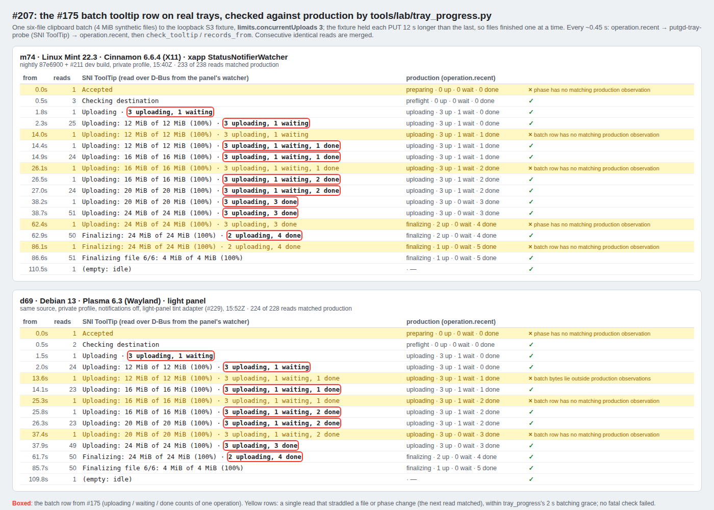

# Replay tray progress on the disposable desktop lab

`tools/lab/tray_progress.py` drives the production JSON CLI, the existing native
desktop fixture and the genuine StatusNotifier host in a pre-provisioned Linux
guest. It creates a new private `/tmp/tp-<id>` config/data/runtime/archive root.
It never provisions credentials, installs packages, unlocks the console or
starts/stops a VM. The operator owns those steps through [the VM lab](vm-lab.md).
This document describes a replay path, **not a record that it has passed**.

The runner returns `protocol-passed-rendering-pending` only after its automated
assertions pass. That is not desktop acceptance. Inspect the QMP hover frames
and the live console for visible icon color, readable tooltip, appropriate
placement and absence of clipped/stale rows. Record the inspector, exact source
and package hashes, profile, screenshot filenames, result and any limitations in
the campaign's acceptance receipt. A host-only Python pass or mocked DBus host
cannot replace this inspection.

## Candidate and guest preparation

Run Cinnamon/X11, GNOME/Wayland and KDE/Wayland functional **and memory** checks
in parallel on one candidate. Use [VM memory evidence](testing-vm-memory-audit.md)
and [the frozen memory protocols](testing-memory.md); this functional runner
does not invent a replacement memory budget. Wait for build/GUI work to stop
before quiet memory sampling.

1. Inventory host QEMU processes, run/base metadata and reserved SSH/VNC ports.
   Run [capacity preflight](lab-storage.md). Preserve immutable golden disks:
   launch only fresh overlays under `work/lab-runs/` with `tools/lab/lab.py`.
   Never boot or modify a referenced base. Check the complete host QMP socket
   path with `tools/diagnostics/check_socket_paths.py --socket` before launch.
2. Build the exact candidate with normal presets and official SDK provisioning
   from [build.md](build.md). Use C++20 and each distro's Qt 6.4.2+ libraries.
   Include `-DPUTGD_LAB_FIXTURE=ON` in the lab package configuration. S3 uses the
   packaged official AWS runtime/module. Proton additionally needs the pinned
   bundle provisioned before CMake and `-DPUTGD_BUNDLE_PROTON=ON`; see
   [Proton runtime instructions](../tools/proton/README.md). Do not substitute
   another compiler, Qt build, SDK or desktop backend.
3. Build/install a distro-native package in the disposable guest. Mint, Ubuntu
   GNOME and Kubuntu KDE need their own DEB/Qt ABI; Fedora needs its own RPM/Qt
   ABI. A Mint package is not evidence for the other distros. Retain package
   SHA256, embedded app/CLI build manifests, installed app/CLI/UI/helper/module
   hashes and distro package versions. On Debian guests, `lab.py install`
   creates `package.json` and compares installed bytes against the package.
   For a native RPM installation, retain the equivalent receipt schema:

   ```json
   {
     "sha256": "<actual archive SHA256>",
     "filename": "<actual package basename>",
     "installedBinarySha256": {
       "/usr/bin/putgd": "<actual packaged/installed SHA256>",
       "/usr/bin/putgd-cli": "<actual packaged/installed SHA256>",
       "/usr/bin/putgd-desktop-fixture": "<actual packaged/installed SHA256>"
     }
   }
   ```

   Include the remaining product binary hashes when available; the runner
   verifies every path in this receipt, not just these three examples. Native
   package-manager installation must resolve its dependencies normally. This
   runner does not add an RPM installer to `lab.py`.
4. Keep the VM's localhost VNC listener running. The runner itself needs no
   viewer: QMP supplies its input and screenshots on VMs, and `physical.py`
   reads the host's VNC tunnel directly. The display wall at
   `http://127.0.0.1:8765/` is only for watching live. Restore a locked session through its visible
   console using the owned/private protected login input identified by existing
   bootstrap metadata. The operator reads it only in memory and types into the
   visibly focused masked field. Do not print it, put it in argv, photograph it,
   or use `credentials.txt` as a login source. Visually verify the unlocked
   native desktop before acceptance. SSH build/log work is separate evidence.
5. Stop any previous lab `putgd` resident explicitly after its work is settled.
   The replay refuses an already running resident and does not kill one to
   make the precondition pass. Guest consoles remain visible throughout.

Git-observed builds must be clean and carry the full requested commit. An
exported source archive may correctly report `sourceProvenance: supplied` and
`dirty: null`; that unknown dirty observation remains in the receipt. Exact
source/archive producer evidence and package/binary hashes establish the
exported candidate identity. App and CLI embedded manifests must match. An old
process surviving a package update is rejected by its live executable hash.

## Native StatusNotifier probe

Build the standalone `tools/lab/tray_probe` program in each target distro using
standard system Qt development packages, CMake and Ninja. Ubuntu/Mint packages
include `qt6-base-dev` and `qt6-base-dev-tools`; Fedora uses `qt6-qtbase-devel`.
Its Qt Core/DBus dependency stays dynamically linked. Administrator
authentication for missing packages belongs to the user. App builds still use
the repository presets; this tiny separate probe does not change root CMake.

```sh
cmake -S tools/lab/tray_probe -B build/tray-probe -G Ninja -DCMAKE_BUILD_TYPE=Release
cmake --build build/tray-probe
sha256sum build/tray-probe/putgd-tray-probe
ldd build/tray-probe/putgd-tray-probe
```

Copy that verified probe to a known guest absolute path, keep its actual guest
hash and supply it below. The probe reads the real session bus's
`org.kde.StatusNotifierWatcher` host flag and registered-item list. It resolves
the DBus connection Unix PID, selects exactly one `putgd` item for the resident
PID and reads its real `ToolTip` and network-order ARGB `IconPixmap`. It checks
the watcher owner/PID again before returning. It neither registers a mock
watcher nor drives an offscreen tray. Missing hosts or ambiguous registration
fail the replay; on GNOME, the declared native tray integration must already be
installed and active.

## Isolated destination and credential references

The operator provisions a disposable guest keychain before the replay. The
runner reads only the supplied nonsecret settings patch, whose selected profile
must contain `credentials: {"mode":"keychain","reference":"..."}`. It takes
no password, session, token, credential file or secret on argv or through its
settings patch. Do not copy secrets into golden disks, source exports, evidence
or review packets. For this campaign the user authorized live S3 test input and
copying **only put.gd's Proton session data** to disposable guest keychains;
that authorization does not cover other host accounts or keychain entries.
Secret provisioning remains an operator-owned, bounded step.

The settings file is a production `settings.patch` object with a `profiles`
array. Other nonsecret settings may also be included. The selected profile must
have the requested provider and a unique isolated test destination:

- S3: a new `objectPrefix` containing `--isolation-marker`, in the authorized
  synthetic bucket destination. Supply ordinary valid S3 settings, a working
  public URL base and the pre-provisioned keychain reference. For root-only test
  credentials, use an empty `objectPrefix` with `naming.mode: template`,
  `collisionPolicy: rename`, and all four filename templates set exactly to
  `<isolation-marker>-{uuid}.{ext}`. This isolates new conditional root keys; it
  never broadens IAM permissions or replaces existing objects.
- Proton: a newly provisioned synthetic test folder whose `folderName` contains
  the marker, with its real `accountRootUid`/`folderUid` and put.gd keychain
  reference. `folderName` is a display hint; the operator must establish that
  the supplied UID is this newly created folder. Use no sharing password unless
  its exact reference was separately provisioned within authorized scope.

The runner requests shared clipboard results, generated names and rename
collisions; it does not overwrite existing objects. It does not modify bucket
policy, versioning, retention or existing user objects. It verifies the accepted
settings revision and explicitly invokes/polls production `setup.unlockCredentials`
for the selected S3 keychain entry before invoking work. Proton reads its own
session through the bundled helper. Provider capability and diagnostics
inspection are saved before the first action.

## Run and inspect

Use new private output directories. Before starting either app or fixture, the
runner records/checks the guest session socket including its `r/putgd/session.sock`
suffix, the existing host QMP socket, and the native guest Wayland/DBus filesystem
socket paths against Linux's 107-byte UTF-8 limit. It preserves the genuine
desktop environment and converts a relative Wayland display socket to its
absolute native path before isolating `XDG_RUNTIME_DIR`. No ownership check or
frozen performance harness is weakened to fit an artifact directory name.

Determine the tray's head-zero pixel coordinates through the visible native
console/QMP frame. Supply them as `--tray-x/--tray-y`; inspect the hover frames to
verify they hit the app icon. Coordinates are witnesses, not an automatic
rendering oracle. The current declared lab profiles use one native display
head; mixed-display/scaling campaigns remain separate required desktop gates.

```sh
python3 -B tools/lab/tray_progress.py \
  --run work/lab-runs/<fresh-cinnamon-run> \
  --output /tmp/tp-evidence-<new-id> \
  --settings <nonsecret-isolated-settings.json> \
  --profile-id <isolated-profile-id> --provider s3 \
  --isolation-marker <unique-destination-marker> \
  --expected-commit <full-candidate-commit> \
  --expected-package-sha256 <actual-distro-package-sha256> \
  --probe /usr/local/bin/putgd-tray-probe \
  --expected-probe-sha256 <actual-guest-probe-sha256> \
  --tray-x <observed-x> --tray-y <observed-y> \
  --payload-mib 32 --timeout 180
```

Repeat with `--provider proton-drive` and that provider's new folder/profile
patch, then with GNOME/KDE only after the Cinnamon functional/memory gates pass.
Every declared desktop/provider combination needs current-source evidence.
All CLI source imports come from the guest fixture's actual native clipboard.
The host clipboard is never used or shared.

The scenario uses two deterministic synthetic files per operation and drives:

1. Two upload operations with one upload worker, requiring active color, a
   queued tooltip row, genuine counters and eventual idle. S3 counters have a
   matching body-byte total/percentage; Proton encrypted SDK bytes have no
   denominator and may decrease on SDK retry. The tray keeps those counters
   separate and labels its source-file-size fallback as an estimate.
2. An explicit same-ID result copy pasted into the independent native guest
   fixture. Pasted links must equal original receipts. S3 additionally retrieves
   public bytes and checks exact length/hash; URLs are read in guest memory
   through the production CLI and never interpolated into SSH/process argv.
   Proton proves confirmed upload/share receipts and native link paste; it does
   not claim an independent decrypted public download from its share page.
3. Two concurrently admitted operations after configuring two workers.
   Core activity rows must show both active operations. Proton serializes helper
   requests for the same keychain reference, so this proves concurrent app
   admission/activity, not parallel SDK transfers for one account. A queued row
   does not count as admission: both operations must be running with two
   non-queued tooltip rows. The original concurrent outcomes are retained.
   For Proton, only explicit `proton_account_busy` unfinished-item failures
   permit up to three sequential recovery passes using `operation.retry` on
   the original IDs and the same credential reference. Artifact/publication
   IDs and already shared receipts must remain unchanged. Every other failure
   stops the scenario.
4. Cancellation after a real transfer counter is observed, terminal cancelled
   state and idle, then explicit production `operation.retry` with the original
   operation, retained artifact and publication IDs. Unknown publication is
   reconciled by that retry; a new action never conceals it.
5. A local-only file batch whose new private archive root is intentionally a
   regular file. Its real save must fail and latch the tray: "Needs attention",
   the error glyph and badge, and "Local save needs attention — open the tray
   menu to review". The latch must hold for 3 seconds untouched. The runner
   then opens it from the desktop's own tray menu (see
   [opening a latched failure](#opening-a-latched-failure)) and requires the
   exact original idle icon afterwards. Replacing that owned blocker with a
   directory permits `operation.retryLocalSave` on the same operation; actual
   saved bytes must match independent source hashes and stay local-only.
6. Resident quit/restart, a new matching process identity, exact preserved
   history receipts and the original idle icon hashes/empty tooltip.

CLI and SNI reads are independent and ordered within one SSH session, avoiding
network round trips between them. The product batches observations. Counter
assertions use before/after CLI reads plus a two-second recent observation
window, restricted to the current row’s operation and artifact identity.
An operation moving up a row keeps its own observations; a previous operation
or file cannot supply its byte bounds. Transition mismatches are preserved
without coverage credit and retried for at most two consecutive seconds. A
persistently idle tray while CLI work remains active fails this same bound.
Privacy, identity, icon color and malformed accounting failures stop immediately;
the rejected SNI text is redacted from failure evidence.

Icon colours are checked against the tint set for the panel the resident sees
(#229). put.gd tints its tray icon for the panel, not the app theme
(`Theme::trayTints`, #60). Dark panels get idle `#d6d6d2`, upload `#91bca2`,
encoding `#e8b66d` and error `#e59b93`; light panels get `#383834`, `#386a4b`,
`#8f5b20` and `#a44139`. At setup the runner reads the panel
tone the way `PanelTone` does, in the resident's own environment: the KDE
configuration cascade (`plasmarc`, `kdeglobals`, the Plasma style's `colors`),
Cinnamon's `org.cinnamon.theme`, or GNOME's dark top bar. It then waits until
put.gd's own report (`ui.snapshot` `diagnostics.trayTint`) agrees, and saves
both in `panel-tone.json`. Every read, attention included, is checked
against that one set. The resident and the reader get the desktop session's
`XDG_CONFIG_DIRS` and `XDG_DATA_DIRS`: Plasma lists `~/.config/kdedefaults`
there, and without it a Breeze Dark panel reads as Plasma's light default.
`TRAY_TINTS` in `tray_progress.py` mirrors `Theme.cpp`; the contracts read the
C++ table and `PanelTone`'s rule rows back, so the two can't drift.

The tooltip title is `put.gd` when idle or preparing, `Uploading` while an upload
is shown, `Upload complete` for a confirmed upload and `Needs attention` for a
latched failure (`TrayController::refreshActivity`). Working icons keep the idle
glyph, with an encoding-colour fill for upload progress; the upload colour is
reserved for a confirmed completion. The reveal and hold timings stay with the
product: activity appears after 200 ms, a shown upload holds at least 600 ms,
and "Finishing upload" covers the short hold after the last transfer. Rounded
tooltip sizes use the app's MB/GB format (`ByteSize::summary`).
`tests/desktop/test_lab_ui_contract.py` fails when any title, label or unit the
runner matches leaves the app source.

A failure latches until it is opened. Only the runner's original local-save
failure ID, or explicit `proton_account_busy` failures on original concurrent or
retry IDs, may latch. Independent terminal CLI items must prove that failure
before the attention state is accepted; until then a frame showing it gets only
the two-second batching grace. Attention without an expected failure is fatal.
While latched, every icon must carry the error colour without a progress or
completion fill, and the first tooltip row must name the expected item, such as
"Local save needs attention — open the tray menu to review". Later rows are
ordinary activity, checked against observations. A local-save latch that clears
before its item is opened fails the replay. A Proton busy latch clears by itself
once its retried items upload. The `attention` results record the failure IDs,
when the latch was first and last seen, how it was opened and when it cleared.

### Opening a latched failure

The runner opens the attention item the way a person does, on the desktop's own
tray menu, and watches the result:

1. A `busctl monitor` on the resident's bus name records every dbusmenu call
   other clients make to put.gd's menu. The guest needs `busctl` and `stdbuf`.
2. The pointer moves to `--tray-x/--tray-y`, and the profile's button
   (right by default) opens the menu. The monitor must show the desktop asking
   for the menu (`AboutToShow` or an `opened` event).
3. The runner counts the attention item's place among the visible, enabled
   top-level rows of the live menu layout and presses Down that many times. If
   the desktop reports hovers, the last one must be the attention row.
4. Enter. The desktop's own `clicked` for exactly that row must reach put.gd
   within 5 seconds. A click on any other row is fatal: it may have started a
   capture or quit the resident.

Frames before, open, highlighted and after are saved as witnesses. Each
profile's optional `tray_menu` entry calibrates its desktop: `button`,
`openSeconds` (0.8 by default) and `firstRowSelected` (whether the menu opens
with its first row highlighted). Attempts record whether their profile was
calibrated.

If the menu does not open, the highlight is elsewhere or no click arrives, the
runner presses Escape, saves the frame and sends the dbusmenu `clicked` event
itself, so the rest of the replay can run. That run never counts as a visible
pass: `visibleMenuFallbacks` in the results and the printed summary carry the
reason, and acceptance treats it as a finding about put.gd on that desktop.

Rounded tooltip bytes must fit real observed byte bounds and their own
integer percentage. A source-size fallback must be labelled `Estimated`, match
the actual counters/source bytes, and stop at 99% while awaiting finalization or
receipt. No elapsed-time percentage is accepted. Concurrent transfer fills are
weighted by their acquired source sizes; local preparation and queued transfers
do not contribute. A latched failure supersedes all fills.
The SNI phase must have a matching production observation. Source filenames,
paths and links are prohibited in tray text.

The runner records finalizing/sharing as `observed` or `not-observed` and retains
phase screenshots only when actually seen. A phase that completes between
samples does not become a passing phase gate by inference. Local retry may
finish before a tooltip observation because its CLI call awaits completion;
the saved-byte/terminal checks still prove that local-save case. For phase
coverage that remains required, replay a larger synthetic workload and inspect
the visible console, retaining every earlier attempt. A run too fast to show
queued/concurrent work or cancellation fails instead of fabricating those
observations. Preserve its full output, record the corrected command, and use
a new output/root/destination marker before retrying. Do not alter a frozen
memory harness or relax a gate to get a pass.

## Concurrent batch row on physical trays (#207)

When several files of one operation transfer at once, the tooltip gets a batch row
(#175), such as "Uploading: 20 MiB of 20 MiB (100%) · 3 uploading, 1 waiting, 2 done".
`check_tooltip` validates that row with `BATCH` and `records_from`. The row was checked
on two physical desktops on 2026-10-20 (round 9), with a dev build of nightly `87e6900`
plus #220 and a private profile under `/tmp/r9*`: config, data, state, cache,
runtime and archive. Without its own `archive.root` the profile would archive into
`~/Documents/put.gd`. The destination was the offline S3 fixture
(`tests/fixtures/s3_server.py`) on loopback, with its synthetic keys in session mode,
stored over the resident's socket because the CLI refuses raw keys. One six-file
clipboard batch (`text/uri-list`, 4 MiB synthetic files) ran with
`limits.concurrentUploads` 3. The fixture held each PUT 12 s longer than the previous
one, so files finished one at a time. About every 0.45 s the driver
([r9lab.py](evidence/tray-batch-207/r9lab.py)) read `operation.recent`, the real
StatusNotifier item through `putgd-tray-probe`, then `operation.recent` again, and
applied `check_tooltip` and `correlated_records` from `tray_progress.py` unchanged.

| Host | Tray host | Reads | Matched | Batch rows seen on the panel |
| --- | --- | --- | --- | --- |
| m74, Linux Mint 22.3, Cinnamon 6.6.4, X11 | xapp StatusNotifierWatcher | 238 | 233 | 3 uploading, 1 waiting → …, 1 done → …, 2 done → 3 uploading, 3 done → 2 uploading, 4 done |
| d69, Debian 13, Plasma 6.3, Wayland, light panel | Plasma | 228 | 224 | the same five rows |

Every mismatch was a single read that straddled a file or phase change, and the next
read matched. That is within the runner's 2 s batching grace. No fatal check failed,
both operations completed, and the tooltip never named a file, path or link.



Notes on the runs:

- **Tray tints on d69:** the d69 resident drew the light-panel set (`#2759B8` idle,
  `#146C42` active, `#092F1D` dim), and the first attempt failed on the icon colour
  ([attempt 1](evidence/tray-batch-207/observations-d69-plasma-attempt1-dark-tint-check.jsonl)),
  because `check_tooltip` then knew only the dark set. The kept run renamed those
  three colours to their dark twins before the check. d69's panel was in fact dark
  (Breeze Dark from `~/.config/kdedefaults`, unchanged since 2026-10-16): this
  run's driver gave the resident no `XDG_CONFIG_DIRS`, so put.gd fell back to
  Plasma's light default. #229 made the check panel-aware and passes the session's
  directories to the resident; replaying these 228 reads against the light set
  passes all of them ([#229 evidence](evidence/2026-10-20-tray-tints-229/README.md)).
- **Clipboard:** the batch needs the desktop clipboard. On d69, Klipper keeps the
  synthetic file list and the loopback link list in its history. Klipper can only clear
  all of its history, so the entries were left and only the current contents were cleared.
- **Notifications** were off on d69. On m74, put.gd closed its own "completed"
  notification when it quit.
- The observation logs are [m74](evidence/tray-batch-207/observations-m74-cinnamon.jsonl)
  and [d69](evidence/tray-batch-207/observations-d69-plasma.jsonl).
  Each line has the SNI title and tooltip, production's rows and the check result.

## Native host restart, cleanup and evidence

The replay restarts the **resident app**. Native tray-host restart is a separate
manual gate because Cinnamon/GNOME/KDE host lifecycles differ and some restart
paths terminate the graphical session. While a large synthetic upload is active,
use the desktop's supported visible host/session recovery workflow where
available. Retain old/new watcher owners, the unchanged app PID, live SNI
properties after re-registration and QMP active/idle hover frames. Confirm that
the newly registered host displays the current activity and eventual idle,
without reopening a view. If a desktop cannot provide this workflow safely,
record that gate as blocked. Do not stand up a fake watcher or restart a
Wayland compositor blindly to claim host-recovery evidence.

The isolated replay pins the recent-activity limit to 100 so all active
rows can be independently observed. Cleanup and restart enumerate each retained operation ID through
`operation.inspect`, so a short recent-activity limit cannot drop old uploads
from the cleanup handoff.

Each run preserves parameters, socket preflight, source identities, package and
running-process identity, native readiness, capabilities/diagnostics, redacted
CLI observations, SNI icon hashes/colors and tooltip rows, scenario outcomes,
actual local synthetic bytes, QMP hover/source/paste frames and a SHA256 manifest.
The app/fixture and VM are left running and visible for inspection. Failures
retain their roots and known operation IDs; the operator inspects those exact
operations before recovery or cleanup. Do not infer that a failed driver means
an upload had no effect.

`cleanup-preparation-private.json` contains exact newly created history IDs and,
for S3, actual original destination/effects/acknowledgement from `delete.prepare`.
It is a private operator handoff and may contain URLs/references; exclude it
from review packets and default diagnostic exports. The runner never calls
`delete.confirm`, sharing revoke or account-file deletion. The operator reviews
and acknowledges only that exact ordered S3 selection through production
services, then records each actual outcome. Proton `delete.prepare` must return
`unsupported_capability`; its synthetic account files remain in the unique test
folder because safe revision-guarded deletion is unavailable. Link revocation
is a separate mutation and does not remove those files.

Windows S3 acceptance uses independent overlays and the native Windows route in
[windows-vm-lab.md](windows-vm-lab.md). This Linux SNI/QMP runner is not Windows
tray proof. The currently pinned Proton runtime supports Linux x86-64 only;
Windows Proton acceptance is blocked until a supported runtime/package exists.
Neither those platform routes nor a service-session exporter is added here.

Pure host contracts can be run independently without builds, guests or service
access:

```sh
python3 -B tests/desktop/test_tray_progress_lab.py
```

They check the replay's socket, identity, privacy, color, accounting and
nonsecret-settings assertions. They do not establish a probe build, live S3 or
Proton success, a desktop functional pass, human rendering inspection or memory
acceptance. Record those actual executions separately.

## Opening an upload from its notification

The native Linux resident gives a single-item upload notification a browser action
only when the item has a confirmed, available link. Clicking the toast opens that
receipt's HTTP(S) URL through the default browser. A batch or local-only result
keeps its existing guidance to open History. Upload completion itself never opens
the browser.

The transport uses the notification server's returned ID and the standard
[`default` action](https://specifications.freedesktop.org/notification/latest-single/).
Separate toasts retain separate links. Activation or dismissal discards the ID;
a departing notification service invalidates its IDs and pending replies. The
first appearance of a service preserves replies for notifications that started
it. The generic Qt fallback has no per-notification click ID and does not promise
browser activation.

Browser activation asks the XDG portal's OpenURI, and falls back to `gio open` with the
host's environment and the configured HTTP(S) URI handler
([diagnostics.md](diagnostics.md#opening-links-and-folders-on-the-host)).
KDE’s generic `xdg-open` path can choose an image application for a remote PNG
even when Firefox is the default browser. Keep the native desktop’s data/config
search paths when launching an isolated test session; a missing browser desktop
entry is a setup failure. See the [GIO URI launch contract](https://docs.gtk.org/gio/type_func.AppInfo.launch_default_for_uri.html).

The private-bus regressions exercise production result handling and outgoing
browser arguments with an isolated opener, plus notification-owner appearance:

```sh
dbus-run-session -- build/dev/test_native_tray   uploadToastOpensItsOwnLink   firstNotificationOwnerAppearancePreservesClickTarget
```

These contracts are not desktop proof. Native acceptance must use the installed
candidate, create a synthetic image in an isolated destination, visibly click the
real toast through the console, and inspect the default browser's exact receipt
URL and image. Preserve operation/history IDs, package and running-byte identities,
QMP frames and public-download hashes; clean only the exact test uploads through
reviewed guarded deletion. Keep the original display wall on port 8765.
