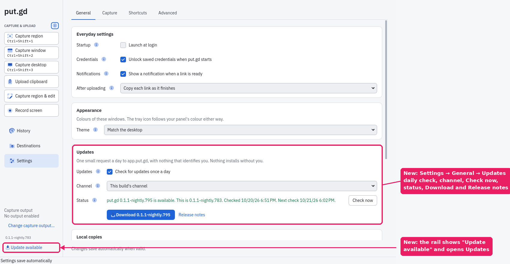
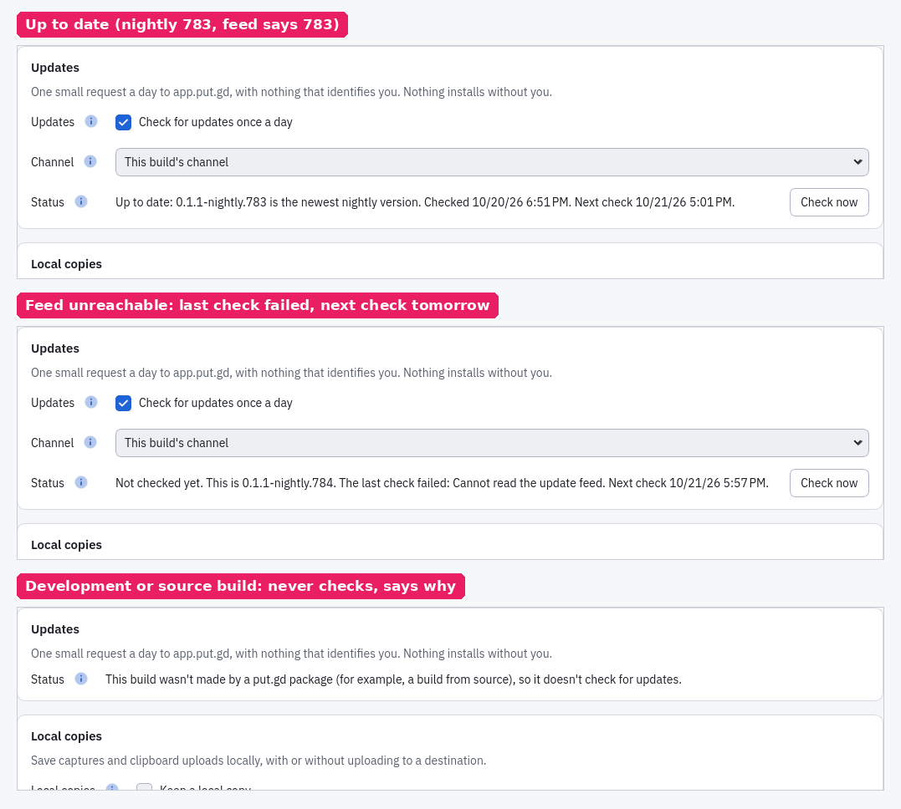

# Updates

How put.gd finds out about a newer version. This page covers phases 0 and 1 of the
design in [issue #293](https://github.com/patrick-hudson/put.gd-desktop/issues/293). The
later phases are listed at the end: the signed apt and dnf repositories, the AppImage's
own **Install update**, and Flatpak ([#83](https://github.com/patrick-hudson/put.gd-desktop/issues/83)).

Each install format updates the way that format normally does. put.gd's part is a small,
private check that tells you, and nothing is installed without you.

## The daily check

Once a day the resident asks app.put.gd for the newest version on its channel:

- **When it runs:** the first check is 5 to 15 minutes after put.gd starts. Later
  checks are 24 hours after the last attempt, give or take 2 hours. The last attempt is
  kept in `update-check.json` in the state folder (`$XDG_STATE_HOME/putgd`, normally
  `~/.local/state/putgd`), so a restart doesn't check again early. A failed check
  is logged and tried again the next day.
- **Where it runs:** the resident runs `putgd-cli --check-update CHANNEL` as a
  short-lived child. The resident itself never loads Qt Network or TLS, so its idle
  memory doesn't change.
- **What it sends:** one `GET https://app.put.gd/update/v1/<channel>.json`. There is no
  query string, cookie, version, locale or installation ID. The `User-Agent` is
  `put.gd-update-check/1`, and the request is the same from every computer.
  app.put.gd keeps no access logs.
- **Where the comparison happens:** on this computer. The links the result offers are
  built from the release tag (the GitHub release page and that package's download), so
  the feed can only choose which of the project's own release files to offer.

## Who is told

| Build | Channel it follows | Notification | Tray menu | Settings and main window |
| --- | --- | --- | --- | --- |
| Stable release | stable | once per new version | **Update available: X.Y.Z** | yes |
| DEB/RPM that updates from put.gd's repository | its repository's channel ([switching](package-repositories.md#switching-channels)) | never: the system updater tells you | yes, while that repository has a newer version | yes, with **Open software updates** |
| Pre-#373 release candidate (`0.1.1-rc.1`, never published) | stable | once per new version | yes | yes |
| Nightly | nightly | never | no | yes |
| Nightly AppImage watching Stable | stable | once per new stable version, so you hear about the first one; never for the first result after you change the channel | yes, while the stable version is newer | yes, with **Switch to stable X** ([switching](#switching-channels)) |
| Development or source build | none | no check | no | says why |
| Flatpak | none: Flatpak updates itself | no check | no | says why |

A version you already saw after **Check now** isn't announced again. put.gd remembers this per
channel, so changing the channel neither repeats an announcement nor hides one. The notification
also follows **Show a notification when a link is ready**.





These pictures come from a tagged `v0.1.1-nightly.783` and `.784` build
(`PUTGD_PACKAGE_TARGET=fedora44`) on f44, and a development build on d69. Both ran in a
private Xvfb and profile against a local feed server set with `PUTGD_UPDATE_FEED_URL`.
The resident's TLS and Qt Network library mappings were the same before and after
**Check now**.

[Desktop acceptance](evidence/2026-10-21-updates-acceptance-303/README.md) (#303) ran
tagged builds on Cinnamon (m74), GNOME with AppIndicator (f44) and Plasma Wayland
(d69), each against a local feed:

- **Memory:** idle memory stays within 0.14 MiB of the build before #301.
- **Scheduled check:** the first check ran 9–11 minutes after start.
- **Stable:** exactly one notification, which opens the release notes. A restart doesn't announce the version again.
- **Nightly:** only Settings and the rail show the update.

On Plasma and GNOME the tray's **Update available** entry used to appear only after a
restart. [#311](https://github.com/patrick-hudson/put.gd-desktop/pull/311) fixed that
([evidence](evidence/2026-10-21-tray-update-visible-304/README.md)).

**Channel** offers *Stable* and *Nightly* and starts on the build's own channel
([#344](https://github.com/patrick-hudson/put.gd-desktop/issues/344); it replaced *This build's
channel*, which named the channel it resolved to since
[#305](https://github.com/patrick-hudson/put.gd-desktop/issues/305)).

## Settings

**Settings → General → Updates**:

- **Check for updates once a day:** on by default.
- **Channel:** *Stable* or *Nightly*. It starts on the build's own channel: *Stable* on a
  release, *Nightly* on a nightly. Choosing the other one watches it instead,
  and an AppImage then offers to [switch](#switching-channels). A build that never checks
  hides the choice and the section says why. A DEB or RPM whose pkg.put.gd repository file is in
  use reads that local file at startup and shows its channel immediately, without a
  choice or a network request. **Other channel** lists the terminal commands that move
  it ([how](package-repositories.md#switching-channels)). This also works with daily
  checks turned off. Local ownership is refreshed around each update check, even if
  the feed request fails. A missing, disabled, foreign or malformed repository file
  leaves the manual channel setting in control. The stored setting is preserved for
  manual installs sharing the configuration; detecting a repository never rewrites it.
- **Status:** the last result, when it was checked and when the next check runs, with
  **Check now**.
- **Download** and **Release notes:** shown when there is a newer version.
  **Download** opens this installation's package (the same DEB, RPM or AppImage you
  installed) in your browser.
- **Download and install** (AppImage only): shown first when a newer version is on this
  build's channel. While you watch the other channel it reads **Switch to CHANNEL VERSION**
  instead ([switching](#switching-channels)). put.gd fetches it, checks it and puts it in place of the AppImage it
  runs from ([how](#download-and-install-from-putgd)). A progress bar and a line below
  show each step and any error; then **Restart put.gd** starts the new version.
- **Open software updates:** replaces **Download** on a DEB or RPM install whose
  repository file from [pkg.put.gd](package-repositories.md) is present and enabled. It
  opens Update Manager on Cinnamon, Discover on Plasma or GNOME Software on GNOME (else
  whichever is installed). Below it, **Or in a terminal** shows `sudo apt update && sudo apt upgrade`
  or `sudo dnf upgrade --refresh` with **Copy**. Delete or disable the repository file
  and, from the next check (or **Check now**), Settings offers **Download** again. The
  check child reads the repository file and starts the updater, so the resident's code
  and idle memory don't change.

When a newer version exists, the main window's rail shows **Update available: X**
under the version, which opens this section.

In the configuration file this is `preferences.updates`
([configuration](configuration.md)):

```json
"preferences": {"updates": {"check": true, "channel": "build"}}
```

Both keys are optional. Without the object, put.gd checks daily on this build's channel.
`"build"` is that default: Settings stores it when you pick the build's own channel, so a DEB
and an AppImage that share one configuration each keep following their own. Picking the
other channel stores `"stable"` or `"nightly"`. A DEB or RPM whose repository file is in use
ignores the setting and follows the repository, and Settings doesn't rewrite it.

## Updating the AppImage

### Download and install from put.gd

A tagged AppImage (stable or nightly) updates itself from **Settings → Updates →
Download and install**, or `update.install` with `confirm: true` from the CLI or MCP. Nothing
installs on its own: not on the daily check, not from a notification.

1. **What it installs:** the newest release on this build's channel, as the update feed names it.
   put.gd reads that release's `SHA256SUMS` from GitHub, and its signature,
   `SHA256SUMS.minisig`, from `pkg.put.gd`. The signature must be by the channel's release key
   (built into put.gd from `packaging/linux/repo/keys/`) and name that release. An unsigned,
   foreign-signed or changed `SHA256SUMS` stops the install.
2. **zsync first:** with `appimageupdatetool` (or `zsync2`) on your `PATH`, put.gd runs it, which
   downloads only the parts that changed. It runs with your system's own environment and
   `SSL_CERT_FILE` set to your system's CA bundle (so it also works on Fedora,
   [#297](https://github.com/patrick-hudson/put.gd-desktop/issues/297)), on a link to the running
   image inside a hidden folder `.putgd-update-XXXXXX` beside it, against the release's `.zsync`
   on `pkg.put.gd`.
3. **Otherwise the whole file:** without such a tool, or when it fails, stalls or produces
   something else, put.gd downloads the whole AppImage from the GitHub release (then from
   `pkg.put.gd`) with its own TLS. Settings and `update.status` say which path was taken and why.
4. **Checked before anything changes:** the new file must match the release's `SHA256SUMS`
   line, be an AppImage, and carry the same update information (the same channel). A download
   that doesn't match is refused and nothing is changed.
5. **Same path:** the new version is renamed onto the file put.gd runs from, keeping its mode.
   Start at login, menu entries and Gear Lever's records keep working; the file keeps its old
   name. The old version stays beside it as a hidden `.putgd-update-backup-VERSION.AppImage`
   until the new one has started once; then put.gd removes it, if it is still the file put.gd
   made ([going back to it](#if-the-new-version-wont-start)). Nothing else in the folder is touched.
6. **Restart:** **Restart put.gd** (or `update.restart` with `confirm: true`) quits put.gd and
   starts the new version. Settings then says "Up to date" and, in the Install row, "Updated from
   OLD to NEW with a zsync update (or from a full download) on DATE". Without a restart, the
   next start of put.gd, at login for example, runs the new version too.

It refuses, with the reason in Settings, while a recording or an upload runs, when the AppImage's
folder isn't writable or has no room for another copy, when the file isn't yours, or when an
installed update still waits for its restart. While you watch the other channel, the same
button switches channels instead ([below](#switching-channels)). DEB and RPM installs update through their repository instead; Flatpak
updates itself.

Accepted on Fedora 44 GNOME, Linux Mint 22.3 Cinnamon, Kubuntu 26.04 Plasma, Debian 13 Plasma and
Aurora (Fedora Atomic) through all three paths, with tampered files refused and the resident's idle
memory unchanged within 0.2 MiB:
[evidence](evidence/2026-10-21-appimage-updater-293/README.md).

An AppImage integrated by Gear Lever 4.6.2 or AppImageLauncher 3.0.0-beta-3 updates the same way:
after 26.1022.968 → 26.1022.983 on Linux Mint 22.3, each tool's menu entry and record still start the
new version, neither shows a second entry or picks up the hidden backup, and each reports no further
update ([evidence](evidence/2026-10-22-appimage-integrators-412/README.md)).

### If the new version won't start

**The backup.** Download and install keeps the version you had next to the AppImage, as a
hidden file named after that version: `.putgd-update-backup-VERSION.AppImage`, for example
`.putgd-update-backup-26.1022.968-nightly.AppImage`. It is the old file itself, unchanged and
still executable, so it takes as much room as one AppImage. The leading dot hides it from file
managers (Ctrl+H shows it) and from start at login, which never starts it. While the update
waits for its restart, Settings → Updates names the file.

**When it goes.** The first time the new version starts from the AppImage's path (after
**Restart put.gd**, or at the next login or launch), put.gd deletes the backup, but only if it is
still the file put.gd made. A backup you renamed, edited or replaced stays where it is. If the
new version never starts, the backup stays too.

**Going back by hand.** If the new version crashes or won't open:

1. Quit put.gd if any of it is still running: **Quit** in the tray menu, or `putgd-cli ui.quit`.
2. In a terminal, go to the folder the AppImage is in (`~/Applications`, or `~/AppImages` with
   Gear Lever) and find the backup:

   ```bash
   cd ~/Applications
   ls -a .putgd-update-backup-*.AppImage
   ```

3. Move it over the AppImage. The AppImage keeps its name through an update, so that name is
   still the one you started, the one in your menu entry and the one start at login runs:

   ```bash
   mv .putgd-update-backup-26.1022.968-nightly.AppImage putgd-26.1022.968-nightly-x86_64.AppImage
   ```

4. Start put.gd as usual. It runs the old version again, from the same path, so menu entries,
   Gear Lever's and AppImageLauncher's records and start at login need nothing else.

Use `mv`, not `cp`: put.gd recognises its own backup back on the path, forgets the update and
offers it again in Settings → Updates; nothing installs until you click. After a copy, Settings
keeps saying the update waits for a restart. Builds from before
[#413](https://github.com/patrick-hudson/put.gd-desktop/pull/413) (26.1022.968-nightly and older)
don't recognise the backup either way; for them, also delete
`~/.local/state/putgd/update-install.json` (`$XDG_STATE_HOME/putgd/` if you set it) after the
`mv`.

Please [open an issue](https://github.com/patrick-hudson/put.gd-desktop/issues/new) with the
version that didn't start, and a diagnostics bundle from the old version if you can
(Settings → Advanced → Diagnostics → **Create diagnostics package…**).

### Switching channels

A DEB or RPM that updates from put.gd's repository moves channels from the command line, not
from Settings: see [package-repositories.md](package-repositories.md#switching-channels). The
rest of this section is about the AppImage.

Settings → Updates → **Channel** picks which feed put.gd reads. For an AppImage that watches
the other channel, **Download and install** becomes an explicit **Switch to CHANNEL VERSION**
([#344](https://github.com/patrick-hudson/put.gd-desktop/issues/344)).

- **Nightly → stable:** choose **Stable**. Once the stable feed names a release, Settings says
  *"Stable 26.1101.960 is available. This is nightly 26.1105.951-nightly; switching replaces it with
  the stable release."* and offers **Switch to stable 26.1101.960**. Versions sort by date
  ([versioning.md](versioning.md)), so a nightly is usually newer than the latest stable
  release, and the switch is to an older version that must be confirmed (below).
- **No stable release yet:** Settings says *"There's no stable release yet. This nightly
  build (VERSION) stays as it is, and doesn't get nightly updates while Stable is chosen.
  put.gd offers the switch once the first stable release is out."* There's no button and
  no error. `update.status` reports `install.reason: "no_release"`.
- **Stable → nightly:** choose **Nightly**, then **Switch to nightly VERSION**.
- **An older version:** when the other channel's release is older than this build (nightly
  → stable once nightlies have moved to the next patch, or stable → nightly before they
  have), the status says so, the button reads **Switch to … (older)**, and put.gd asks first:
  an older version may not open settings or history saved by a newer one.

A switch runs the [Download and install](#download-and-install-from-putgd) steps, with the
other channel's checks:

- `SHA256SUMS.minisig` must be by **that channel's** release key, and its trusted comment
  must be `put.gd TAG CHANNEL`. A release signed by the other key is refused.
- The new image must carry that channel's update information, the running image's with
  `/dl/<from>/` changed to `/dl/<to>/`.
- zsync is seeded from the running image, with the whole-file download as the fallback.
- The new version is renamed onto the same path, the old one is kept as a hidden backup
  until the new one has started, and **Restart put.gd** starts it.

**After the switch:**

- Settings says *"Switched from nightly X to stable Y … on DATE"*, and **Channel** stays on
  the channel you chose, which is now also the build's own, so later updates install as usual.
- **Start at login:** put.gd rewrites the login script from the new image right after the
  switch, before any restart. Login starts the switched image, and only put.gd AppImages
  beside it with the new channel's update information count as newer ones. Old-channel
  copies (from AppImageLauncher or appimageupdatetool) are ignored, even when their names
  look newer.
- **Other updaters:** the file now embeds the new channel's permalink, so appimageupdatetool,
  AppImageLauncher and Gear Lever follow the new channel from then on. (Gear Lever reads it at
  each check unless you saved a custom update URL in its app details.)
- **Notifications:** put.gd remembers the version it announced (or you saw in Settings) per
  channel. The first result after you change the channel shows in Settings and isn't also
  announced; the version you switched to counts as seen. Stable still announces each later
  version once, including to a nightly AppImage that watches Stable; nightly never announces.

**From an agent:** `update.status` reports `install.kind` (`update` or `switch`) and
`install.switch` (`{from, to, version, tag, older}`). `update.install` then needs
`{"confirm": true, "channel": "stable"}`, plus `"allowOlder": true` when `older` is true
(MCP `install_update(confirm, channel, allow_older)`).

Accepted on Fedora 44 GNOME and Linux Mint 22.3 Cinnamon with lab channels under `pkg.put.gd/lab`:
both directions, the older-version confirmation, no stable release yet, tampered releases refused,
start at login after a switch, and the resident's idle memory unchanged
([evidence](evidence/2026-10-22-appimage-channel-344/README.md)).

### Other AppImage updaters

Tagged AppImages also update through the usual AppImage tools; untagged builds can't
([how it works](release.md#appimage-updates)):

- **Gear Lever** (Flatpak): **Update** downloads the new image and replaces the file in
  place.
- **AppImageLauncher**: **Integrate and run** moves the image to `~/Applications` and adds a
  menu entry with **Update this AppImage**. The update is a delta (only the changed parts are
  downloaded). The new version is written beside the old one, which is kept, and while
  AppImageLauncher's daemon runs the menu lists both (as **put.gd (1)** and **put.gd (2)**);
  remove the old one with **Delete this AppImage**.
  On Linux Mint 22.3, AppImageLauncher 3.0.0-beta-3's own **Update this AppImage** action fails
  (`libQt5QuickWidgets.so.5: cannot open shared object file`), an upstream bug; running
  `/opt/appimagelauncher.AppDir/usr/bin/update ~/Applications/putgd-….AppImage` works.
- **appimageupdatetool** (command line): `appimageupdatetool putgd-….AppImage` writes the new
  version beside the old one; `--remove-old` deletes the old file afterwards.

**Start at login follows the update.** From an AppImage, launch at login starts the newest put.gd
AppImage in the same folder as the one you last ran, if it is your own file and carries the same
update information (the same channel). So the next login starts the new version after any of the
updaters, even if the old file was removed, and put.gd then remembers the new file. The version of
the file you last ran is read from the file itself, not its name, since put.gd's own update keeps
the name.

### Fedora

put.gd's own **Check now** works in the AppImage on Fedora 44 since #329: AppRun points
the image's TLS clients at Fedora's CA bundle ([details](diagnostics.md)).
**Download and install** works too: put.gd hands appimageupdatetool that bundle, and the
`.zsync` names the image on `pkg.put.gd`, which doesn't redirect
([above](#download-and-install-from-putgd)). The rest of this section is about running
appimageupdatetool yourself. It looks for the certificate bundle at Ubuntu's path,
`/etc/ssl/certs/ca-certificates.crt`, which Fedora doesn't have
([#297](https://github.com/patrick-hudson/put.gd-desktop/issues/297), upstream
[zsync2#91](https://github.com/AppImageCommunity/zsync2/issues/91)). Without it, it prints
`zsync2: Unknown error while checking whether file (null) exists: Bad address` about thirty
times and crashes. Setting `SSL_CERT_FILE=/etc/pki/ca-trust/extracted/pem/tls-ca-bundle.pem`
stops the crash and the update check works, but the update itself still fails with
`zsync_legacy: Other error? -1`: the step that follows GitHub's download redirect doesn't read
`SSL_CERT_FILE`. Releases whose `.zsync` names the image on `pkg.put.gd` (from #293 phase 3 on)
need no redirect, so `SSL_CERT_FILE` alone is then enough:

```sh
SSL_CERT_FILE=/etc/pki/ca-trust/extracted/pem/tls-ca-bundle.pem appimageupdatetool ~/Applications/putgd-….AppImage
```

For older releases, either use **Gear Lever**, which isn't affected (it runs in its own Flatpak
runtime), or show appimageupdatetool Fedora's bundle at the expected path, without root:

```sh
APPIMAGE_EXTRACT_AND_RUN=1 bwrap --dev-bind / / --tmpfs /etc/pki/tls/certs \
  --ro-bind /etc/pki/ca-trust/extracted/pem/tls-ca-bundle.pem /etc/pki/tls/certs/ca-certificates.crt \
  ./appimageupdatetool-x86_64.AppImage ~/Applications/putgd-….AppImage
```

On Fedora `/etc/ssl/certs` is a link to `/etc/pki/tls/certs`, so the bundle appears at
`/etc/ssl/certs/ca-certificates.crt` for that one command. `APPIMAGE_EXTRACT_AND_RUN=1` is needed
because FUSE mounts don't work inside `bwrap`. AppImageLauncher's updater uses the same library
(zsync2) and is expected to behave the same; it wasn't tested on Fedora. Recorded on Fedora 44:
[AppImage updates on Fedora](evidence/2026-10-21-appimage-login-306-307/README.md#fedora-297).

## CLI and MCP

| Interface | What it does |
| --- | --- |
| `putgd-cli update.status` | Returns `build` (version, kind, channel, packageTarget, supported, reason), `check`, `channelSetting`, `channel`, `channelSource` (`setting`, or `repository` when a repository install follows its repository's suite), `enabled`, `notifies`, `action`, `checking`, `attemptedAt`, `checkedAt`, `nextCheckAt`, `result` and `error`. `action`, from the last check, is `{kind: "software-updates", manager, file, channel, command, updater, otherChannel, older}` for a repository install (`otherChannel` `{channel, commands, docs}`: the terminal commands that move to the other channel; `older` `{version, command}` while the repository's release is older than this build), otherwise `{kind: "download", repository: "absent" \| "disabled" \| "other" \| "none"}` |
| `putgd-cli update.check` | Checks now, even with daily checks off, and returns the same object. A failed check returns its error: `update_feed_unavailable`, `update_feed_invalid`, `update_check_failed` or `update_check_unavailable` |
| `putgd-cli --update-info` | This build's channel and package target. No resident and no network |
| `putgd-cli --check-update nightly` | The resident's child mode: one feed request and one JSON line, whose `action` says how this install updates (it reads the repository file). No resident needed |
| `putgd-cli --open-software-updates` | The child mode behind `update.openSoftwareUpdates`: reads the repository file again and starts the updater. No resident needed |
| `putgd-cli update.openSoftwareUpdates` | Opens the system's software updater, as **Open software updates** does. `software_updates_unavailable` when this install doesn't update from put.gd's repository (the details name why) or no updater is installed (the details carry the command) |
| `putgd-cli update.install '{"confirm":true}'` | AppImage only: starts **Download and install** and returns `update.status` at once. `method` (`auto`, `zsync` or `download`) forces one path. Follow `install` in `update.status`: `state` (`idle`, `running`, `installed`, `failed`), `phase` (`checking`, `verifying`, `zsync`, `download`, `installing`, `done`), `method`, `bytes`, `total`, `error`, `result` (with `zsync.fallbackReason`, `backup` and the signature's trusted comment), `available`/`reason`, `kind` (`update` or `switch`), `switch` (`{from, to, version, tag, older}`), `restartRequired`, `installed` (with `channel` and `previousChannel`) and `backup`. A switch takes `"channel"` (the watched channel) and, when `switch.older`, `"allowOlder": true`. Refusals: `update_confirm_required`, `update_install_unavailable` (`not_appimage`, `not_running_from_appimage`, `not_checked`, `no_release`), `update_install_busy`, `update_restart_required`, `update_switch_confirm_required`, `update_switch_older`; the install's own errors (`update_not_available`, `update_no_release`, `update_image_not_writable`, `update_disk_full`, `update_sums_unavailable`, `update_signature_invalid`, `update_download_failed`, `update_verification_failed`, `update_zsync_failed`, `update_install_failed`) arrive in `install.error` |
| `putgd-cli update.restart '{"confirm":true}'` | Once an installed update waits for its restart: starts the AppImage again from the host after this resident exits, and quits it. `update_restart_unavailable` otherwise |
| `putgd-cli --install-update nightly [--method M] [--state DIR] [--switch [--allow-older]]` | The child mode behind `update.install`: progress lines, then one result line. No resident needed; it reads `$APPIMAGE`. Another channel than the build's needs `--switch`, and an older version `--allow-older` |
| MCP `get_update_status`, `check_for_updates`, `open_software_updates`, `install_update`, `restart_after_update` | `update.status`, `update.check`, `update.openSoftwareUpdates`, `update.install` and `update.restart` |
| `settings.patch` / MCP `patch_configuration` | `{"preferences": {"updates": {"check": false}}}` and so on |

`PUTGD_UPDATE_FEED_URL` replaces `https://app.put.gd/update/v1/` for tests and the lab;
`PUTGD_UPDATE_RELEASE_URL` replaces `https://github.com/patrick-hudson/put.gd-desktop/releases/download/`
and `PUTGD_UPDATE_MIRROR_URL` replaces `https://pkg.put.gd/releases/` for the install. Each must
be `https`, or `http` on a loopback address.

## Feed contract v1

`https://app.put.gd/update/v1/stable.json` and `nightly.json` (also at
`https://pkg.put.gd/update/v1/`), each with a `.minisig`. The package signer publishes
them after the apt and dnf repositories carry the release, so a DEB or RPM user is never
told about a version apt or dnf can't fetch yet ([package-repositories.md](package-repositories.md)).
Until patrick-hudson/put.gd-site#3 is applied, the put.gd-site deploy still publishes
the app.put.gd copy within about a minute of each release.

```json
{
  "schema": 1,
  "channel": "nightly",
  "generatedAt": "2026-10-20T18:32:24Z",
  "release": {
    "tag": "v26.1022.942-nightly",
    "version": "26.1022.942-nightly",
    "publishedAt": "2026-10-22T05:55:50Z",
    "notesUrl": "https://github.com/patrick-hudson/put.gd-desktop/releases/tag/v26.1022.942-nightly",
    "assets": {
      "debian13": {"name": "putgd-26.1022.942-nightly-debian13-x86_64.deb", "url": "https://github.com/…", "size": 52732030, "sha256": "…"}
    }
  }
}
```

- **Assets:** keyed `ubuntu24.04`, `ubuntu26.04`, `debian13`, `fedora44` and `appimage`.
- **No release:** `release` is `null` while a channel has none. Today that's stable.
- **Version order:** calendar versions `YY.MDD.N` sort by date, then commit count, and a
  nightly sorts before the stable release with the same `YY.MDD.N` (#373,
  [versioning.md](versioning.md)). Every calendar version sorts after every pre-#373
  `0.1.1[-rc.N|-nightly.N]`.
- **Builds from before #373:** a `0.1.1-nightly.N` build can't read a calendar version, so
  once its feed names one, its check reports `update_feed_invalid` ("The update feed names
  an invalid version for its channel"), and it can't install the update in-app. apt, dnf
  and the zsync updaters (appimageupdatetool, Gear Lever, AppImageLauncher) still upgrade
  it, because they don't parse put.gd's versions; after that, in-app updates work again.
  The lab acceptance shows both sides ([evidence](evidence/2026-10-22-calver-373/README.md)).
- **Checks the client makes:** a stable feed may name only stable versions and a
  nightly feed only nightlies. The tag must be `v` + version. Any other `schema` is
  rejected, and so is a feed over 256 KiB.
- **Download link:** an asset whose `url` isn't the GitHub release download for that
  tag and name is replaced by `https://app.put.gd/dl/<channel>/<target>`.

## Builds and packages

Two CMake cache variables decide whether a build checks:

- **`PUTGD_PACKAGE_TARGET`:** which published package this build becomes:
  - `ubuntu24.04`, `ubuntu26.04`, `debian13` or `fedora44`, set by `package.yml` from the
    matrix name;
  - `appimage`, set by `tools/releases/build-appimage.sh`;
  - `flatpak`, set in `packaging/flatpak/gd.put.Putgd.yml`;
  - empty for development and source builds, which never check.

  `native.py --package-target` makes the native audit compare it with
  `putgd-cli --update-info`, and the AppImage build checks it too.
- **`PUTGD_UPDATE_CHECK`:** default `ON`. A distribution that packages put.gd itself sets
  it `OFF`; Settings then says checks were turned off for this build.
- **`PUTGD_PACKAGE_REPOSITORY_URL`:** default `https://pkg.put.gd`. Tagged DEB and RPM
  builds add this repository, and the app recognises it in the repository file. Lab builds
  set `https://pkg.put.gd/lab`.

Only clean tagged builds (stable or nightly, and the pre-#373 candidate) have a channel. Every other
build reports `development_build` or `no_package` and never checks.

## Later phases (#293)

- **Phase 2 (done):** signed apt and dnf repositories at `pkg.put.gd`, which the DEB and
  RPM add when installed; see [package-repositories.md](package-repositories.md).
  AppStream catalog data in the repositories, so software centres can find put.gd before
  it's installed, is [#314](https://github.com/patrick-hudson/put.gd-desktop/issues/314).
- **Phase 3 (done):** the AppImage's own **Download and install**
  ([above](#download-and-install-from-putgd)), with the signer's AppImage mirror on
  `pkg.put.gd`.
- **Phase 4:** Flatpak, from its own signed repository, in [#83](https://github.com/patrick-hudson/put.gd-desktop/issues/83).
- **Windows:** waits for a published Windows build.
