# put.gd for Windows

The Windows build under `src/windows/` is a native Win32 implementation of the same
product: no Qt, no bundled runtime, no third-party libraries. It speaks the same
schema-1 JSON session protocol as the Linux resident, so `putgd-cli` and the MCP
helper work unchanged, and it keeps the same process boundaries so the resident
stays small ([memory strategy](memory-strategy.md)). It landed as draft pull request
[#405](https://github.com/patrick-hudson/put.gd-desktop/pull/405); the gaps it
declares are issues #400 to #404 and #406.

## Process model

| Process | Role | Built-in Windows APIs |
| --- | --- | --- |
| `putgd.exe` | Resident: tray icon and menu, global shortcuts, clipboard owner, journal, session pipe, helper supervision | Shell_NotifyIcon (toasts through `NIF_INFO`), RegisterHotKey, clipboard format listener, `System32\winsqlite3.dll`, named pipes, Credential Manager, the Run key |
| `putgd.exe --capture MODE` | Live region/window/desktop selector and pixel capture, PNG encode | layered windows, GDI `BitBlt` / `PrintWindow`, DWM, WIC |
| `putgd.exe --image-job` | Decode and normalize clipboard or file images, previews, DIB export | WIC |
| `putgd.exe --s3-worker` | One S3 request: SigV4 signing over WinHTTP, then exit | WinHTTP, BCrypt |
| `putgd.exe --ui VIEW` | History/Activity, Destinations, Settings and About window | common controls v6, custom drawing, `IFileOpenDialog`, uxtheme, DWM |
| `putgd.exe --edit-image` | Capture region & edit canvas | GDI+, WIC |
| `putgd-cli.exe` | JSON session client over the pipe | named pipes |
| `proton\putgd-proton-runtime.exe --stdio` | One Proton Drive request through the official Drive SDK (the Linux helper, cross-built for Windows) | Credential Manager through Bun.secrets, WinHTTP-free: Bun's own TLS stack |

The helper control protocol (bootstrap, ready, activate, heartbeat, checkpoints) is
specified in `src/windows/common/Protocol.h`. Helpers never create files: the
resident stages owner-only inputs and outputs and verifies byte counts and SHA-256
digests on both sides of a handoff; the editor's PNG must pass the same chunk
inspector as on Linux ([image editor](image-editor.md)).

The session endpoint is `\\.\pipe\putgd-<hash of the user SID>`, served with an
owner-only DACL. A second resident refuses to start, and `putgd.exe` launched again
forwards a `ui.show` request. Secrets live in Credential Manager as generic
credentials named `putgd/<reference>` (DPAPI under the user's logon, no unlock
prompt); session mode keeps them in resident memory only. Configuration is
`%LOCALAPPDATA%\put.gd\config.json`: the schema-1 document, content-hash revisions,
a cooperative `config.json.lock`, atomic replacement and a directory watcher with
the 75 ms debounce ([configuration](configuration.md)). The journal is
`history.sqlite` through the SQLite that ships in Windows; artifacts, previews and
capture/editor staging sit beside it as owner-only directories.

## Proton Drive

The resident registers the `proton-drive` provider ([Proton Drive](proton-drive.md)) when
`proton\putgd-proton-runtime.exe` next to `putgd.exe` matches the digest compiled in from
its provisioning manifest (`-DPUTGD_PROTON_MANIFEST=…/manifest.json`); otherwise
`capabilities` reports the provider unavailable with `proton_runtime_unavailable` and the
Destinations editor keeps its Add menu entry disabled. The helper is the same TypeScript
source as on Linux, cross-compiled on a Linux host with
`python3 tools/proton/provision_runtime.py --target windows-x64` (the locked
`@oven/bun-windows-x64` runtime, checks recorded in the manifest for running on Windows).
Each request is one child with a newline-JSON request on stdin, a private
owner-only data directory under `%LOCALAPPDATA%\put.gd\proton-data`, and a per-account
lock file under `proton-accounts` because the service rotates the refresh token; the
resident holds no Proton secret. The helper stores the session and link passwords in
Credential Manager through Bun.secrets, which refuses writes from a non-interactive
logon (an SSH key session, a service): the resident must run in the user's desktop
session. Sharing, link expiry, revocation, reconciliation and the retry deadline
adoption follow the Linux rules; the journal's `sharing_operations` table and the
`history.share`/`history.revokeLink`/`history.inspectLink`/`share.inspect` methods
are served on Windows. Shipping the runtime with a Windows build (CI provisioning,
Bun attribution, catalog, installer placement) is #408; Backblaze B2 on Windows is #409.

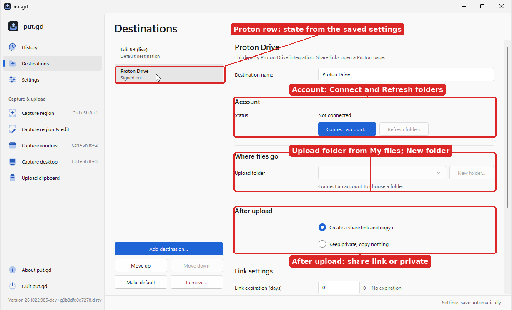

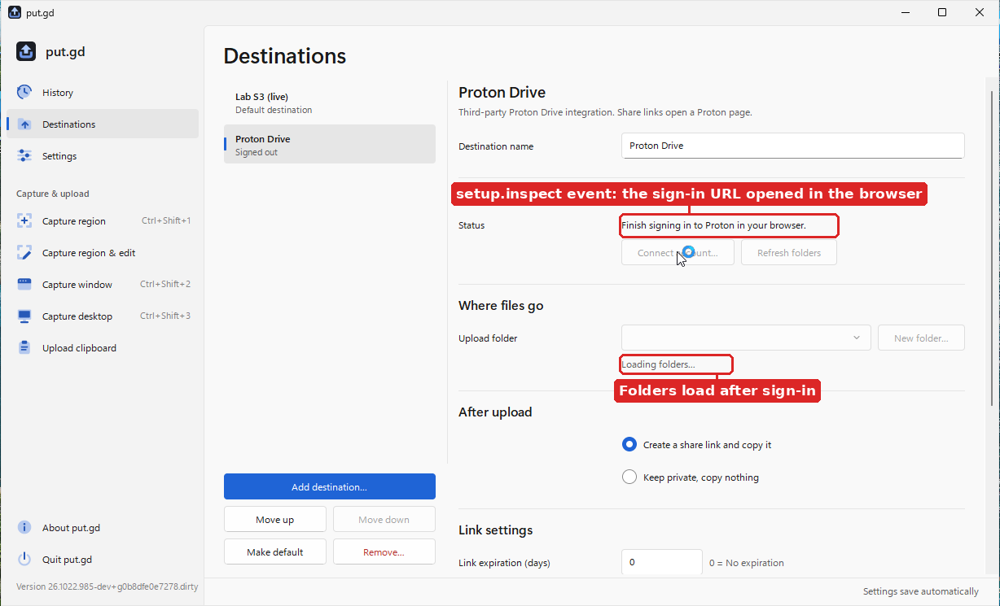

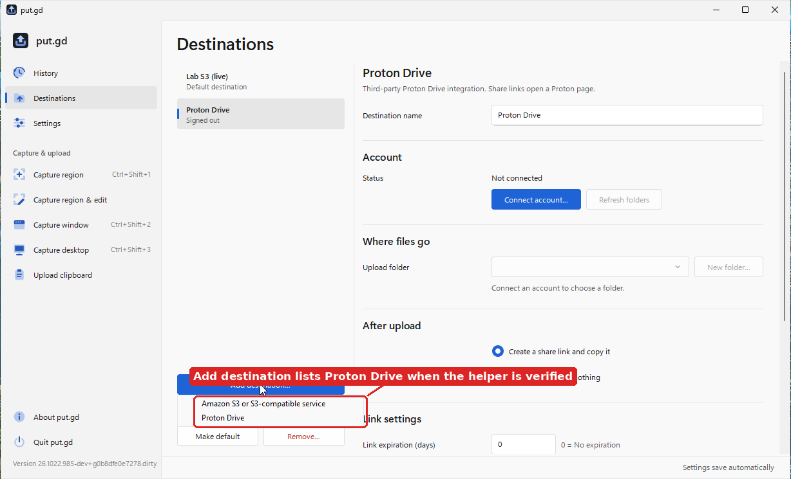

Verified on 2026-10-22 in the guest (`work/verification/2026-10-22-windows-native/proton/`),
first without an account: the helper's version, probe and stdio cases, a Bun.secrets round
trip through Credential Manager, the connect auth event within a second, a Proton profile
validated and saved, Test connection answering `proton_setup_required`, concurrent setup on
one account answering `proton_account_busy`, `history.share` on an S3 record answering
`sharing_unsupported`, and the S3 path unchanged. Then with Patrick signed in on the guest
display through the window's Connect account… (`live-results.md` there): account
inspection with the e-mail and folders, a folder created by the app, Test connection
(`account-folder`), a capture uploaded and shared with the link copied, inspect, revoke
(link gone, `linkAvailable` false), a new link created, a one-day expiry recorded as
`shareExpiresAt`, a stored link password used for a new link, a private upload with no
link and nothing copied followed by an explicit link, a 4-second deadline ending as
`proton_request_timeout` with the upload unknown and Retry adopting the longer current
deadline (the link step keeps the receipt's accepted deadline, as on Linux), a repeated
name renamed on collision, and a 120 MiB upload cancelled mid-transfer
(`proton_result_unknown`, reason `cancelled`) that Retry reconciled and uploaded. The
same session found and fixed three window repaint faults (a scrolled pane showing another
label's text, Settings combos still calling Proton unavailable, History rows blanked by a
one-row repaint).

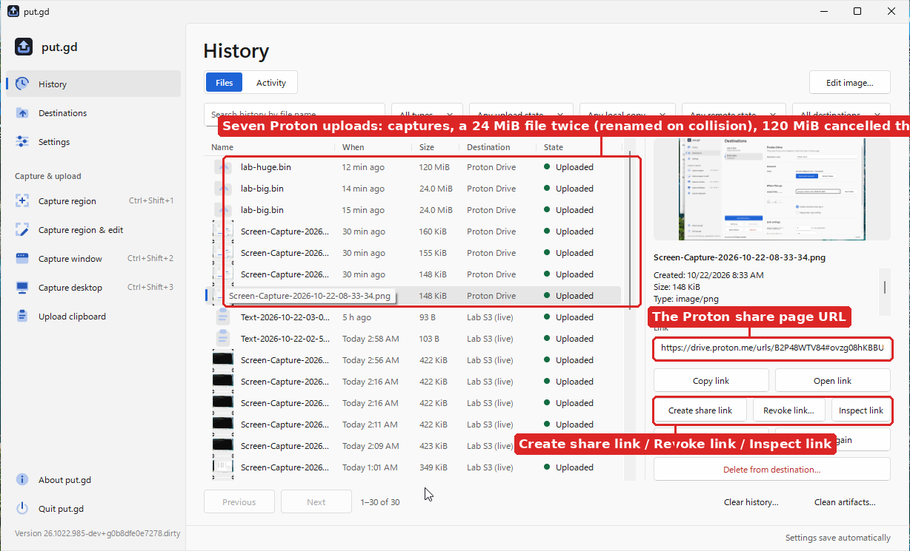

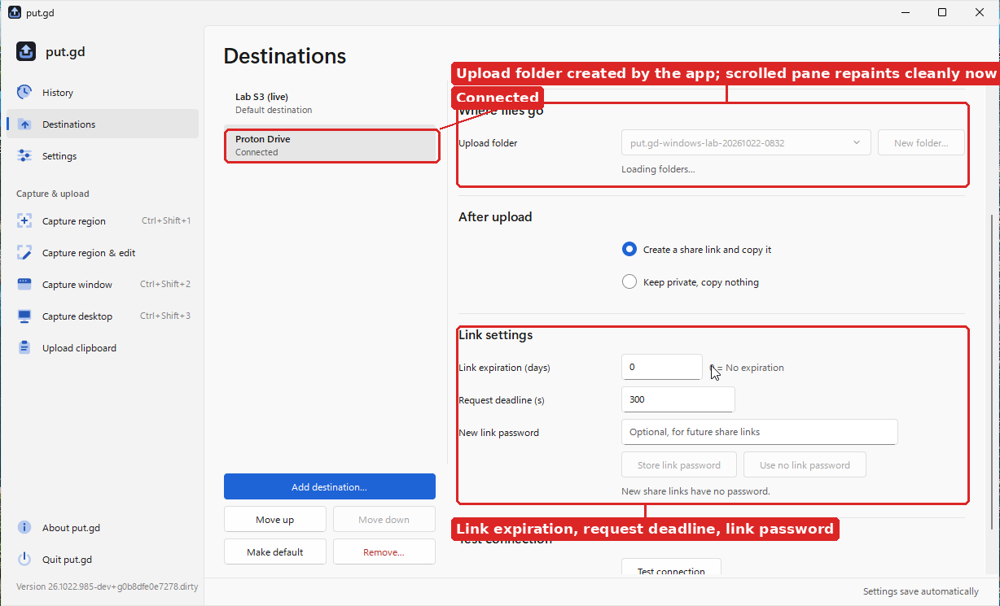

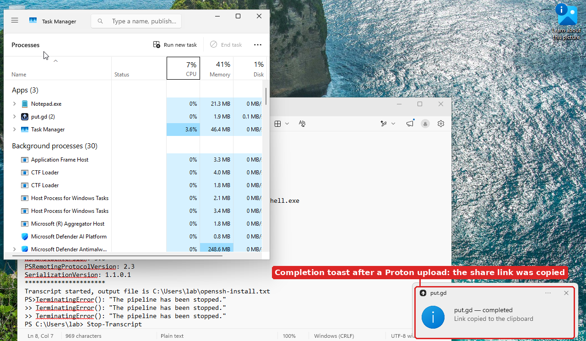

Not verified: Proton's plan-size (200003) and quota refusals, a service-side revision change
racing a link mutation, and DPI above 100 %.

## Logs and diagnostics

The resident keeps the persistent log, unclean-exit detection, crash records, opt-in crash
dumps and the diagnostics package with upload described in
[diagnostics.md](diagnostics.md#windows) (#125): JSON Lines records of the same schema and
redaction under `%LOCALAPPDATA%\put.gd\logs\`, a `running.json` marker with notes for
`WM_ENDSESSION`, `WM_CLOSE` and console events, an unhandled-exception filter in every mode,
minidumps through the system's `dbghelp.dll`, and `diagnostics.bundle`/
`diagnostics.uploadTarget` through the ordinary upload pipeline.

## Building

Cross-compile from Linux (what CI's `windows` job does, [ci.md](ci.md)):

```sh
sudo apt-get install -y g++-mingw-w64-x86-64-posix mingw-w64-tools ninja-build
cmake -S src/windows -B build/windows -G Ninja -DCMAKE_BUILD_TYPE=Release \
  -DCMAKE_TOOLCHAIN_FILE="$PWD/cmake/toolchains/x86_64-w64-mingw32.cmake"
cmake --build build/windows
```

The executables are static (libstdc++, libgcc and winpthread linked in) and import
only system DLLs. The build identity comes from the repository's calendar-version
generator ([versioning](versioning.md)), so `putgd.exe --version-json` reports the
same `YY.MDD.N` version as the Linux build of that commit. The portable core (JSON,
settings, naming, operation records, S3 rules, PNG inspector, SigV4, the editor
model) builds and tests on Linux:

```sh
cmake -S src/windows -B build/windows-host -DPUTGD_WINDOWS_PORTABLE_TESTS=ON
cmake --build build/windows-host && ctest --test-dir build/windows-host
```

The sources are MSVC-clean C++20; a native Visual Studio build is
`cmake -S src/windows -B build -G "Visual Studio 17 2022"` (an MSVC CI job is #404).

## Lab

Acceptance runs in a disposable Windows 11 guest cloned from the sealed base on a
builder ([Windows VM lab](windows-vm-lab.md)), reached over the new
`--ssh-forward` port. The resident is started on the interactive desktop through an
interactive scheduled task, after which `putgd-cli` works from any session because
the pipe namespace is global. Global shortcuts, the tray and the clipboard belong to
the desktop session; the test scripts set and read the clipboard from there.

## Verified on 2026-10-22

Guest `w11-e3ceec338284` on d69 (Windows 11 Enterprise evaluation 26H2, 3 vCPUs,
8 GiB), build `26.1022.985-dev+g0b8dfe0e7278`, mingw-w64 GCC 14. Raw screenshots,
the guest notes and the test scripts are in the private
`work/verification/2026-10-22-windows-native/` folder; the pictures below are the
curated subset.

- Resident start, pipe, `capabilities`, `diagnostics`, `settings.get/patch/reload/validate/reorderProfiles/developmentTemplate`, revision conflicts, `ui.quit`.
- Desktop, window (click to pick) and region capture (live overlay with crosshair, drag; Escape cancels with `capture_cancelled`), the Ctrl+Shift+3 global shortcut, tray menu and brand icon, completion toast.
- Clipboard import of text, files and images; local copies under `Documents\put.gd`; history records and previews; `history.copyLink`, `history.copyImage`, `history.preview`, `history.detail`, `operation.copy/retry/retryLocalSave`.
- Capture region & edit driven through `editor.open/inspect/apply/preview/submit` (redaction, arrow, text, crop) with the sanitized PNG handoff.
- Live S3 with the acceptance key set under `put.gd/acceptance/windows-lab/`: credentials stored in Credential Manager, `setup.testDestination` (synthetic upload, public GET, guarded cleanup), a real capture uploaded and fetched publicly with matching bytes, link copied, `delete.prepare/confirm` removed the object; a wrong key set stayed `failed` with `s3_access_denied` and retried truthfully.
- Launch at login through the Run key, the update feed check against app.put.gd, the diagnostics package, `cache.clear`, `logs.clear`.
- Memory, resident alone with no window open, five minutes of one-second samples: 2.6 MiB working set on average (4.4 peak), 2.8 MiB private, 0 CPU seconds. After captures and uploads the resident settled between 4 and 8 MiB; the window helper used about 25 MiB while open and exits with the window.

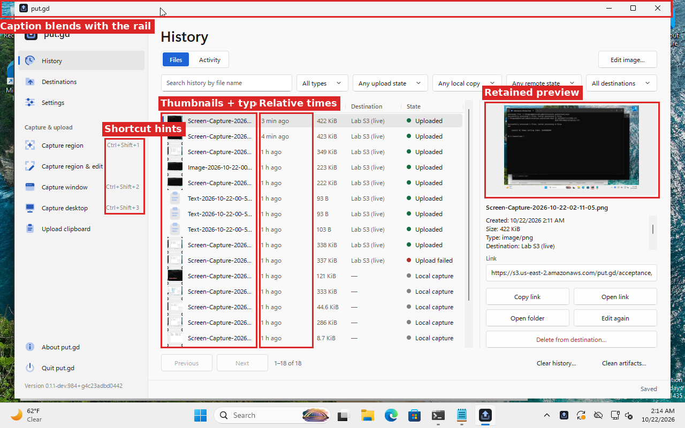

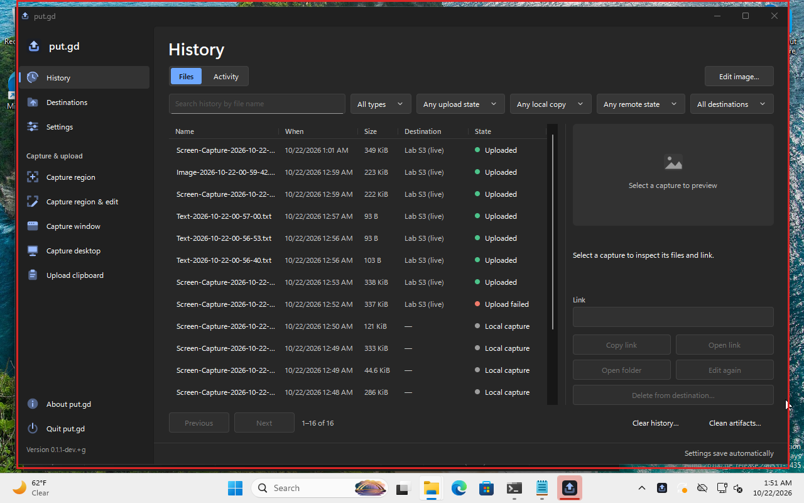

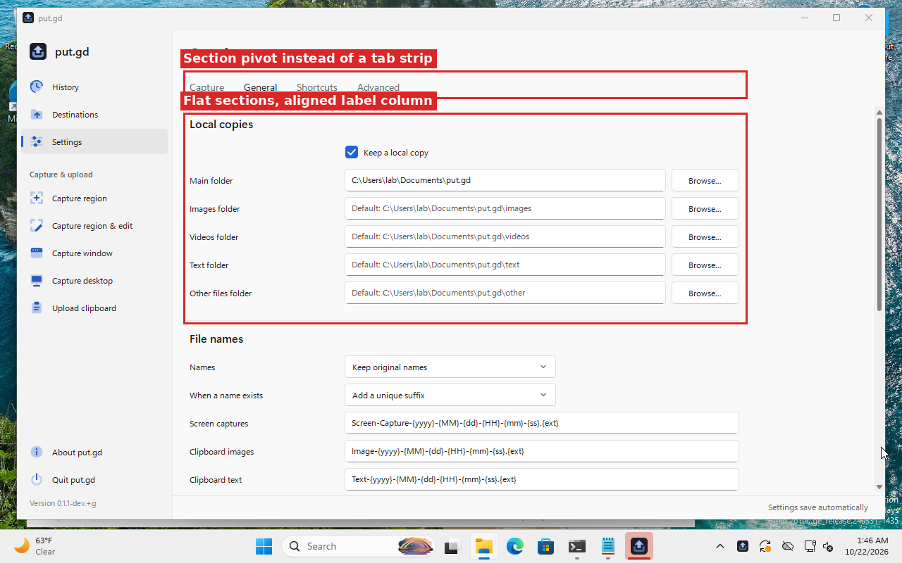

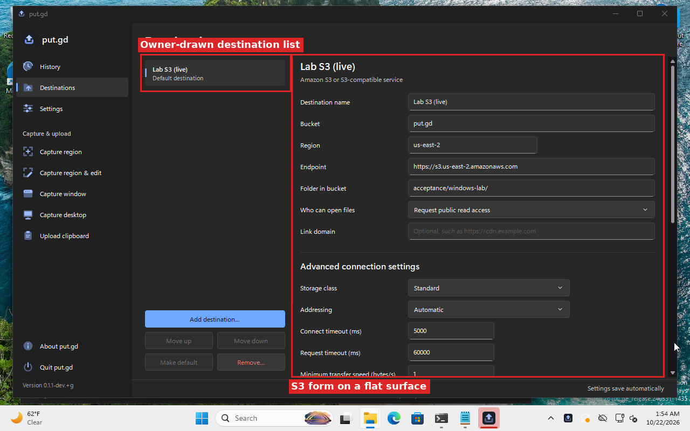

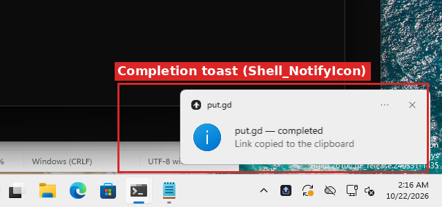

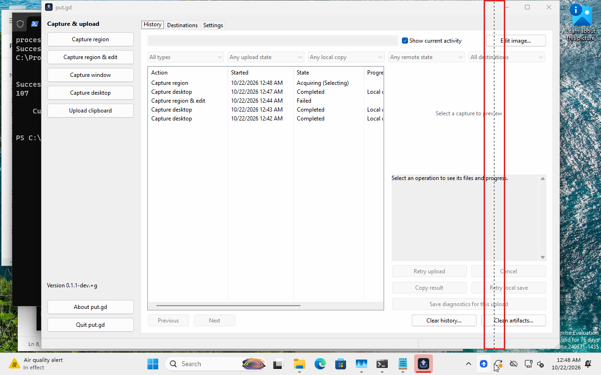

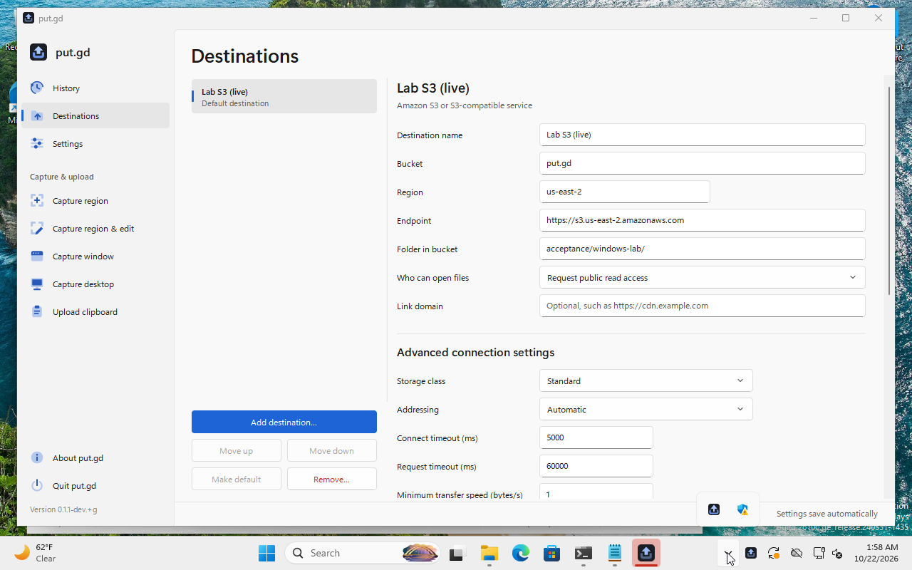

Not verified here: DPI scaling above 100 %, multiple monitors, keyboard-only
operation of the window, Windows 10, and a signed or packaged install.

## Not available in this build

| Gap | Issue |
| --- | --- |
| Screen recording (`record` action, `recording.*`) | #400 |
| Shipping the Proton runtime with a Windows build | #408 |
| Backblaze B2 destination | #409 |
| Multipart uploads and files over the 5 GiB single-PUT limit | #402 |
| Per-item cancellation, the `ui.*` window-driving methods, history gallery/date/MIME filters | #403 |
| The diagnostics package dialog and **Save diagnostics for this upload** | #450 |
| Symbolizing crash records and dumps | #451 |
| Packaging (portable zip, installer), VERSIONINFO, update installation, an MSVC CI job | #404 |
| Following a system theme change while the window is open | #406 |
